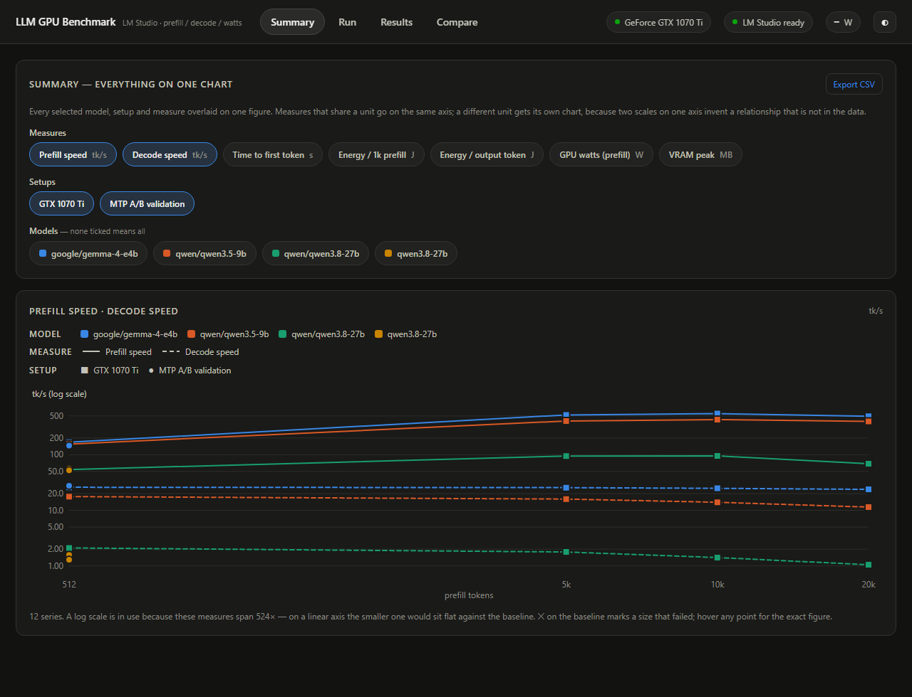

# Wattever

**Watts, tokens, and whatever your card can actually handle.**

Measures what a graphics card really does with local LLMs in LM Studio:
**prefill throughput**, **decode throughput** and **power draw**, at prompt
lengths from 512 to 80,000 tokens — then caches every run so you can swap cards
and compare them side by side.

Built for the question "is this card worth it?" rather than for leaderboards. A
model that fails to load at 40k context is a result, not an error, and is
recorded as one.



Two cards, same models, same prompts, reasoning off — prefill throughput at a
10,000-token prompt, and decode speed:

| Model | GTX 1070 Ti 8 GB | RTX 5060 Ti 16 GB | |
|---|---|---|---|
| gemma-4-e4b — prefill | 549 tk/s | **2090 tk/s** | 3.8× |
| gemma-4-e4b — decode | 24.9 tk/s | **69.3 tk/s** | 2.8× |
| qwen3.5-9b — prefill | 430 tk/s | **1741 tk/s** | 4.1× |
| qwen3.5-9b — decode | 14.0 tk/s | **54.0 tk/s** | 3.9× |
| qwen3.8-27b Q4_K_M — prefill | 96 tk/s | 250 tk/s | 2.6× |
| qwen3.8-27b Q4_K_M — decode | 1.4 tk/s | 2.7 tk/s | 1.9× |

The third row is the interesting one, and it is a lesson about quantisation
rather than about the cards. That build is **17.74 GB at Q4_K_M**, so it does not
fit in 16 GB any more than in 8 GB: it spills to system RAM on both cards and
crawls on both. Twice the VRAM moved the wall without removing it.

The same model at **IQ4_XS is 15.18 GB and does fit** — measured resident at
14.8 GB of 16.3 GB on the 5060 Ti, at 40k context. Same weights, same card, and
the difference between unusable and usable is the quantisation you downloaded.
Check the file size against your VRAM before concluding anything about a card.

Two more things the numbers show. On the 1070 Ti the 9B loses 36% of its decode
speed between 512 and 20k tokens while the smaller model loses 8%, because at
7.2 GB of 8 GB it is fighting its own KV cache for the last of the VRAM; on the
5060 Ti that collapse disappears. And prefill keeps *climbing* with prompt
length on the newer card — 207 tk/s at 512 tokens, 2971 at 40k — because short
prompts are dominated by fixed overhead and only long ones actually saturate the
hardware.

**[Send us your card's results →](CONTRIBUTING.md)** Old and slow is as useful
as new and fast.

---

## Quick start

- **Windows** — double-click **`Wattever.bat`**
- **macOS** — double-click **`Wattever.command`** (once:
  `chmod +x Wattever.command`)

Either starts a small local server and opens the UI in your browser. Leave the
console window open while you benchmark; close it (or press Ctrl+C) to stop.

Requirements: Python 3.9+, LM Studio with the `lms` CLI (`lms bootstrap` once),
and for wattage either an NVIDIA GPU or macOS with admin rights. **No pip
install needed** — standard library only, and the UI loads no external scripts,
so it works offline.

Defaults are already set to the four models this was built for:
`google/gemma-4-e4b`, `qwen/qwen3.5-9b`, `qwen/qwen3.6-35b-a3b` and
`unsloth/Qwen3.8-27B-GGUF (IQ4_XS)`. Any model LM Studio has indexed can be
selected instead; a model that is still downloading simply appears in the list
once it finishes.

---

## Comparing two cards

1. With the first card installed, pick your models and a prefill ceiling, give
   the run a label (`GTX 1070 Ti — stock`) and press **Start benchmark**.
2. Shut down, swap the card, relaunch, run it again with a new label.
3. Open **Compare**, tick both runs.

Runs are stored as one JSON file each under `results/runs/`, keyed to the GPU
that produced them (name, UUID, VRAM, driver), so nothing is lost between
sessions and nothing needs re-running. Colour follows the run consistently
across every chart, so the 1070 Ti stays the same colour everywhere.

---

## What gets measured, and how

| Metric | Meaning |
|---|---|
| **Prefill tk/s** | `prompt_tokens ÷ time-to-first-token`. The cost of ingesting context. |
| **Decode tk/s** | Output tokens per second, timed **from the first token onward** so prefill cost does not leak in. |
| **TTFT** | Wall-clock wait before anything appears. |
| **GPU watts** | **Measured** with `nvidia-smi`, sampled continuously (150 ms) and integrated separately over the prefill and decode windows. |
| **System watts** | **Estimated**: `GPU + non-GPU idle + CPU TDP × measured CPU load`. Both constants are editable under Advanced — set them from a wall meter if you have one. |
| **J / 1k prefill**, **J / token** | Energy per unit of work. The figure that actually compares cards, since it is independent of how long a test took. |
| **VRAM peak** | A flat ceiling across sizes means the runtime started spilling to system RAM. |

### Why prefill is the headline number

An agent re-reads its growing context on every step, so a twenty-step loop over
a 20k context pays prefill twenty times. Prefill is compute-bound, which is
where newer architectures pull furthest ahead; decode is bandwidth-bound and
holds roughly flat until offload begins, then collapses. That shape is the
thing this tool is designed to show you.

### Four details that make the numbers trustworthy

- **Prefix caching is defeated.** llama.cpp-family runtimes reuse the attention
  cache for an unchanged prompt prefix, which would report impossible prefill
  speeds on a repeat. Every prompt opens with a unique nonce.
- **Context is sized per test.** The model is reloaded for each prefill size
  with `--context-length` set to just that test's needs (`prefill + output +
  headroom`), so a 512-token test is not slowed by cache allocated for 80k. It
  also means a 40k test can fail to load while 10k succeeds — which is the
  information you want.
- **Reasoning is off by default** (`reasoning_effort: none`). With it on, these
  models spend almost the whole output budget thinking (measured: 189 of 192
  tokens), so "decode tk/s" would describe a chain of thought rather than an
  answer, and would not be comparable between models that think by default and
  models that do not. The `reasoning_tokens` count is recorded either way.
  Note that `chat_template_kwargs.enable_thinking` is *accepted but ignored* by
  LM Studio — it is not a working substitute.
- **TTFT counts the first delta of any kind**, including `reasoning_content`,
  so a thinking model's prefill is not inflated by its whole reasoning trace.

---

## Configuration

**Prefill sizes** is the one setting that decides the workload: each selected
size is one measurement, run at that prompt length. The *quick pick* buttons
beside it are only shortcuts — "up to 20k" ticks 512 / 5k / 10k / 20k for you,
then you can adjust individual sizes freely.

**GPU offload**: `auto` lets LM Studio place layers (what a normal user gets),
`max` demands full GPU residency and fails if it will not fit, or pick a fixed
ratio. With *fall back to more CPU offload* enabled, a failed load is retried
with progressively more CPU offload, and the placement that actually worked is
recorded per result — "ran, but only with half the layers on the CPU" is a
different answer from "ran on the GPU".

**Speculative decoding (MTP)** — off by default. Choose `on`, or `both` to
A/B it in a single session. Results are keyed by **(GPU, model, prefill size,
MTP mode)**, so an MTP run never overwrites a plain one and both appear as
separate series in Compare (MTP drawn dashed, same colour as its card). Only a
GGUF that ships a bundled MTP head supports it; for any other model the MTP pass
is recorded as `mtp_unsupported` rather than failing the run. Of the four
default models, only the unsloth Qwen3.8-27B has an MTP head.

**Stop a model after its first failure** avoids grinding through 40k and 80k
once 20k has already proved impossible. Turn it off to force every size.

Timeouts matter at the top end: an 80k prefill with heavy CPU offload can take
many minutes, and the per-test timeout (default 30 min) is what stops it hanging
forever.

### Interrupting a run

**Nothing finished is ever lost.** The run file is rewritten after every single
test, via a temp file and an atomic rename, so a kill at any moment leaves all
completed measurements intact and the file readable.

- **Stop button** — aborts the in-flight request immediately (not just at the
  next token), records that one test as `cancelled`, stamps the run
  `cancelled`, unloads the model. Everything before it stays in the cache and
  shows up in Compare as normal.
- **Closing the browser tab** — does not stop anything. The benchmark runs
  server-side; the page is only a viewer. Reopen the URL and it reconnects to
  the run in progress.
- **Closing the console window, Ctrl+C, or a power cut** — completed tests are
  kept, but the run never gets to stamp its final status, so it is shown as
  **interrupted** rather than `running`. A partial run is still usable: it
  simply has fewer sizes than a full one.

There is no resume. To extend an interrupted run, start a new one with the sizes
you still need — Compare handles runs with different size sets.

---

## Reading the results

**Summary** tab: one figure with everything on it. Tick any combination of
measures, setups and models, and every combination is overlaid on a single
chart — tick Prefill speed and Decode speed with three models and you get six
curves on one axis.

Three encodings carry the three dimensions, so identity never rests on colour
alone and the eight categorical hues are never cycled:

| dimension | encoding |
|---|---|
| model | colour |
| measure | line style (solid, dashed, dotted) |
| setup | marker shape (circle, square, triangle, diamond) |

Two rules keep it honest. **Measures that share a unit share an axis; a
different unit gets its own chart** — never two scales on one axis, which would
invent a relationship that is not in the data. And when the overlaid values
span more than 40×, the axis switches to **log scale** and says so, because
decode at 1 tk/s beside prefill at 550 would otherwise sit flat against the
baseline. Each encoding indexes a fixed order rather than the current
selection, so toggling one series never restyles the others.

**Compare** tab: the same data faceted one panel per model, for looking at a
single measure closely. Lines show it against context length on a log x axis;
**a ✕ on the baseline marks a size that failed**, with the reason on hover, so
you can see exactly where a card runs out. The table underneath gives the same
numbers with a percentage column oriented so positive always means better.

**Results** tab: every cached run, grouped by GPU, with the full measurement
table (including offload placement, load time, both wattage figures and VRAM
peak), plus the failure reasons in full. Export CSV or JSON per run or across
all of them.

Repeats are reduced to the median, never the best case.

---

## Windows and macOS in the same comparison

The same app runs on both, and results from both land in the same cache and the
same charts. A Mac run and a PC run can sit side by side in Compare.

**Identical on both platforms** — and therefore directly comparable:

- the corpus and the prompts (deterministic; for a given model and size the
  prompt is byte-identical, because the token ratio depends on the tokeniser,
  not the machine)
- prefill tk/s, decode tk/s, TTFT, actual prompt tokens, context ceiling
- reasoning disabled, the cache-defeating nonce, per-size context sizing
- the result schema, so nothing re-run is needed and old runs stay readable

**Different, and labelled as such:**

| | Windows / Linux + NVIDIA | macOS |
|---|---|---|
| Power tool | `nvidia-smi` | `powermetrics` (needs admin) |
| GPU watts | board power, card only | GPU rail of the SoC |
| CPU watts | estimated (TDP × load) | **measured** (CPU + ANE rails) |
| VRAM | measured, and it is a hard wall | blank — unified memory, no separate pool |
| `power.source` | `nvidia-smi` | `powermetrics` or `none` |

On macOS the launcher asks once whether to measure power, because
`powermetrics` requires root. Answer yes and it caches the credential and keeps
it warm for the whole run (refreshed every 50 s, dropped on exit), so a
two-hour benchmark never stops to ask for a password. Answer no — or run from a
plain shell — and everything still works except the wattage and joule columns,
which stay blank.

**Reading a cross-platform energy comparison.** GPU watts from the two tools
measure different boundaries, so the honest comparison is the *estimated system
watts* column, and the Compare tab shows a warning when you put mixed sources
on one chart. Speed metrics carry no such caveat.

Note that VRAM and GPU-offload are the two metrics that genuinely do not
transfer. On unified memory a model either fits in the shared pool or it does
not; there is no PCIe hop and no partial-offload penalty to measure, so the
VRAM column stays blank and the offload setting has little effect. Prefill,
decode and watts — the three things that matter — behave and compare normally.

The macOS path is written against documented `powermetrics`, `sysctl` and
`system_profiler` output and its parser is unit-tested against real output
shapes (Apple Silicon, Intel Mac, idle), but it has not yet been run on Mac
hardware. If something looks wrong there, the console window will say what.

---

## The benchmark corpus

The query is always the same: *summarise this document*. The document is
`corpora/agentic-ai-oct2026.core.md` — a hand-written report on the state of
agentic AI as of October 2026 — extended by `tools/build_corpus.py` with
generated appendix material (platform profiles, deployment case studies,
incident post-mortems, eval specs, hardware notes, a regulatory digest, a
glossary, practitioner questions, a bibliography) to reach ~88k tokens.

**It is a benchmark fixture, not reporting.** The core report's argument and
vocabulary are realistic; the appendix entries are synthetic composites built
deterministically from structured data, so every card receives byte-identical
prompts. Prefill cost does not depend on whether prose is factual, so this
costs the measurement nothing — but do not cite the appendices.

Token targets are hit by learning the real chars-per-token ratio from the
`prompt_tokens` LM Studio reports, starting from a measured estimate (~4.6 for
these tokenisers) and refining it per model. In practice sizes land within about
±8% of target — the denser appendix text tokenises differently from the opening
report — and **the actual `prompt_tokens` is what gets recorded, charted and
divided into the throughput figures**, so the small offset costs nothing. The
prompt for a given model and size is identical on every card, because the ratio
depends on the tokeniser rather than the GPU, which is what makes cross-card
comparison exact. `corpora/sizes/*.txt` are reference exports of each length.

---

## Layout

```
Wattever.bat / .command      double-click one of these
wattever/
  server.py                  local HTTP server + JSON API
  runner.py                  orchestration, load ladder, failure classification
  lmstudio.py                lms CLI control + the measured streaming call
  power.py                   nvidia-smi / powermetrics sampling, energy integration
  platform_util.py           the Windows / macOS differences, in one place
  corpus.py                  prompt construction + token calibration
  store.py                   run cache, CSV export
web/                         single-page UI (no build step, no CDN)
corpora/                     the document, and per-size exports
results/runs/*.json          the cache, one file per run -- tracked in git
tools/build_corpus.py        regenerates the corpus
```

---

## Contributing

Results first: run it on your card and open a PR with the JSON file that lands
in `results/runs/`. Every run in that folder shows up in the Summary and
Compare tabs for everyone, so the repo doubles as a shared dataset of what real
hardware does. See [CONTRIBUTING.md](CONTRIBUTING.md) and
[results/README.md](results/README.md).

Code contributions are welcome too; the one hard rule is that measurement
semantics do not change silently, because every run already committed depends
on them.

---

## Troubleshooting

**"The `lms` CLI was not found"** — install LM Studio, run `lms bootstrap` once,
relaunch. Context length and GPU offload can only be set through the CLI, so the
tool needs it even though inference goes over the REST API.

**Everything fails to load on a big model** — expected on 8 GB. A 15 GB IQ4_XS
27B runs, but mostly from system RAM: measured here at ~1.5 tk/s decode versus
~27 tk/s for a 7.5B model that fits. That contrast is the point.

**Wattage is blank** — the GPU does not report `power.draw` via nvidia-smi.
Speed still measures fine.

**A size shows `exceeds_model_context`** — the requested prefill plus output
exceeds the model's own maximum context, so it was never attempted.

**Port in use** — the server picks the next free port automatically and prints
the URL it chose in the console window.
