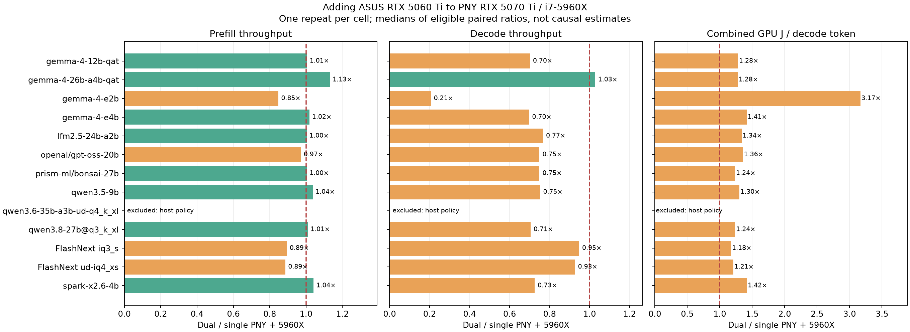

# Adding an ASUS RTX 5060 Ti to the PNY RTX 5070 Ti / i7-5960X

This setup contains a PNY RTX 5070 Ti 16 GB and ASUS RTX 5060 Ti 16 GB with the i7-5960X, 64 GiB memory, driver 617.42 and reported 300 W / 180 W board limits. **180 cases across 15 model variants** were recorded, one repeat per model/prompt/client cell. Outcomes: {"failed":1,"ok":179}. Both GPU boards are monitored individually and together.

[Full case comparisons](../results/aggregates/5070-plus-5060-comparison.csv) · [Measurements across all five hardware configurations](../results/aggregates/5070-plus-5060-all-configurations.csv) · [Shareable JSON](../results/aggregates/5070-plus-5060-public.json)

**Measurement cohort complete:** all 144 LM Studio and 36 native Strata cells are included below, with one measured inference repeat per condition. Completed cells include recorded failures or censoring; completion of the grid does not mean every request succeeded.

## Main measured outcomes

- LM Studio: 120/120 matched cells completed, versus 113 successful baseline cells. Supplemental Qwen cells completed: 24/24.
- **LM Studio cohort only:** median matched single-client decode change -27.7% (57 eligible pairs); combined GPU decode J/token change +34.6% (57 pairs). Two-client per-request decode change -25.0% (55 pairs). These figures exclude native Strata rows.
- Native Strata: 35/36 successful attempts across 3 models; all 36 attempted, 1 timeout/censored deadline and 0 other unsuccessful outcomes. Its single-client matched decode change is -6.7% (12 eligible pairs), with per-model details and configuration qualifications below; native Qwen35 still selects one GPU.
- The supplemental LM Studio Qwen variants and native Strata variants remain separate engine/quantization conditions. Their practical rates appear below; no quality equivalence was measured.
- Gemma E2B has a severe LM Studio serving regression, confirmed by retained native server decode timings. Its cause remains unisolated by this cohort.
- A separate connection diagnostic found a roughly two-second IPv6/localhost fallback component. Client prefill/TTFT remain end-to-end measurements; no retrospective correction was applied.

## Comparison boundaries

The primary baseline is the same PNY RTX 5070 Ti and i7-5960X with one GPU. Adding the 5060 Ti and letting the runtime allocate work across both cards is the hardware/configuration treatment. The new pass also uses all-card telemetry; historical passes monitored the selected card. Request timing definitions are retained, but collector overhead was not independently isolated. Older 5060 Ti / ASUS 5070 Ti configurations also use the i7-5820K, so those are whole-system comparisons with a CPU difference. They are not isolated board-scaling experiments.

LM Studio follows its configured evenly distributed GPU strategy. Its strict VRAM cap is off; WDDM/shared-memory behavior is not separately measured, and dedicated VRAM readings alone do not establish fully resident placement. Strata Flash-Next supports layer splitting with the faster 5070 Ti as the main/output device; the native Qwen3.6 path supports a single selected GPU. Native execution observations appear below only for measured source runs. Per-engine launch observations and per-card VRAM/utilization identify actual behavior where reported. Merely installing two cards does not establish that each model executes across both.

Thirteen established variants form the matched cohort. The two supplemental user-tested LM Studio Qwen Q4_K_M variants address the larger combined capacity; they change engine and/or quantization relative to the single-card alternatives. No intelligence or quantization-quality conclusion follows from their speed.

## Matched performance and energy

Changes below are medians of eligible dual/single paired ratios over both client counts and all six prompt targets. Energy/token uses single-client decode intervals only. N is the number of eligible workload cells, not an independent repeat count. Lower energy/token is favorable. Combined dual-card board energy is compared with single-card board energy, including the additional card’s idle consumption.

|Model|Prefill change (N)|Decode change (N)|Combined decode J/token change (N)|
|---|---:|---:|---:|
|google/gemma-4-12b-qat|+0.5% (12)|-29.8% (12)|+28.2% (6)|
|google/gemma-4-26b-a4b-qat|+13.1% (9)|+2.8% (9)|+27.7% (5)|
|google/gemma-4-e2b|-15.2% (12)|-79.4% (12)|+216.6% (6)|
|google/gemma-4-e4b|+1.8% (12)|-30.2% (12)|+41.5% (6)|
|lfm2.5-24b-a2b|+0.3% (11)|-23.3% (11)|+33.7% (6)|
|openai/gpt-oss-20b|-2.8% (11)|-25.0% (11)|+35.8% (5)|
|prism-ml/bonsai-27b|+0.4% (12)|-25.0% (12)|+23.6% (6)|
|qwen/qwen3.5-9b|+3.7% (12)|-24.7% (12)|+30.4% (6)|
|qwen3.6-35b-a3b-ud-q4_k_xl|— (0)|— (0)|— (0)|
|qwen3.8-27b@q3_k_xl|+0.9% (9)|-29.5% (9)|+23.8% (5)|
|qwen3.8-flash-next-iq3_s|-10.5% (12)|-5.2% (12)|+17.5% (6)|
|qwen3.8-flash-next-unsloth-ud-iq4_xs|-11.3% (12)|-7.3% (12)|+20.9% (6)|
|spark-x2.6-4b|+4.2% (12)|-27.5% (12)|+41.8% (6)|

### LM Studio cohort ratios

This table excludes native Strata cells and retains the original LM Studio cohort boundary.

|Model|Prefill change (N)|Decode change (N)|Combined decode J/token change (N)|
|---|---:|---:|---:|
|google/gemma-4-12b-qat|+0.5% (12)|-29.8% (12)|+28.2% (6)|
|google/gemma-4-26b-a4b-qat|+13.1% (9)|+2.8% (9)|+27.7% (5)|
|google/gemma-4-e2b|-15.2% (12)|-79.4% (12)|+216.6% (6)|
|google/gemma-4-e4b|+1.8% (12)|-30.2% (12)|+41.5% (6)|
|lfm2.5-24b-a2b|+0.3% (11)|-23.3% (11)|+33.7% (6)|
|openai/gpt-oss-20b|-2.8% (11)|-25.0% (11)|+35.8% (5)|
|prism-ml/bonsai-27b|+0.4% (12)|-25.0% (12)|+23.6% (6)|
|qwen/qwen3.5-9b|+3.7% (12)|-24.7% (12)|+30.4% (6)|
|qwen3.8-27b@q3_k_xl|+0.9% (9)|-29.5% (9)|+23.8% (5)|
|spark-x2.6-4b|+4.2% (12)|-27.5% (12)|+41.8% (6)|

### Native Strata cohort ratios

Native ratios retain model/quant identities and qualify omitted KV/draft metadata. Effective GPU-cache capacity and supported GPU placement change as the intended treatment; MTP runtime counts override stale declarations.

|Model|Prefill change (N)|Decode change (N)|Combined decode J/token change (N)|
|---|---:|---:|---:|
|qwen3.6-35b-a3b-ud-q4_k_xl|— (0)|— (0)|— (0)|
|qwen3.8-flash-next-iq3_s|-10.5% (12)|-5.2% (12)|+17.5% (6)|
|qwen3.8-flash-next-unsloth-ud-iq4_xs|-11.3% (12)|-7.3% (12)|+20.9% (6)|

## Native Strata execution conditions

|Model / canonical quant|Observed GPU order / split|Serving slots|Effective GPU expert count (backend units)|Host expert memory GiB / residency evidence|Configured max drafts / declared|Observed drafts offered / accepted|Speculative drafts observed|
|---|---|---:|---:|---|---|---|---|
|qwen3.6-35b-a3b-ud-q4_k_xl / UD-Q4_K_XL|[0] / not reported|1|19|18.75 / all_experts_pageable_host_log|unreported / unreported|0 / 0|False|
|qwen3.8-flash-next-iq3_s / IQ3_S|[1,0] / auto|1|6988|46.84 / full_arena_locked_or_pinned_within_log_rounding|4 / 4|3,557 / 2,073|True|
|qwen3.8-flash-next-unsloth-ud-iq4_xs / UD-IQ4_XS|[1,0] / auto|1|5203|55.44 / full_arena_locked_or_pinned_within_log_rounding|4 / 4|3,556 / 2,046|True|

qwen3.6-35b-a3b-ud-q4_k_xl: GPU layer placement and effective expert-cache capacity are intended configuration treatments, not equality requirements; Actual KV dtype unreported in both native captures; matching engine defaults are qualified, not a verified dtype; Host expert allocation/residency evidence differs; native ratios require matching evidence. Pageable allocation alone does not establish paging or disk traffic; baseline: requested MTP is known but actual draft count is unreported; dual: requested MTP is known but actual draft count is unreported.

qwen3.8-flash-next-iq3_s: GPU layer placement and effective expert-cache capacity are intended configuration treatments, not equality requirements; baseline: runtime MTP draft count overrides inconsistent historical/operator declaration; raw metadata retained.

qwen3.8-flash-next-unsloth-ud-iq4_xs: GPU layer placement and effective expert-cache capacity are intended configuration treatments, not equality requirements; baseline: runtime MTP draft count overrides inconsistent historical/operator declaration; raw metadata retained.

Configured max drafts are verified launch settings, not observed proposals or acceptance. Offered/accepted counters cover the loaded engine lifetime, including warmups; Flash counters may include suffix drafts as well as MTP. Zero offers means no speculative drafts were observed in those counters despite requesting MTP. Their full scope remains in the CSV; counts are not assigned to individual timed requests.

Expert-cache capacity and GPU layer placement change when the second card is available and are intended treatment effects. Their backend-specific counts are not interchangeable across FlashNext and Qwen35. Full FlashNext host arena evidence is separately required for eligible native ratios; pinned/locked residency does not establish that every unrelated process allocation is resident. Qwen35 uses its native single-GPU hybrid path; both boards remain inside measured power, including the unused card's draw. Two clients do not imply two native serving slots.

### Context and concurrency

Ratios are dual/single, with the unweighted median across eligible matched models for each prompt target and client count. Higher throughput and lower TTFT/energy are favorable. Whole-case group energy is available for the two-client workload, not a decode-only interval. All absolute values remain in the CSV.

|Prompt target|Clients|Prefill ratio (N)|Decode ratio (N)|Aggregate output ratio (N)|TTFT ratio (N)|Whole-case GPU J ratio (N)|
|---:|---:|---:|---:|---:|---:|---:|
|512|1|0.960 (12)|0.718 (12)|— (0)|1.060 (11)|— (0)|
|5,000|1|0.972 (11)|0.731 (11)|— (0)|1.029 (11)|— (0)|
|10,000|1|0.997 (12)|0.735 (12)|— (0)|1.003 (12)|— (0)|
|20,000|1|1.009 (12)|0.729 (12)|— (0)|0.992 (12)|— (0)|
|40,000|1|1.063 (12)|0.737 (12)|— (0)|0.942 (12)|— (0)|
|80,000|1|1.030 (10)|0.726 (10)|— (0)|0.972 (10)|— (0)|
|512|2|0.972 (12)|0.741 (12)|0.841 (7)|1.032 (10)|1.331 (7)|
|5,000|2|0.969 (12)|0.760 (12)|0.878 (8)|1.032 (12)|1.217 (8)|
|10,000|2|1.005 (12)|0.762 (12)|0.908 (6)|1.002 (10)|1.228 (6)|
|20,000|2|1.035 (12)|0.786 (12)|0.945 (7)|0.989 (10)|1.186 (7)|
|40,000|2|1.012 (10)|0.787 (10)|1.015 (5)|1.001 (10)|1.172 (5)|
|80,000|2|1.088 (9)|0.765 (9)|1.454 (2)|0.924 (9)|1.014 (2)|

## Single-client 20k observations

Each cell is **prefill / decode tokens/s**. Historical two-repeat configurations use the median within that cell; the new configuration has one repeat. Different rows represent different model/quantization/engine variants. Failed/censored cases have no fabricated throughput.

|Model / quantization|5060 Ti / 5820K|ASUS 5070 Ti / 5820K|PNY 5070 Ti / 5820K|PNY 5070 Ti / 5960X|5070 + 5060 Ti / 5960X|
|---|---:|---:|---:|---:|---:|
|google/gemma-4-12b-qat / Q4_0|1,556.98 / 41.82|2,630.95 / 74.23|2,744.04 / 76.62|2,743.72 / 77.22|2,803.58 / 53.27|
|google/gemma-4-26b-a4b-qat / Q4_0|295.11 / 82.29|2,947.40 / 120.78|3,009.79 / 127.82|3,106.63 / 131.20|3,373.04 / 94.11|
|google/gemma-4-e2b / Q4_K_M|3,777.36 / 91.11|4,927.22 / 128.79|4,853.18 / 130.00|4,856.96 / 136.32|4,243.85 / 23.14|
|google/gemma-4-e4b / Q4_K_M|2,801.06 / 63.25|3,963.60 / 98.28|3,818.97 / 97.20|4,025.27 / 98.04|3,976.70 / 68.57|
|lfm2.5-24b-a2b / Q4_0|2,606.97 / 129.84|3,736.96 / 184.89|3,687.34 / 181.85|3,872.21 / 175.14|3,993.90 / 142.92|
|openai/gpt-oss-20b / MXFP4|2,745.47 / 82.71|3,953.22 / 127.28|4,017.67 / 131.04|4,059.30 / 129.98|4,041.30 / 97.02|
|prism-ml/bonsai-27b / Q1_0|897.97 / 43.74|1,616.86 / 70.64|1,704.67 / 73.18|1,694.77 / 74.08|1,737.92 / 54.84|
|qwen/qwen3.5-9b / Q4_K_M|2,211.59 / 50.44|3,456.22 / 82.19|3,552.68 / 84.22|3,579.96 / 85.66|3,774.16 / 62.50|
|qwen/qwen3.6-35b-a3b / Q4_K_M|—|—|—|—|3,135.24 / 103.74|
|qwen/qwen3.8-27b / Q4_K_M|—|—|—|—|1,571.40 / 26.41|
|qwen3.6-35b-a3b-ud-q4_k_xl / UD-Q4_K_XL|650.73 / 21.52|1,282.24 / 29.42|1,254.94 / 31.37|1,254.80 / 35.72|516.03 / 32.36|
|qwen3.8-27b@q3_k_xl / Q3_K_XL|811.22 / 22.86|1,468.33 / 40.97|1,543.58 / 42.14|1,542.62 / 42.14|1,642.48 / 29.71|
|qwen3.8-flash-next-iq3_s / IQ3_S|647.83 / 20.32|1,201.26 / 34.43|1,207.54 / 34.89|1,187.11 / 40.98|931.63 / 38.95|
|qwen3.8-flash-next-unsloth-ud-iq4_xs / UD-IQ4_XS|198.00 / 8.75|1,083.69 / 20.78|1,098.11 / 22.00|1,090.20 / 25.21|690.75 / 22.68|
|spark-x2.6-4b / Q4_K_M|2,961.21 / 73.88|4,197.99 / 120.14|4,221.98 / 122.90|4,297.50 / 122.26|4,278.03 / 88.96|

## Single-client 80k observations

|Model / quantization|5060 Ti / 5820K|ASUS 5070 Ti / 5820K|PNY 5070 Ti / 5820K|PNY 5070 Ti / 5960X|5070 + 5060 Ti / 5960X|
|---|---:|---:|---:|---:|---:|
|google/gemma-4-12b-qat / Q4_0|1,231.24 / 37.30|2,314.60 / 64.11|2,509.36 / 67.25|2,508.48 / 68.00|2,649.60 / 47.43|
|google/gemma-4-26b-a4b-qat / Q4_0|failed/censored|failed/censored|failed/censored|failed/censored|3,566.29 / 75.16|
|google/gemma-4-e2b / Q4_K_M|3,373.20 / 73.52|5,742.13 / 107.88|6,018.80 / 108.32|6,066.30 / 110.32|4,130.15 / 7.85|
|google/gemma-4-e4b / Q4_K_M|2,569.81 / 48.56|4,288.38 / 78.66|4,328.93 / 78.24|4,323.40 / 77.77|5,036.21 / 52.71|
|lfm2.5-24b-a2b / Q4_0|2,407.98 / 86.36|4,643.50 / 124.77|4,588.72 / 112.76|4,921.65 / 128.17|4,938.31 / 102.97|
|openai/gpt-oss-20b / MXFP4|1,832.00 / 62.59|4,246.32 / 98.02|4,573.16 / 102.69|4,562.61 / 103.42|3,577.19 / 75.28|
|prism-ml/bonsai-27b / Q1_0|733.69 / 29.90|1,174.28 / 49.52|1,241.82 / 51.64|1,252.62 / 52.81|1,605.42 / 38.18|
|qwen/qwen3.5-9b / Q4_K_M|2,181.25 / 39.44|3,421.92 / 64.61|3,560.78 / 66.63|3,575.23 / 67.85|4,612.52 / 50.22|
|qwen/qwen3.6-35b-a3b / Q4_K_M|—|—|—|—|3,820.67 / 80.91|
|qwen/qwen3.8-27b / Q4_K_M|—|—|—|—|1,454.89 / 21.91|
|qwen3.6-35b-a3b-ud-q4_k_xl / UD-Q4_K_XL|529.18 / 6.28|1,015.39 / 11.50|1,070.20 / 12.09|1,077.47 / 13.06|484.38 / 12.66|
|qwen3.8-27b@q3_k_xl / Q3_K_XL|failed/censored|failed/censored|failed/censored|failed/censored|1,516.44 / 23.83|
|qwen3.8-flash-next-iq3_s / IQ3_S|770.82 / 19.72|1,431.77 / 34.16|1,485.18 / 33.31|1,493.93 / 32.24|1,286.35 / 38.88|
|qwen3.8-flash-next-unsloth-ud-iq4_xs / UD-IQ4_XS|266.07 / 9.58|1,311.57 / 22.00|1,362.49 / 22.23|1,360.92 / 22.68|1,209.99 / 21.21|
|spark-x2.6-4b / Q4_K_M|2,819.15 / 50.34|3,986.19 / 83.39|4,114.42 / 85.83|4,111.73 / 86.21|5,100.15 / 62.36|

## Larger Qwen serving configurations

The supplemental LM Studio Q4_K_M variants use the available two-card configuration. Values are kept alongside the different single-card serving alternatives so their practical speed/energy trade-offs can be assessed without merging their identities.

|Model family / target|Clients|Single-card serving variant|Single prefill / decode|Dual-card LM Studio variant|Dual prefill / decode|Single / dual decode J per token²|
|---|---:|---|---:|---|---:|---:|
|Qwen3.6-35B / 20,000|1|Strata / UD-Q4_K_XL|1,254.80 / 35.72|LM Studio / Q4_K_M|3,135.24 / 103.74|2.71 / 2.08|
|Qwen3.6-35B / 80,000|1|Strata / UD-Q4_K_XL|1,077.47 / 13.06|LM Studio / Q4_K_M|3,820.67 / 80.91|11.66 / 2.42|
|Qwen3.6-35B / 20,000|2|Strata / UD-Q4_K_XL|886.23 / 31.61|LM Studio / Q4_K_M|2,261.85 / 53.34|— / —|
|Qwen3.6-35B / 80,000|2|Strata / UD-Q4_K_XL|770.72 / 11.50|LM Studio / Q4_K_M|2,508.80 / 29.49|— / —|
|Qwen3.8-27B / 20,000|1|LM Studio / Q3_K_XL|1,542.62 / 42.14|LM Studio / Q4_K_M|1,571.40 / 26.41|5.91 / 8.37|
|Qwen3.8-27B / 80,000|1|LM Studio / Q3_K_XL|failed / timeout|LM Studio / Q4_K_M|1,454.89 / 21.91|— / 9.85|
|Qwen3.8-27B / 20,000|2|LM Studio / Q3_K_XL|538.63 / 15.43|LM Studio / Q4_K_M|1,003.50 / 14.82|— / —|
|Qwen3.8-27B / 80,000|2|LM Studio / Q3_K_XL|failed / timeout|LM Studio / Q4_K_M|916.62 / 8.74|— / —|

² Decode J/token is available for successful single-client cases only. Concurrent energy uses the whole-group window in the CSV. These comparisons change engine and/or quantization, and can also change context allocation and serving parallelism. They describe usable serving configurations under the recorded timeout; they do not isolate a second-GPU effect or establish equal answer quality.

## Hardware measurements

|Probe (payload GB/s)|Single PNY / 5960X|Dual-card setup|
|---|---:|---:|
|RAM copy, fixed six workers|23.40|22.37|
|RAM copy, one worker|9.69|8.37|
|RAM copy, automatic workers|21.93|22.69|
|SATA sequential read|0.54|0.54|
|RAM → GPU 0 (3 × 16)|13.53|13.49|
|RAM → GPU 1 (3 × 8)|—|6.85|
|NVMe sequential read, AirDisk 256GB SSD|2.82|2.71|

Transfers use decimal GB/s of copied payload. Each GPU path was probed separately; simultaneous combined host transfer and GPU-to-GPU bandwidth were not measured. The PCIe figures describe the installed card/path under load; they do not measure an empty slot or prove a different card’s negotiated width. The NVMe probe is a short uncached sequential-file read; device/controller caches can contribute. No controlled SATA/NVMe inference sweep was added. Four populated channels are inferred from firmware slot labels; active memory-controller mode remains unverified.

|Arithmetic / copy probe|Single PNY baseline|Dual: PNY 5070 Ti|Dual: ASUS 5060 Ti|
|---|---:|---:|---:|
|FP32 4096³ (TFLOP/s)|35.68|35.58|17.92|
|FP32 8192³ (TFLOP/s)|36.63|36.45|18.77|
|FP16 4096³ (TFLOP/s)|100.33|100.23|49.55|
|FP16 8192³ (TFLOP/s)|101.77|101.42|49.86|
|INT8 4096³ (TOPS)|330.03|326.65|169.99|
|INT8 8192³ (TOPS)|350.52|348.39|181.90|
|VRAM copy, 256 MiB (payload GB/s)|374.50|375.09|192.32|
|VRAM copy, 1024 MiB (payload GB/s)|375.17|373.54|192.27|

These are brief validated dense cuBLAS and device-copy measurements, not model-token speed predictions. Fifteen timed batches per shape belong to one capture, not fifteen independent experiment repeats. FP32 disables TF32; FP16 requests FP32 compute/output but does not explicitly disable reduced-precision partial reductions. INT8 uses integer TOPS; INT4 was not measured. VRAM-copy rates count payload bytes; nominal read-plus-write traffic is about twice that figure. No simultaneous two-GPU compute or peer-transfer rate is inferred by summing these probes.

## Sustained telemetry and memory

|Stage / device|Mean board W¹|Peak board W|Peak °C|Peak VRAM GiB|Power coverage|
|---|---:|---:|---:|---:|---:|
|LM Studio / Combined|153.15|437.96|71.0|29.45|99.9%|
|LM Studio / NVIDIA GeForce RTX 5070 Ti|87.35|255.18|71.0|15.53|99.9%|
|LM Studio / NVIDIA GeForce RTX 5060 Ti|65.81|183.49|71.0|13.93|99.9%|
|qwen3.8-flash-next-unsloth-ud-iq4_xs / Combined|118.59|234.34|60.0|29.46|98.1%|
|qwen3.8-flash-next-unsloth-ud-iq4_xs / NVIDIA GeForce RTX 5070 Ti|94.83|146.89|60.0|15.08|98.1%|
|qwen3.8-flash-next-unsloth-ud-iq4_xs / NVIDIA GeForce RTX 5060 Ti|23.76|113.27|60.0|14.38|98.1%|
|qwen3.8-flash-next-iq3_s / Combined|132.52|259.48|63.0|29.00|99.5%|
|qwen3.8-flash-next-iq3_s / NVIDIA GeForce RTX 5070 Ti|105.86|159.98|63.0|15.25|99.5%|
|qwen3.8-flash-next-iq3_s / NVIDIA GeForce RTX 5060 Ti|26.65|128.24|61.0|13.75|99.5%|
|qwen3.6-35b-a3b-ud-q4_k_xl / Combined|92.12|155.21|61.0|15.49|99.9%|
|qwen3.6-35b-a3b-ud-q4_k_xl / NVIDIA GeForce RTX 5070 Ti|88.22|151.11|61.0|15.35|99.9%|
|qwen3.6-35b-a3b-ud-q4_k_xl / NVIDIA GeForce RTX 5060 Ti|3.91|26.05|39.0|0.18|99.9%|

¹ Whole-stage time-weighted means include model loading, idle periods and requests; they are not decode-only board watts. Peaks are observed sensor samples, not guaranteed physical maxima. Combined temperature is the hottest observed card and combined VRAM is the peak of simultaneous device sums.

Whole-client peaks: CPU utilization **99.3%**, RAM **63.91 GiB / 100.0%**. CPU temperature: **— °C** (unavailable means no actual CPU sensor). Temperature/clock changes across different workloads do not by themselves diagnose thermal throttling.

### Per-card decoding power and energy

|20k single-client model|5070 decode W|5060 decode W|Combined decode W|5070 J/token|5060 J/token|Combined J/token|
|---|---:|---:|---:|---:|---:|---:|
|google/gemma-4-12b-qat|98.99|93.56|192.55|1.86|1.76|3.61|
|google/gemma-4-26b-a4b-qat|109.27|100.42|209.69|1.16|1.07|2.23|
|google/gemma-4-e2b|64.34|42.26|106.60|2.78|1.83|4.61|
|google/gemma-4-e4b|103.20|91.32|194.52|1.51|1.33|2.84|
|lfm2.5-24b-a2b|126.42|123.08|249.50|0.88|0.86|1.75|
|openai/gpt-oss-20b|110.18|94.21|204.39|1.14|0.97|2.11|
|prism-ml/bonsai-27b|101.48|94.04|195.52|1.85|1.71|3.57|
|qwen/qwen3.5-9b|117.16|113.16|230.32|1.87|1.81|3.69|
|qwen/qwen3.6-35b-a3b|107.72|108.09|215.80|1.04|1.04|2.08|
|qwen/qwen3.8-27b|114.94|106.17|221.12|4.35|4.02|8.37|
|qwen3.6-35b-a3b-ud-q4_k_xl|93.96|5.31|99.27|2.90|0.16|3.07|
|qwen3.8-27b@q3_k_xl|109.39|105.61|215.00|3.68|3.55|7.24|
|qwen3.8-flash-next-iq3_s|90.80|24.24|115.04|2.33|0.62|2.95|
|qwen3.8-flash-next-unsloth-ud-iq4_xs|78.61|21.27|99.88|3.47|0.94|4.40|
|spark-x2.6-4b|125.95|113.19|239.14|1.42|1.27|2.69|

These are observed decode intervals, including the other card’s draw when idle. Whole-system power and CPU energy are outside this measured GPU-board boundary. Per-card prefill/decode coverage, temperatures, clocks, VRAM and utilization remain in the CSV and raw run.

## Findings from the recorded cases

Across eligible matched cells, google/gemma-4-26b-a4b-qat has the highest median decode ratio, **1.028×** (9 cells), and google/gemma-4-e2b the lowest, **0.206×** (12 cells). These are descriptive model-specific observations from one pass.

|Single-card outcome|Dual-card outcome|Cells|
|---|---|---:|
|absent|ok|24|
|failed|ok|7|
|ok|failed|1|
|ok|ok|148|

Newly completed cells: google/gemma-4-26b-a4b-qat / 80,000 / 1 clients, google/gemma-4-26b-a4b-qat / 40,000 / 2 clients, google/gemma-4-26b-a4b-qat / 80,000 / 2 clients, lfm2.5-24b-a2b / 80,000 / 2 clients, qwen3.8-27b@q3_k_xl / 80,000 / 1 clients, qwen3.8-27b@q3_k_xl / 40,000 / 2 clients, qwen3.8-27b@q3_k_xl / 80,000 / 2 clients. No speedup is assigned against a failed baseline.

Previously successful cells that did not complete: qwen3.6-35b-a3b-ud-q4_k_xl / 80,000 / 2 clients. Raw failures and deadline evidence remain in the CSV.

LFM2.5 reasoning-only output was observed in **12/12** successful cases. The generation rate includes thinking tokens; a successful transport test is not proof of a completed visible task answer.

**Gemma E2B is a substantial regression, beyond the typical split-model loss.** At 20k its decode rate falls from 136.32 to 23.14 tokens/s; at 80k, from 110.32 to 7.85. The requests have matching context capacities, reported zero reasoning tokens and server-reported token counts. Retained LM Studio native timing lines independently report 23.15 and 7.85 decode tokens/s for those same requests. This confirms a serving-path slowdown rather than a missing-thinking-token numerator. During the 80k decode interval, observed dedicated VRAM peaks were only 4.08 / 4.19 GiB, average clocks were 2987 / 2798 MHz and temperature peaks were 57 / 52 °C for the 5070 / 5060. Those readings provide no evidence of dedicated-VRAM exhaustion or a large clock collapse. The exact cause requires separate profiling; this pass does not isolate cross-device attention/KV transfers or another backend implementation issue. No inference was repeated for this audit.

## Client connection overhead

A post-run, inference-free diagnostic measured median metadata-request latency of **2.062 s through localhost** versus **22.3 ms through IPv4 loopback**. Localhost resolved IPv6 first; direct IPv6 TCP attempts failed with Windows error 10061 after approximately two seconds, while IPv4 connected in about 15 ms. The running helper had no managed-base environment override and used the default localhost route. [Diagnostic samples](../results/aggregates/5070-plus-5060-loopback-diagnostic.json) preserve the actual measurements.

This is evidence for a fixed connection component in client TTFT, especially visible on small prompts. LM Studio’s native prompt-evaluation timings are a different boundary: for the audited E2B 20k request they report 2.305 s of prompt evaluation versus 4.471 s client TTFT. The post-run probe used Python 3.12.15; inference used Python 3.13.14, so it is supporting connection-path evidence rather than a measured decomposition of every request.

The archived rates and energy remain unchanged. No fixed delay is subtracted, and historical helper environments are not reconstructed. Client prefill ratios should not be interpreted as isolated GPU prompt-evaluation ratios. For future profiles, explicitly selecting IPv4 loopback with LMS_BASE_URL=http://127.0.0.1:1234 can avoid this observed fallback; collect fresh baselines or native server timings before mixing latency results across those connection profiles.

## Practical implications

Within the LM Studio cohort's measured automatic placement policy, adding the 5060 Ti has a median matched decode ratio of 0.729× and single-client decode energy/token ratio of 1.346×. For models and contexts that already fit the 5070 Ti, using that card alone is the better starting point for this measured throughput/energy trade-off. Assess native Strata separately because its placement and expert-cache policies differ.

The two-card setup has two separate VRAM pools. Automatic distribution is not equivalent to one GPU with twice the memory bandwidth. The 5060 Ti’s lower measured compute, VRAM-copy and host-transfer rates provide context for any scaling loss, but this experiment does not isolate their individual causal contributions.

For intuition, a sequential equal-work split between devices with relative rates 1 and 0.5 takes 0.5/1 + 0.5/0.5 = 1.5 time units, or about 0.67× the faster card’s rate, before communication overhead. This illustration assumes equal work and no overlap; actual model placement, batching and host experts can change that behavior.

Two simultaneous requests to one split model are not two independently placed model servers. A separate 5070-only / 5060-only serving experiment could test aggregate job throughput without splitting each request; it was not part of this matched pass.

## Measurement interpretation

- Prompt targets are 512, 5k, 10k, 20k, 40k and 80k, with one and two clients. The output budget is 256 tokens, matching the speed/watt reference; these are throughput tests, not capability tests.
- Prefill is actual prompt tokens divided by client TTFT. TTFT includes server scheduling, tokenization and queueing; it is not an isolated kernel rate. Concurrent request medians and aggregate output throughput are distinct metrics. Aggregate output is total reported completion tokens divided by whole-group wall time, including prefill.
- Configuration matching requires the same model, canonical quantization spelling, engine/version, reasoning/MTP request, context, sampling, corpus and protocol. Quantization labels are normalized only when reported; no quant is invented from a model ID. Native runtime draft counts, speculation threshold and quality-affecting controls must agree where either capture reports them. Historical declared drafts can be stale (3 versus actual4); runtime evidence takes precedence without altering raw history. GPU placement/effective cache changes are intended treatments, not matching failures. Full FlashNext host-arena residency is checked separately; omitted native KV/draft fields remain explicit qualifications, not invented values.
- Native Qwen35 host expert size and pinned/pageable allocation policy must match for eligible ratios. A pinned-to-pageable change is an explicit configuration difference; missing evidence is not treated as equality. Pageable allocation does not prove actual paging, shared-VRAM spill or disk traffic. Startup-only placement probes have no timed inference observations in this cohort.
- Throughput and normalized energy ratios require actual per-request input vectors within max(8 tokens, 2%). TTFT requires max(4 tokens, 0.5%). Whole-case time/energy and aggregate output rate additionally require completion vectors within max(8 tokens, 2%). Estimated completion counts are excluded from output-rate ratios. Both cases must succeed. All vectors, tolerances and exclusions are in the case CSV.
- Both GPU boards are sampled by nvidia-smi at a requested 150 ms interval. Combined phase energy requires complete power observations for both. Short or sparse windows are marked low confidence and excluded from energy-ratio summaries. Concurrent energy is integrated once over the whole group, never summed over overlapping requests.
- CPU utilization and system RAM are whole-client measurements. Per-card GPU load, VRAM, clocks, temperature and power are retained. Combined utilization is an unweighted device mean; it is not a compute-weighted saturation measure. The global VRAM peak comes from simultaneous sums, not the sum of independent card peaks.
- System power is an estimate: total GPU watts + 60 W + 140 W × CPU utilization fraction. No measured wall power or CPU package energy is available. Whole-run sampled energy includes loading and idle intervals and must not be labeled inference-only energy.
- Reasoning requested none is not proof of zero reasoning. Inspect first-output kind, actual reasoning-token counts and finish reasons. LFM2.5 can consume the full output budget in thinking; that records generation throughput, not a completed visible answer.
- A timeout is a censored outcome, not a completed 300-second inference. Failure counts and newly successful contexts are reported alongside speed, with no ratios against failures.
- One repeat, automatic clocks, ambient temperature, OS caches and unisolated background activity limit precision. This series describes practical configurations and does not establish statistical significance or a causal benefit from a particular board manufacturer.

See the [PNY/ASUS board report](pny-5070-ti-comparison.md), [CPU comparison](5960x-cpu-comparison.md), [storage follow-up](5070-ti-hardware-follow-up.md) and [measurement definitions](measurements.md) for their distinct protocols. Credentials, private paths and device UUIDs are excluded from public attachments.
