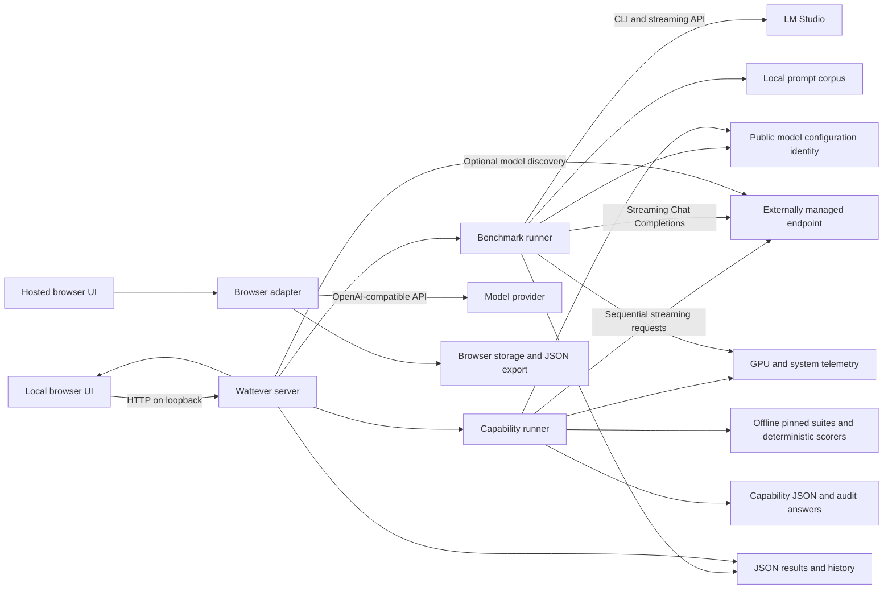

# Architecture

The standard-library server serves local static assets and coordinates one benchmark at a time. The runner plans cases, collects streaming responses and optional power samples, and saves progress to JSON. Managed LM Studio uses its CLI for model lifecycle and context/MTP scheduling. The generic endpoint adapter sends streaming Chat Completions requests and optionally discovers model IDs; the engine manages model lifecycle and execution settings. Both use the same helper workload and result pipeline. The UI reads status and events and displays saved results.

Discovery inventories the benchmark client using bounded OS/driver probes. It does not establish remote inference hardware. Generic local-power attribution requires an explicit user assertion. Detected fields, user-reported reproduction settings, sourced compute claims, provider timings and client timings remain distinct. Public result projection removes endpoint connection details and credentials; free-text fields still require review. Result files preserve case/session provenance, and older schema 2 files remain readable with additive metadata. See [measurements](measurements.md), [API](api.md), and [getting started](getting-started.md).

Connect/direct starts resolve endpoint identity without required naming fields. Explicit service metadata and known public API hosts establish detected/inferred service labels; unsupported discovery keeps generic names. Canonical public API routes use stable provider IDs, while other routes use private URL-to-random-ID mappings. Port numbers and model aliases are not software evidence. Route identity and inference-local attribution remain separate.

The hosted browser adapter connects directly to the configured provider after the user chooses Connect. It has no hosted proxy or helper credentials and cannot access helper telemetry or control model loading. The browser and helper use different measurement protocols; see [browser mode](browser.md).

The capability runner shares transport and public model identity with throughput runs but uses separate protocols, storage and deterministic grading. Bundled dataset files are checked against pinned checksums before suite registration; no dataset download occurs during evaluation. One speed or capability benchmark runs at a time. Timeout/cancellation prevents subsequent work while a request worker remains active because provider-side termination is unverified. See [capability evaluation](capabilities.md).

Telemetry has an independent host CPU/RAM sampler and a streaming GPU reader. Recent history is bounded; online all-run aggregates preserve observed means/peaks and coverage. Neither hardware discovery nor telemetry establishes remote inference hardware. The hosted result catalog is read-only and can expose both result families without provider access; launching capability tests requires the helper.
