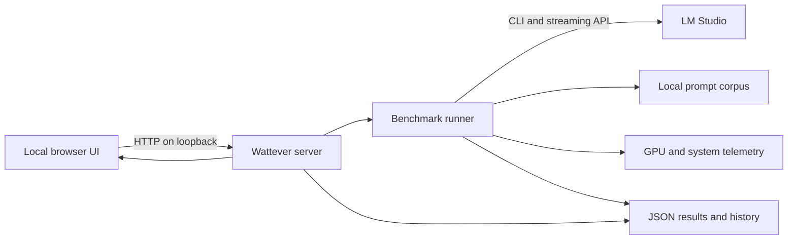

# Architecture

The standard-library server serves local static assets and coordinates one benchmark at a time. The runner plans cases, loads models through LM Studio, collects streaming responses and optional power samples, and saves progress to JSON. The UI reads status and events and displays saved results. System discovery and sensor access are platform dependent; no external service is required by Wattever itself. The LM Studio endpoint can be configured separately.

The selected sensor and model execution placement are separate. Result files preserve case and session provenance; power estimates have a different boundary from GPU measurements. See [measurements](measurements.md), [API](api.md), and [getting started](getting-started.md).
