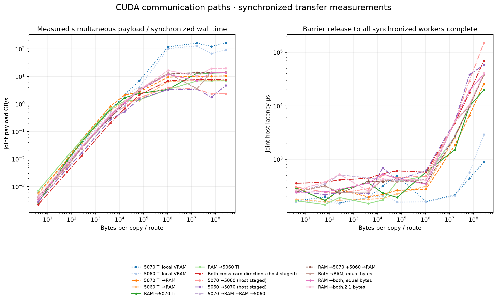
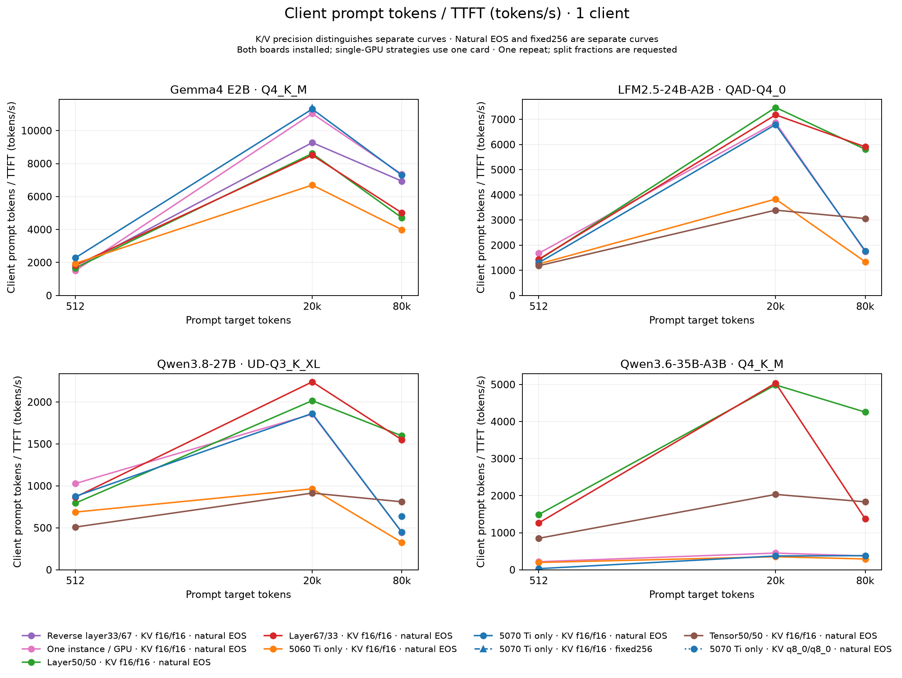
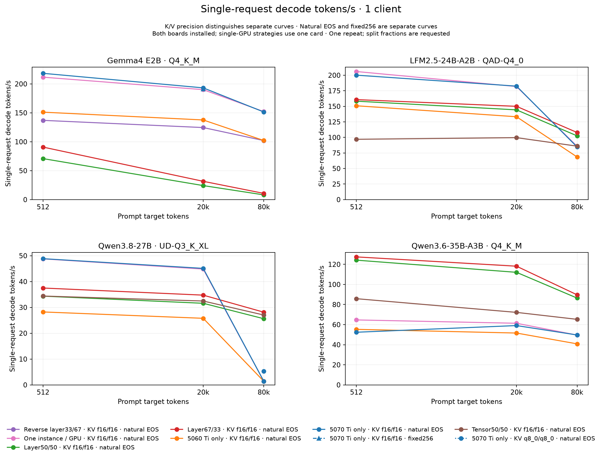
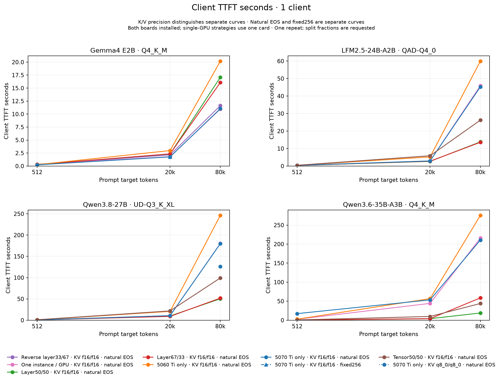
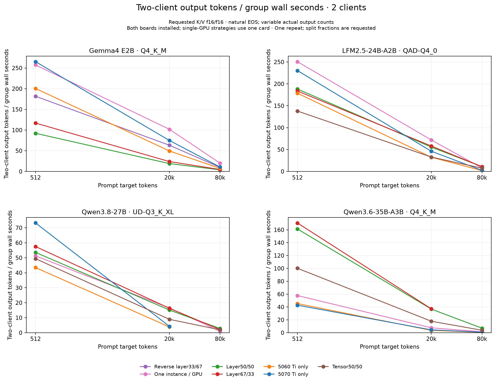
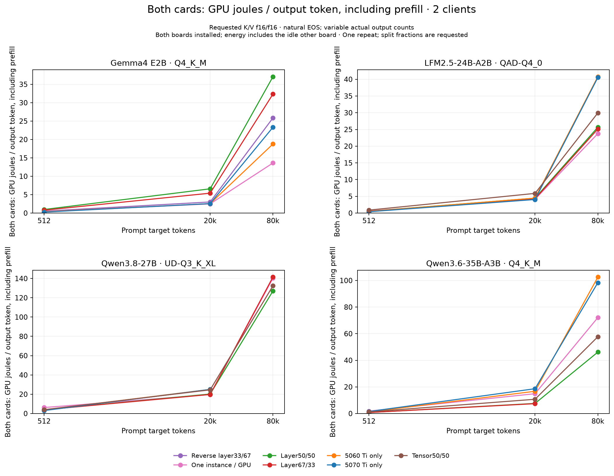
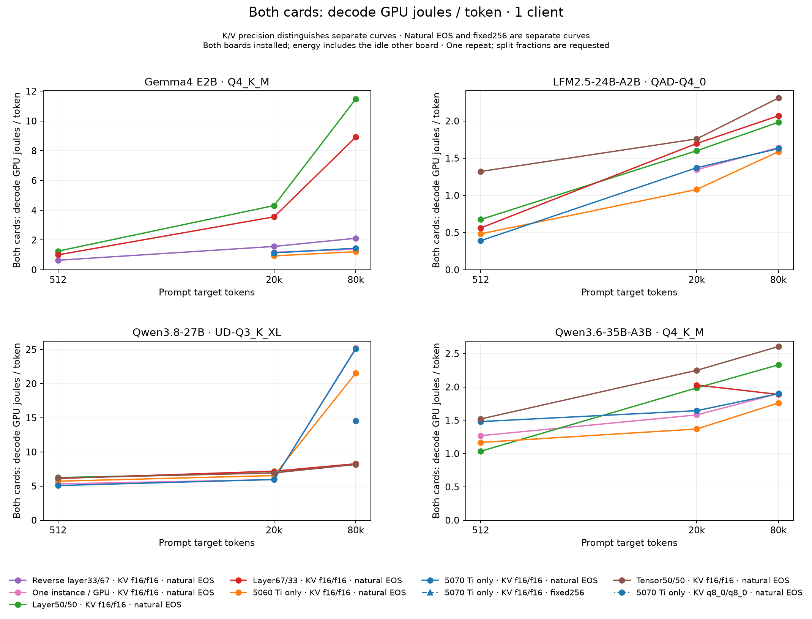

# Dual-GPU communication and placement investigation

**Completed supplied diagnostic matrices.** These captures are separate from normal Wattever benchmark aggregates. Existing historical measurements remain unchanged.

Recorded conditions: 153 unprofiled screening and 3 profiled. Screening outcomes: {"allocation_failed":1,"failed":3,"ok":143,"unsupported_configuration":6}. Eligible timing conditions: 143. Required but absent case IDs: 0; unobserved required representative model/strategy/prompt/client combinations: 0. All entries in the supplied capture manifests were attempted. Full transfer capture available: True. Each measured inference condition has one repeat; internal CUDA-copy samples are not inference repeats.

The required150-condition screen is complete. Broad classic-row24 and fixed-output48 follow-up matrices were deferred under the user time limit; only the individually recorded closeout probes were attempted. Unattempted optional plan entries are deferred research, not pending attempted measurements or silently fabricated results.

[Raw shareable evidence (gzip JSON)](../results/aggregates/dual-gpu-communication-and-placement-raw.json.gz) · [All conditions](../results/aggregates/dual-gpu-communication-and-placement-conditions.csv) · [Matched strategy ratios](../results/aggregates/dual-gpu-communication-and-placement-strategy-ratios.csv) · [Per-card telemetry](../results/aggregates/dual-gpu-communication-and-placement-telemetry.csv) · [Original 180-case comparison](5070-plus-5060-comparison.md)

## Communication topology and peer capability

Operator identities are PNY RTX5070 Ti16GB and ASUS RTX5060 Ti16GB; NVIDIA names and per-capture mappings verify logical ordering where provided. PnP endpoint/parent relationships are observed topology, while physical PE-slot labels remain unverified. Firmware generic Slot1–7 entries conflict with this three-slot board and are not used as slot proof.

|Observed endpoint|PnP Gen snapshot|Width snapshot|Parent bridge location|Physical slot|
|---|---|---|---|---|
|NVIDIA GeForce RTX 5070 Ti|3|16|PCI bus 0, device 3, function 0|unverified|
|NVIDIA GeForce RTX 5060 Ti|3|8|PCI bus 0, device 2, function 0|unverified|
|Standard NVM Express Controller|3|4|PCI bus 0, device 1, function 0|unverified|

The [EVGA X99 Micro2 manual](https://www.evga.com/support/manuals/files/131-HE-E095_Part1_v2.pdf) documents x16/x16/x8 allocation with a40-lane processor, and the M.2/PE3 sharing rule. [Intel specifies40 PCIe3 lanes and four memory channels for5960X](https://www.intel.com/content/www/us/en/products/sku/82930/intel-core-i75960x-processor-extreme-edition-20m-cache-up-to-3-50-ghz/specifications.html). These specifications do not prove which physical slots are occupied. Distinct observed root bridges do not establish absence of contention in host memory/controller paths; no active GPU lane loss is inferred from NVMe presence alone.

Negotiated link pairs during workload windows are retained in the telemetry CSV. Snapshot generation/width is not bandwidth; maxima of independent samples are not combined into an invented link state.

|Capture|Accessing CUDA device|Peer allocation device|Can access peer|
|---|---|---|---|
|0|0|1|False|
|0|1|0|False|
|1|0|1|False|
|1|1|0|False|

Unsupported peer access explicitly uses portable-pinned host staging. Peer-enabled CUDA API paths remain transport-unverified unless independently traced; capability or a peer-copy event alone is not labeled direct P2P.

## Transfer measurements

[Raw internal samples](../results/aggregates/dual-gpu-communication-and-placement-micro-samples.csv) · [Transfer summaries](../results/aggregates/dual-gpu-communication-and-placement-micro-summary.csv)

All rates below are medians of actual joint payload/elapsed samples. Simultaneous throughput is measured over a shared barrier-to-completion interval, never the sum of individual rates. Host latency includes Python dispatch, context/event handling and synchronization. Staged cross-device routes synchronize DtoH before HtoD; there is no within-route double-buffer pipeline. Host pages are CUDA-pinned with OS first-touch placement; CPU affinity/NUMA are not pinned. Full destination validation occurs after the last measured batch with prior poisoning, not independently after every internal sample. These short Windows/WDDM captures are not pure PCIe latency or peak VRAM bandwidth. Memory clocks were not captured, so no clock-state explanation is established. Requested mode names do not imply multiple copies: the actual copies-per-route field governs, including one copy at256MiB under the64MiB batch budget.

|Capture|Status|Distinct copy sizes|Recorded measurements|Cleanup errors|
|---|---|---|---|---|
|0|completed|10|280|0|
|1|completed|2|56|0|

[Communication-capture telemetry](../results/aggregates/dual-gpu-communication-and-placement-micro-telemetry.csv) comes from the gated wrapper's sibling telemetry.json. Negotiated link pairs are retained both across the diagnostic interval and, where sampler timestamps overlap, inside actual timed-copy windows. A missing timed-window sample is unavailable evidence, not an idle link. Wrapper board energy covers allocations, warmups, validation and checkpoint I/O; it is not isolated transfer energy.

|Capture|GPU|Link pairs inside timed copies|Timed-window samples|Whole diagnostic GPU J|Peak °C|
|---|---|---|---|---|---|
|0|0|[[1,16],[2,16],[3,16]]|173|4,678.81|50.00|
|0|1|[[1,8],[2,8],[3,8]]|173|2,314.20|41.00|
|1|0|[[3,16]]|12|148.98|45.00|
|1|1|[[3,8]]|12|71.52|36.00|

|Largest transfer / route bytes|Case|Copies / route|Measured joint payload GB/s|Joint host µs|Validated|Transport|
|---|---|---|---|---|---|---|
|268435456|HtoD0|[1]|13.57|19,780.20|True|["HtoD"]|
|268435456|DtoH0|[1]|10.42|25,753.20|True|["DtoH"]|
|268435456|DtoD0|[1]|167.88|1,599.00|True|["DtoD"]|
|268435456|HtoD1|[1]|6.88|39,008.40|True|["HtoD"]|
|268435456|DtoH1|[1]|7.08|37,906.30|True|["DtoH"]|
|268435456|DtoD1|[1]|92.13|2,913.80|True|["DtoD"]|
|268435456|cross_0_to_1|[1]|2.37|113,309.10|True|["explicit_portable_pinned_host_staging"]|
|268435456|cross_1_to_0|[1]|4.66|57,558.10|True|["explicit_portable_pinned_host_staging"]|
|268435456|simultaneous_HtoD_equal|[1,1]|13.77|38,977.90|True|["HtoD"]|
|268435456|simultaneous_HtoD_weighted_2_1|[2,1]|19.69|40,902.10|True|["HtoD"]|
|268435456|simultaneous_DtoH_equal|[1,1]|14.12|38,012.30|True|["DtoH"]|
|268435456|bidirectional_cross|[1,1]|7.68|69,868.00|True|["explicit_portable_pinned_host_staging"]|
|268435456|mixed_HtoD0_DtoH1|[1,1]|14.00|38,347.00|True|["DtoH","HtoD"]|
|268435456|mixed_DtoH0_HtoD1|[1,1]|13.77|38,999.00|True|["DtoH","HtoD"]|

[Local-copy reference definitions](../results/aggregates/dual-gpu-communication-and-placement-vram-copy-definitions.csv) reconcile the older and new256MiB measurements. Both use payload bytes, not a2× arithmetic mismatch; nominal read-plus-write is a separately named quantity. The older probe calibrates longer CUDA-event batches (110/58copies in the retained captures); the new largest-size modes each use one copy and report a separately timed host-wall rate. Compare like timing scopes before discussing differences.

|Capture / mode|GPU|Copies / sample|Internal samples|CUDA-event payload GB/s|Joint host-wall payload GB/s|Nominal read+write GB/s|
|---|---|---|---|---|---|---|
|historical_compute_probe|0|110|15|375.09|unavailable|750.18|
|communication_0_synchronized_group_latency|0|[1]|15|383.62|304.59|unavailable|
|communication_0_batched_throughput|0|[1]|7|197.42|167.88|unavailable|
|historical_compute_probe|1|58|15|192.32|unavailable|384.63|
|communication_0_synchronized_group_latency|1|[1]|15|98.97|92.42|unavailable|
|communication_0_batched_throughput|1|[1]|7|99.05|92.13|unavailable|

The5070 latency-mode CUDA-event reference agrees approximately with the old375GB/s payload result, while other new event references are lower. Host overhead alone cannot explain a lower GPU-event reference. Conditions, sustained state, boost behavior and protocol are not isolated, and memory clocks were not recorded in those original captures; this is not evidence of a physical VRAM-bandwidth regression.


[Separate sustained local-copy protocol control](../results/aggregates/dual-gpu-communication-and-placement-sustained-vram-control.csv) is optional and never replaces or pools with the original280-copy capture or historical compute probe. It requests sequential cards,256MiB payloads,5 warmups,15 internally timed batches calibrated toward80ms (bounded at128 copies), CUDA-event and synchronized host-wall timing, full final-buffer validation and sparse50ms SM/memory-clock observations. Its repeated random64KiB source block differs from the historical independent full-random pattern. Event and host rates count payload once; neither is a physical DRAM-controller traffic counter. Clock observations do not establish a boost/state cause.

|Capture|GPU|Status|Eligible control|Copies / batch|Batches|CUDA-event payload GB/s|Host-wall payload GB/s|SM clock median MHz (N)|Memory clock median MHz (N)|Cleanup|
|---|---|---|---|---|---|---|---|---|---|---|
|sustained-local-vram-20261103T080820Z|0|completed|True|115|15|374.46|372.69|2,985.00 (9)|13,801.00 (9)|True|
|sustained-local-vram-20261103T080820Z|1|completed|True|58|15|192.57|191.74|2,790.00 (9)|13,801.00 (9)|True|

Smoke/subset captures remain in raw evidence and CSV, and are excluded from the full-transfer summary graph/table. Local VRAM copies are payload rates; physical read-plus-write traffic is different.

## Host-pinned allocation diagnostic

[Allocation attempts](../results/aggregates/dual-gpu-communication-and-placement-host-pin.csv) retain requested sizes, exact Driver API outcomes, physical/commit headroom, gate decisions, release and context-cleanup evidence. These allocation-only samples are separate from copy samples and inference repeats.

|Capture / test type|Chunk|Requested GiB|Allocation result / code|Allocation seconds|Available RAM GiB|Commit headroom GiB|Gate|Final release|Context cleanup|
|---|---|---|---|---|---|---|---|---|---|
|0 / sequential_single_allocation|unreported|0.50|CUDA_SUCCESS / 0|0.116460|57.45|68.10|True|True|True|
|0 / sequential_single_allocation|unreported|4.00|CUDA_SUCCESS / 0|0.790328|57.45|68.11|True|True|True|
|0 / sequential_single_allocation|unreported|8.00|CUDA_SUCCESS / 0|1.604898|57.46|68.12|True|True|True|
|0 / sequential_single_allocation|unreported|16.00|CUDA_ERROR_OUT_OF_MEMORY / 2|0.000098|57.45|68.12|True|not required|True|
|0 / sequential_single_allocation|unreported|18.75|CUDA_ERROR_OUT_OF_MEMORY / 2|0.000055|57.44|68.10|True|not required|True|
|1 / pooled_concurrent_chunks|1|8.00|CUDA_SUCCESS / 0|1.783379|57.18|67.77|True|True|True|
|1 / pooled_concurrent_chunks|2|8.00|CUDA_SUCCESS / 0|2.150689|49.13|59.80|True|True|True|
|1 / pooled_concurrent_chunks|3|2.75|CUDA_SUCCESS / 0|0.814196|41.18|51.79|True|True|True|

|Capture|Sequence outcome|Held concurrently before cleanup GiB|Final release order|All host allocations released|Remaining allocations|Context destroyed|
|---|---|---|---|---|---|---|
|0|sequential allocations, each released before next|unavailable|per-attempt release|True|0|True|
|1|all_chunks_held_concurrently|18.75|reverse allocation order|True|0|True|

In the supplied fresh-context captures, single allocations of 16.00 GiB, 18.75 GiB failed despite passing the headroom gate. A pooled sequence held 18.75 GiB concurrently and completed verified cleanup. This demonstrates a working chunked allocation path; simple total-host-RAM exhaustion alone does not account for this contrast.


Pooled attempt status "held" describes ownership during the probe, before final cleanup. Per-chunk releases and the final global cleanup are reported separately above; a held-during-probe status is not an unreleased allocation. Capture-level held-byte totals are repeated as metadata in attempt rows and must not be added. If concurrent8+8+2.75GiB allocations succeed while a single16/18.75GiB allocation fails, chunking demonstrably helps in that fresh-context experiment and simple total-host-RAM exhaustion does not explain that contrast by itself. The native Runtime allocation in a loaded process remains a different API/context/state condition.

A fresh CUDA Driver context and cuMemHostAlloc flags0 are different API/context/state conditions from the native engine's Runtime allocation in a loaded process, even though flags0 correspond to the default allocation policy. Allocation success at a smaller size and CUDA out-of-memory at a larger size, despite OS headroom, measure those specific requests only. Buffers were not touched and no copies/kernels were run in this diagnostic. Exact failure cause and applicability to the native Qwen35 pageable-host condition remain unresolved; this does not prove that adding the second GPU caused the failure. Do not infer actual paging or a physical-RAM limit from that error alone.

## Controlled execution strategies

The baseline standalone matrix uses explicit IPv4 loopback, F16 requested K/V, reasoning off, MTP off, common weights, per-slot context and sampling. Optional cache-precision interventions are separate conditions, identified by requested and observed K/V types; the baseline F16 note does not apply to a q8 request. A nonbaseline precision is not claimed verified from a weight GGUF or an ignored flag: matching cache allocator evidence is required for its ratios/rankings. Unverified conditions retain actual timing observations in separate CSV columns/raw evidence. CPU offload, actual layer placement and native tensor restrictions remain recorded outcomes. Automatic fitting may choose different weight placement; no tensor-mode fallback is silently substituted. Independent instances use one logical model instance per card; file-backed GGUF pages may be shared by the OS, so this does not establish twice the physical host RAM. One-client independent runs still pay the second loaded card's idle draw. Do not sum process RSS or per-card shared allocations as physical RAM; OS total-minus-available is the global physical-memory boundary. Tensor restrictions belong to the actual pinned architecture/build, not a generic promise of support.


[Final-load allocation evidence](../results/aggregates/dual-gpu-communication-and-placement-actual-placement.csv) isolates the last model-loader pass with positive real model buffers, excluding earlier dry fit passes and zero-size allocations. KV allocations are read from the last positive KV context when context markers establish it. Unavailable pass/context boundaries and startup-prefix truncation remain explicit; no dry CPU KV/layer assignment is silently combined with a final GPU allocation.

An offloaded41/41 layer message does not establish that all weights reside in GPU memory: tensor/expert overrides can retain nonzero CPU_Mapped model allocations. The original offload flags remain reported metadata, alongside final positive CPU/host/GPU model-buffer sizes. CPU embeddings/output tensors and explicitly named expert policies are identified separately; a host buffer with no tensor-role evidence is not labeled an expert by its size. Logged allocation sums are not independent physical-RAM totals, active compute placement, or a per-layer KV map.


The frozen runner warms each engine with only8 generated tokens. This does not establish that every CPU-offloaded memory-mapped GGUF page or rarely used MoE expert was prefaulted, nor that filesystem-cache state was equal across conditions. GPU startup loading and an8-token warmup do not verify full host-weight residency. First-query file-backed demand paging can cause page reads without RAM exhaustion or pagefile swapping. Per-phase reads, process working set and faults provide qualified context only; global counters include other processes, and no SSD bottleneck is claimed without attributed I/O evidence. Filesystem/host-page state is separate from token-prefix cache reuse: cache_prompt=false and a zero reused-token count do not prove a cold or equal OS file cache.


In this new strategy matrix, single5070 and single5060 mean execution on one GPU while the other card remains physically installed and idle. Their all-card energy includes that idle board. Historical physically single-card installations have a different energy boundary and remain separate; these labels never mean the other board was removed.

|Model|Strategy|Outcome|Conditions|
|---|---|---|---|
|gemmae2b|gemma_kv_local|ok|6|
|gemmae2b|independent|ok|6|
|gemmae2b|layer_equal|ok|6|
|gemmae2b|layer_favor5070|ok|6|
|gemmae2b|row_equal|failed|1|
|gemmae2b|single5060|ok|6|
|gemmae2b|single5070|ok|7|
|gemmae2b|tensor_equal|unsupported_configuration|6|
|lfm25|independent|ok|6|
|lfm25|layer_equal|ok|6|
|lfm25|layer_favor5070|ok|6|
|lfm25|single5060|ok|6|
|lfm25|single5070|ok|6|
|lfm25|tensor_equal|ok|6|
|qwen27|independent|ok|6|
|qwen27|layer_equal|ok|6|
|qwen27|layer_favor5070|ok|6|
|qwen27|single5060|failed|1|
|qwen27|single5060|ok|5|
|qwen27|single5070|failed|1|
|qwen27|single5070|ok|6|
|qwen27|tensor_equal|ok|6|
|qwen35|independent|ok|6|
|qwen35|layer_equal|ok|6|
|qwen35|layer_favor5070|allocation_failed|1|
|qwen35|layer_favor5070|ok|5|
|qwen35|single5060|ok|6|
|qwen35|single5070|ok|6|
|qwen35|tensor_equal|ok|6|

[Cache precision verification](../results/aggregates/dual-gpu-communication-and-placement-precision-verification.csv) distinguishes requested flags from observed cache allocator types. Quantized-cache conditions without explicit matching evidence remain outside precision-specific comparisons; their observed transport timings remain available.


[Output-stop verification](../results/aggregates/dual-gpu-communication-and-placement-output-stop-verification.csv) keeps the optional fixed256 condition separate from natural EOS. The fixed wrapper requests --ignore-eos and256 output tokens; comparison eligibility additionally requires exact256 nonestimated API counts for every request and every effective server props.default_generation_settings.params.ignore_eos=true. The verification sidecar is accepted only after rechecking its saved-result SHA256, exact public request projection, every server-metadata SHA256/props value and owned-process cleanup. Missing or conflicting proof leaves timing observations available but excludes the fixed-output claim and its rankings. Natural-EOS screening scores may select new configurations, never substitute as fixed-output measurements.


[Structured failure restrictions](../results/aggregates/dual-gpu-communication-and-placement-failure-restrictions.csv) retain observed architecture, split-axis, KV/flash, allocation and context rejection categories where an allowlisted message establishes them. Private result identity/status and owned-process cleanup are checked before reading bounded terminal logs. Raw error strings, stack frames, local paths, URLs, IDs and credentials are never copied. Metadata KV-head counts and documented restrictions remain separate from an observed failure cause.

|Model|Strategy|Prompt|Clients|Outcome|Observed safe reason codes|Evidence availability|KV-head metadata|
|---|---|---|---|---|---|---|---|
|gemmae2b|row_equal|20000|1|failed|backend_split_buffers_unsupported|unavailable|[1]|
|gemmae2b|tensor_equal|512|1|unsupported_configuration|tensor_split_axis_assertion|observed_terminal_private_evidence|[1]|
|gemmae2b|tensor_equal|512|2|unsupported_configuration|tensor_split_axis_assertion|observed_terminal_private_evidence|[1]|
|gemmae2b|tensor_equal|20000|1|unsupported_configuration|tensor_split_axis_assertion|observed_terminal_private_evidence|[1]|
|gemmae2b|tensor_equal|20000|2|unsupported_configuration|tensor_split_axis_assertion|observed_terminal_private_evidence|[1]|
|gemmae2b|tensor_equal|80000|1|unsupported_configuration|tensor_split_axis_assertion|observed_terminal_private_evidence|[1]|
|gemmae2b|tensor_equal|80000|2|unsupported_configuration|tensor_split_axis_assertion|observed_terminal_private_evidence|[1]|
|qwen27|single5070|80000|2|failed|request_or_startup_timeout|observed_terminal_private_evidence|[4]|
|qwen27|single5060|80000|2|failed|request_or_startup_timeout|observed_terminal_private_evidence|[4]|
|qwen35|layer_favor5070|80000|2|allocation_failed|allocation_out_of_memory|observed_terminal_private_evidence|[2]|

Timeouts are censored outcomes, not zero performance, capacity-OOM evidence or a deadlock diagnosis. In the frozen standalone runner, --timeout900 applies to urllib socket operations; future waits/cancellation and executor joins do not impose a hard900-second group deadline. Actual measured group wall time is retained when available. Whole-case UTC elapsed time includes idle checks, loading, tokenization/warmup, requests, cancellation, cleanup and profiling exports where applicable; it is separately named and never substituted for missing inference time.

|Model|Strategy|Prompt|Clients|Outcome|Whole case elapsed seconds|Recorded group wall seconds|
|---|---|---|---|---|---|---|
|gemmae2b|row_equal|20000|1|failed|3.72|unavailable|
|gemmae2b|tensor_equal|512|1|unsupported_configuration|8.96|unavailable|
|gemmae2b|tensor_equal|512|2|unsupported_configuration|8.23|unavailable|
|gemmae2b|tensor_equal|20000|1|unsupported_configuration|7.96|unavailable|
|gemmae2b|tensor_equal|20000|2|unsupported_configuration|8.03|unavailable|
|gemmae2b|tensor_equal|80000|1|unsupported_configuration|8.12|unavailable|
|gemmae2b|tensor_equal|80000|2|unsupported_configuration|8.12|unavailable|
|qwen27|single5070|80000|2|failed|953.78|unavailable|
|qwen27|single5060|80000|2|failed|972.27|unavailable|
|qwen35|layer_favor5070|80000|2|allocation_failed|23.06|unavailable|

vLLM comparison: no configured Linux environment was established (WSL registry absent in the retained inventory); no OS, driver or reboot changes were made. Native Windows standalone llama.cpp reuses the GGUF files. [Official vLLM GGUF documentation](https://docs.vllm.ai/en/latest/features/quantization/gguf/) identifies experimental support through its separate GGUF plugin; compatibility/performance for these quants was not measured here.


Classic `row` is a separate placement strategy from experimental `tensor`: the row adapter requests a weight partition across both cards while keeping KV/intermediates on the designated main GPU; experimental tensor mode shards KV and performs cross-device reductions. These are requested policies, not proof of actual placement. Wrapper SHA256/strategy definitions remain in the conditions/raw evidence; unchanged core measurement/client/power source fingerprints are still required for matched strategy comparisons.

|Configuration adapter|Adapter SHA256|Requested strategy definition|
|---|---|---|
|untracked/run_fixed_output_screen.py|cad96c2cf4577aecd1d7a922daf6745c2c1d9e98157e3598c123a73bfb83fb20|{"architecture_support":"Runtime checked per model; architecture/KV/flash-attention restrictions remain explicit failures. No support or direct P2P transport is assumed.","execution_mode":"classic row weight partition","experimental_tensor_kv_sharding":false,"kv_intermediate_placement_policy":"Classic row mode places KV and intermediate results on the configured main GPU according to pinned llama.cpp help; actual allocation must be verified from startup/trace.","main_gpu_physical_index":0,"main_gpu_role":"PNY RTX5070 Ti; pinned CUDA order is PCI_BUS_ID","main_gpu_visible_index":0,"physical_gpu_indices":[0,1],"placement_evidence_limit":"Per-layer weight assignment alone cannot establish row tensor fractions or actual shared-KV locations; inspect retained startup evidence and diagnostic traces.","precision_context_policy":"Inherited fixed per-request context, F16 K/V and flash-attention on; never silently reduce context or change precision.","split_mode":"row","tensor_split_fractions":"1,1","visible_to_physical":{"0":0,"1":1},"weight_allocation_policy":"Inherited --gpu-layers auto --fit on maximizes GPU allocation with reserved VRAM; any actual CPU offload is retained in placement evidence."}|
|untracked/run_fixed_output_screen.py|cad96c2cf4577aecd1d7a922daf6745c2c1d9e98157e3598c123a73bfb83fb20|{}|
|untracked/run_kv_screen.py|11de5eb600098818046fcc603df08dcc8df73d85f23c594fd1030a1bcc450fc6|{}|

[Pinned llama.cpp CUDA documentation](https://github.com/ggml-org/llama.cpp/blob/3f8af15a7/docs/multi-gpu.md). Per-model unsupported cases are retained above and in the conditions CSV. Failed/censored runs have no fabricated zero throughput.

Matched ratios require identical software/weight-header identity, requested parameters, context, prompt hashes and actual input counts. Full-file hashes are reported when available; a header/tensor-directory hash is not proof of every weight byte. Strict decode, whole-group throughput/elapsed and energy ratios additionally match actual output counts; TTFT/prefill comparisons do not require matching future output length. Early EOS is allowed: a common output budget does not force identical completion counts. Separate descriptive same-budget ratio columns retain valid actual-work comparisons when counts differ, with both counts and the length qualification; they are not pooled into strict ratios. Absolute tokens/s remains available for every verified successful condition. Requested KV flags and observed raw placement logs remain separate evidence; a split fraction is not an actual weight/KV map.

|Capture|Observed software version|Executable SHA256|Source SHA256 map|CUDA overrides|Weight identity scope|
|---|---|---|---|---|---|
|profiled-screening-gemma|{"diagnostic_redacted":true}|ff552b19fe6038bd45a00ead5e4a8d49422e3d6735cfc9672acc34b0c9767115|{"tools/diagnostic_telemetry.py":"a767283e7d00abf9351dea8837b7f6f47c11b00ea6c842d1fcacb0cf4a063113","tools/nsight_capture.py":"26cd72c318560d9d361c7998f2f83aab481e45d3804f49fdf7e11229f8a49e2b","tools/standalone_screen.py":"45c976bca16d86785092e8d0c4195446f97c844b271338da96923960ad084dfe","wattever/lmstudio.py":"90fb13d211b343fca04b0d308aabc3027a89767e5e95f44c90f0e570d8fe4665","wattever/power.py":"fd7d52593b2af5c30ba330ab9440a767394370442b73170f4324e924d96bc43c"}|{}|Full hash when supplied, otherwise bounded GGUF header/tensor directory|
|screening-fixed-row-closeout|{"diagnostic_redacted":true}|ff552b19fe6038bd45a00ead5e4a8d49422e3d6735cfc9672acc34b0c9767115|{"tools/diagnostic_telemetry.py":"a767283e7d00abf9351dea8837b7f6f47c11b00ea6c842d1fcacb0cf4a063113","tools/standalone_screen.py":"45c976bca16d86785092e8d0c4195446f97c844b271338da96923960ad084dfe","wattever/lmstudio.py":"90fb13d211b343fca04b0d308aabc3027a89767e5e95f44c90f0e570d8fe4665","wattever/power.py":"fd7d52593b2af5c30ba330ab9440a767394370442b73170f4324e924d96bc43c"}|{}|Full hash when supplied, otherwise bounded GGUF header/tensor directory|
|screening-gemma|{"diagnostic_redacted":true}|ff552b19fe6038bd45a00ead5e4a8d49422e3d6735cfc9672acc34b0c9767115|{"tools/diagnostic_telemetry.py":"a767283e7d00abf9351dea8837b7f6f47c11b00ea6c842d1fcacb0cf4a063113","tools/standalone_screen.py":"45c976bca16d86785092e8d0c4195446f97c844b271338da96923960ad084dfe","wattever/lmstudio.py":"90fb13d211b343fca04b0d308aabc3027a89767e5e95f44c90f0e570d8fe4665","wattever/power.py":"fd7d52593b2af5c30ba330ab9440a767394370442b73170f4324e924d96bc43c"}|{}|Full hash when supplied, otherwise bounded GGUF header/tensor directory|
|screening-kv-q8-closeout|{"diagnostic_redacted":true}|ff552b19fe6038bd45a00ead5e4a8d49422e3d6735cfc9672acc34b0c9767115|{"tools/diagnostic_telemetry.py":"a767283e7d00abf9351dea8837b7f6f47c11b00ea6c842d1fcacb0cf4a063113","tools/standalone_screen.py":"45c976bca16d86785092e8d0c4195446f97c844b271338da96923960ad084dfe","wattever/lmstudio.py":"90fb13d211b343fca04b0d308aabc3027a89767e5e95f44c90f0e570d8fe4665","wattever/power.py":"fd7d52593b2af5c30ba330ab9440a767394370442b73170f4324e924d96bc43c"}|{}|Full hash when supplied, otherwise bounded GGUF header/tensor directory|
|screening-remaining|{"diagnostic_redacted":true}|ff552b19fe6038bd45a00ead5e4a8d49422e3d6735cfc9672acc34b0c9767115|{"tools/diagnostic_telemetry.py":"a767283e7d00abf9351dea8837b7f6f47c11b00ea6c842d1fcacb0cf4a063113","tools/standalone_screen.py":"45c976bca16d86785092e8d0c4195446f97c844b271338da96923960ad084dfe","wattever/lmstudio.py":"90fb13d211b343fca04b0d308aabc3027a89767e5e95f44c90f0e570d8fe4665","wattever/power.py":"fd7d52593b2af5c30ba330ab9440a767394370442b73170f4324e924d96bc43c"}|{}|Full hash when supplied, otherwise bounded GGUF header/tensor directory|

|Model|GGUF filename|Weight file GiB|Header/directory SHA256|Full-file SHA256|
|---|---|---|---|---|
|gemmae2b|gemma-4-E2B-it-Q4_K_M.gguf|3.19|2166a695e15e6e09ca2cf6dd17d59fbcacf25aaee5cf7d035f423fe57379adbe|unreported|
|qwen27|Qwen3.8-27B-UD-Q3_K_XL.gguf|12.24|93693a3a27deaefde32edc90037d5b68d647a90f8d5e09aaac8cc25c5bc63419|unreported|
|lfm25|LFM2.5-24B-A2B-QAD-Q4_0.gguf|12.65|3f6a85b69ee5655fd6401582511655aa220c531dd1713b0103d9a69a3580653a|unreported|
|qwen35|Qwen3.6-35B-A3B-Q4_K_M.gguf|19.71|d3dfcf03ccefdf98f1ba731c4afc455aa09563a2023d43b6a836243cb42f8ec1|unreported|

[Backend timing attachment](../results/aggregates/dual-gpu-communication-and-placement-backend-timings.csv) preserves prompt-evaluation/decode durations, counts, rates and raw timing lines by owned server. These rows remain unassigned to requests unless the original slot/task evidence establishes attribution; no row-order matching is invented.

|Model|Weight quant|Requested K/V|Output stop|Strategy|Clients|Configuration group|Prefill ratio (N)|Decode ratio (N)|Aggregate ratio (N)|GPU energy/token ratio (N)|
|---|---|---|---|---|---|---|---|---|---|---|
|gemmae2b|Q4_K_M|f16/f16|ignore_eos_requested_256|row_equal|1|f589d19d|unavailable (0)|unavailable (0)|unavailable (0)|unavailable (0)|
|gemmae2b|Q4_K_M|f16/f16|natural_eos|gemma_kv_local|1|49c9822e|0.820 (3)|unavailable (0)|unavailable (0)|unavailable (0)|
|gemmae2b|Q4_K_M|f16/f16|natural_eos|gemma_kv_local|2|810e86ac|0.833 (3)|unavailable (0)|unavailable (0)|unavailable (0)|
|gemmae2b|Q4_K_M|f16/f16|natural_eos|independent|1|49c9822e|0.976 (3)|0.984 (3)|0.980 (3)|1.031 (2)|
|gemmae2b|Q4_K_M|f16/f16|natural_eos|independent|2|810e86ac|1.329 (3)|unavailable (0)|unavailable (0)|unavailable (0)|
|gemmae2b|Q4_K_M|f16/f16|natural_eos|layer_equal|1|49c9822e|0.728 (3)|0.225 (2)|0.302 (2)|2.864 (1)|
|gemmae2b|Q4_K_M|f16/f16|natural_eos|layer_equal|2|810e86ac|0.711 (3)|unavailable (0)|unavailable (0)|unavailable (0)|
|gemmae2b|Q4_K_M|f16/f16|natural_eos|layer_favor5070|1|49c9822e|0.753 (3)|0.416 (1)|0.459 (1)|unavailable (0)|
|gemmae2b|Q4_K_M|f16/f16|natural_eos|layer_favor5070|2|810e86ac|0.711 (3)|unavailable (0)|unavailable (0)|unavailable (0)|
|gemmae2b|Q4_K_M|f16/f16|natural_eos|single5060|1|49c9822e|0.592 (3)|unavailable (0)|unavailable (0)|unavailable (0)|
|gemmae2b|Q4_K_M|f16/f16|natural_eos|single5060|2|810e86ac|0.559 (3)|unavailable (0)|unavailable (0)|unavailable (0)|
|gemmae2b|Q4_K_M|f16/f16|natural_eos|tensor_equal|1|49c9822e|unavailable (0)|unavailable (0)|unavailable (0)|unavailable (0)|
|gemmae2b|Q4_K_M|f16/f16|natural_eos|tensor_equal|2|810e86ac|unavailable (0)|unavailable (0)|unavailable (0)|unavailable (0)|
|lfm25|QAD-Q4_0|f16/f16|natural_eos|independent|1|59479ea9|1.011 (3)|1.013 (3)|1.006 (3)|1.026 (2)|
|lfm25|QAD-Q4_0|f16/f16|natural_eos|independent|2|1cdeb71e|1.785 (3)|2.278 (3)|1.559 (3)|1.018 (3)|
|lfm25|QAD-Q4_0|f16/f16|natural_eos|layer_equal|1|59479ea9|1.100 (3)|0.791 (3)|0.977 (3)|1.185 (3)|
|lfm25|QAD-Q4_0|f16/f16|natural_eos|layer_equal|2|1cdeb71e|1.496 (3)|0.987 (3)|1.207 (3)|1.099 (3)|
|lfm25|QAD-Q4_0|f16/f16|natural_eos|layer_favor5070|1|59479ea9|1.107 (3)|0.822 (3)|0.968 (3)|1.125 (3)|
|lfm25|QAD-Q4_0|f16/f16|natural_eos|layer_favor5070|2|1cdeb71e|1.414 (3)|1.068 (3)|1.259 (3)|1.049 (3)|
|lfm25|QAD-Q4_0|f16/f16|natural_eos|single5060|1|59479ea9|0.755 (3)|0.754 (3)|0.758 (3)|1.123 (3)|
|lfm25|QAD-Q4_0|f16/f16|natural_eos|single5060|2|1cdeb71e|0.764 (3)|0.753 (3)|0.759 (3)|1.103 (3)|
|lfm25|QAD-Q4_0|f16/f16|natural_eos|tensor_equal|1|59479ea9|0.908 (3)|0.546 (3)|0.545 (3)|1.652 (3)|
|lfm25|QAD-Q4_0|f16/f16|natural_eos|tensor_equal|2|1cdeb71e|0.691 (3)|0.801 (3)|0.713 (3)|1.451 (3)|
|qwen27|UD-Q3_K_XL|f16/f16|natural_eos|independent|1|86fb9d1c|0.998 (3)|0.998 (3)|1.003 (3)|1.021 (3)|
|qwen27|UD-Q3_K_XL|f16/f16|natural_eos|independent|2|464ae10c|2.190 (2)|unavailable (0)|unavailable (0)|unavailable (0)|
|qwen27|UD-Q3_K_XL|f16/f16|natural_eos|layer_equal|1|86fb9d1c|1.082 (3)|unavailable (0)|unavailable (0)|unavailable (0)|
|qwen27|UD-Q3_K_XL|f16/f16|natural_eos|layer_equal|2|464ae10c|1.558 (2)|unavailable (0)|unavailable (0)|unavailable (0)|
|qwen27|UD-Q3_K_XL|f16/f16|natural_eos|layer_favor5070|1|86fb9d1c|1.202 (3)|unavailable (0)|unavailable (0)|unavailable (0)|
|qwen27|UD-Q3_K_XL|f16/f16|natural_eos|layer_favor5070|2|464ae10c|1.695 (2)|unavailable (0)|unavailable (0)|unavailable (0)|
|qwen27|UD-Q3_K_XL|f16/f16|natural_eos|single5060|1|86fb9d1c|0.730 (3)|0.578 (1)|0.596 (1)|1.148 (1)|
|qwen27|UD-Q3_K_XL|f16/f16|natural_eos|single5060|2|464ae10c|0.681 (2)|unavailable (0)|unavailable (0)|unavailable (0)|
|qwen27|UD-Q3_K_XL|f16/f16|natural_eos|tensor_equal|1|86fb9d1c|0.582 (3)|unavailable (0)|unavailable (0)|unavailable (0)|
|qwen27|UD-Q3_K_XL|f16/f16|natural_eos|tensor_equal|2|464ae10c|0.805 (2)|unavailable (0)|unavailable (0)|unavailable (0)|
|qwen35|Q4_K_M|f16/f16|natural_eos|independent|1|efcb132a|1.209 (3)|1.039 (3)|1.195 (3)|0.874 (3)|
|qwen35|Q4_K_M|f16/f16|natural_eos|independent|2|91d0d302|1.468 (3)|unavailable (0)|unavailable (0)|unavailable (0)|
|qwen35|Q4_K_M|f16/f16|natural_eos|layer_equal|1|efcb132a|13.369 (3)|2.054 (2)|9.815 (2)|0.365 (2)|
|qwen35|Q4_K_M|f16/f16|natural_eos|layer_equal|2|91d0d302|10.927 (3)|unavailable (0)|unavailable (0)|unavailable (0)|
|qwen35|Q4_K_M|f16/f16|natural_eos|layer_favor5070|1|efcb132a|13.499 (3)|unavailable (0)|unavailable (0)|unavailable (0)|
|qwen35|Q4_K_M|f16/f16|natural_eos|layer_favor5070|2|91d0d302|10.181 (2)|unavailable (0)|unavailable (0)|unavailable (0)|
|qwen35|Q4_K_M|f16/f16|natural_eos|single5060|1|efcb132a|0.943 (3)|unavailable (0)|unavailable (0)|unavailable (0)|
|qwen35|Q4_K_M|f16/f16|natural_eos|single5060|2|91d0d302|0.777 (3)|unavailable (0)|unavailable (0)|unavailable (0)|
|qwen35|Q4_K_M|f16/f16|natural_eos|tensor_equal|1|efcb132a|5.451 (3)|unavailable (0)|unavailable (0)|unavailable (0)|
|qwen35|Q4_K_M|f16/f16|natural_eos|tensor_equal|2|91d0d302|4.614 (3)|unavailable (0)|unavailable (0)|unavailable (0)|

Ratios are strategy/single5070 within the new controlled protocol. They do not pool native Strata, LM Studio, smoke or profiled measurements. Backend prompt-evaluation durations are retained separately and may be unassigned to requests; they are not substituted for client TTFT.

## Why prefill can improve while decode slows

[Bounded startup pipeline evidence](../results/aggregates/dual-gpu-communication-and-placement-pipeline-startup.csv) retains startup enabled/disabled messages and n_copies, but reported active settings require the independently isolated final real positive KV-context epoch. Earlier fit/dry-run pipeline messages are retained separately and do not establish the active setting. The split request alone never establishes that pipelining was enabled. Missing messages, unisolated contexts, truncated startup coverage and mixed states remain explicit; a logged pipeline setting alone does not establish overlapping GPU kernels or a phase-specific speedup.

|Model|Strategy|Prompt|Clients|Server|Capture type|Pipeline state|Enabled|n_copies|Evidence basis|Startup prefix truncated|
|---|---|---|---|---|---|---|---|---|---|---|
|gemmae2b|single5070|20000|1|server0|profiling|unavailable|unreported|[]|Active context not isolated; dry-fit startup observations retained separately|False|
|gemmae2b|layer_equal|20000|1|server0|profiling|unavailable|unreported|[]|Active context not isolated; dry-fit startup observations retained separately|False|
|gemmae2b|gemma_kv_local|20000|1|server0|profiling|unavailable|unreported|[]|Active context not isolated; dry-fit startup observations retained separately|False|
|gemmae2b|single5070|20000|1|server0|screening|unavailable|unreported|[]|Final real positive KV context|False|
|gemmae2b|row_equal|20000|1|server0|screening|unavailable|unreported|[]|Active context not isolated; dry-fit startup observations retained separately|False|
|gemmae2b|single5070|512|1|server0|screening|unavailable|unreported|[]|Final real positive KV context|False|
|gemmae2b|single5070|512|2|server0|screening|unavailable|unreported|[]|Final real positive KV context|False|
|gemmae2b|single5070|20000|1|server0|screening|unavailable|unreported|[]|Final real positive KV context|False|
|gemmae2b|single5070|20000|2|server0|screening|unavailable|unreported|[]|Final real positive KV context|False|
|gemmae2b|single5070|80000|1|server0|screening|unavailable|unreported|[]|Final real positive KV context|False|
|gemmae2b|single5070|80000|2|server0|screening|unavailable|unreported|[]|Final real positive KV context|False|
|gemmae2b|single5060|512|1|server0|screening|unavailable|unreported|[]|Final real positive KV context|False|
|gemmae2b|single5060|512|2|server0|screening|unavailable|unreported|[]|Final real positive KV context|False|
|gemmae2b|single5060|20000|1|server0|screening|unavailable|unreported|[]|Final real positive KV context|False|
|gemmae2b|single5060|20000|2|server0|screening|unavailable|unreported|[]|Final real positive KV context|False|
|gemmae2b|single5060|80000|1|server0|screening|unavailable|unreported|[]|Final real positive KV context|False|
|gemmae2b|single5060|80000|2|server0|screening|unavailable|unreported|[]|Final real positive KV context|False|
|gemmae2b|layer_equal|512|1|server0|screening|observed|True|[]|Final real positive KV context|False|
|gemmae2b|layer_equal|512|2|server0|screening|observed|True|[]|Final real positive KV context|False|
|gemmae2b|layer_equal|20000|1|server0|screening|observed|True|[]|Final real positive KV context|False|
|gemmae2b|layer_equal|20000|2|server0|screening|observed|True|[]|Final real positive KV context|False|
|gemmae2b|layer_equal|80000|1|server0|screening|observed|True|[]|Final real positive KV context|False|
|gemmae2b|layer_equal|80000|2|server0|screening|observed|True|[]|Final real positive KV context|False|
|gemmae2b|layer_favor5070|512|1|server0|screening|observed|True|[]|Final real positive KV context|False|
|gemmae2b|layer_favor5070|512|2|server0|screening|observed|True|[]|Final real positive KV context|False|
|gemmae2b|layer_favor5070|20000|1|server0|screening|observed|True|[]|Final real positive KV context|False|
|gemmae2b|layer_favor5070|20000|2|server0|screening|observed|True|[]|Final real positive KV context|False|
|gemmae2b|layer_favor5070|80000|1|server0|screening|observed|True|[]|Final real positive KV context|False|
|gemmae2b|layer_favor5070|80000|2|server0|screening|observed|True|[]|Final real positive KV context|False|
|gemmae2b|tensor_equal|512|1|server0|screening|unavailable|unreported|[]|Active context not isolated; dry-fit startup observations retained separately|False|
|gemmae2b|tensor_equal|512|2|server0|screening|unavailable|unreported|[]|Active context not isolated; dry-fit startup observations retained separately|False|
|gemmae2b|tensor_equal|20000|1|server0|screening|unavailable|unreported|[]|Active context not isolated; dry-fit startup observations retained separately|False|
|gemmae2b|tensor_equal|20000|2|server0|screening|unavailable|unreported|[]|Active context not isolated; dry-fit startup observations retained separately|False|
|gemmae2b|tensor_equal|80000|1|server0|screening|unavailable|unreported|[]|Active context not isolated; dry-fit startup observations retained separately|False|
|gemmae2b|tensor_equal|80000|2|server0|screening|unavailable|unreported|[]|Active context not isolated; dry-fit startup observations retained separately|False|
|gemmae2b|independent|512|1|server0|screening|unavailable|unreported|[]|Final real positive KV context|False|
|gemmae2b|independent|512|1|server1|screening|unavailable|unreported|[]|Final real positive KV context|False|
|gemmae2b|independent|512|2|server0|screening|unavailable|unreported|[]|Final real positive KV context|False|
|gemmae2b|independent|512|2|server1|screening|unavailable|unreported|[]|Final real positive KV context|False|
|gemmae2b|independent|20000|1|server0|screening|unavailable|unreported|[]|Final real positive KV context|False|
|gemmae2b|independent|20000|1|server1|screening|unavailable|unreported|[]|Final real positive KV context|False|
|gemmae2b|independent|20000|2|server0|screening|unavailable|unreported|[]|Final real positive KV context|False|
|gemmae2b|independent|20000|2|server1|screening|unavailable|unreported|[]|Final real positive KV context|False|
|gemmae2b|independent|80000|1|server0|screening|unavailable|unreported|[]|Final real positive KV context|False|
|gemmae2b|independent|80000|1|server1|screening|unavailable|unreported|[]|Final real positive KV context|False|
|gemmae2b|independent|80000|2|server0|screening|unavailable|unreported|[]|Final real positive KV context|False|
|gemmae2b|independent|80000|2|server1|screening|unavailable|unreported|[]|Final real positive KV context|False|
|gemmae2b|gemma_kv_local|512|1|server0|screening|observed|True|[]|Final real positive KV context|False|
|gemmae2b|gemma_kv_local|512|2|server0|screening|observed|True|[]|Final real positive KV context|False|
|gemmae2b|gemma_kv_local|20000|1|server0|screening|observed|True|[]|Final real positive KV context|False|
|gemmae2b|gemma_kv_local|20000|2|server0|screening|observed|True|[]|Final real positive KV context|False|
|gemmae2b|gemma_kv_local|80000|1|server0|screening|observed|True|[]|Final real positive KV context|False|
|gemmae2b|gemma_kv_local|80000|2|server0|screening|observed|True|[]|Final real positive KV context|False|
|qwen27|single5070|80000|1|server0|screening|unavailable|unreported|[]|Final real positive KV context|True|
|lfm25|single5070|512|1|server0|screening|unavailable|unreported|[]|Final real positive KV context|False|
|lfm25|single5070|512|2|server0|screening|unavailable|unreported|[]|Final real positive KV context|False|
|lfm25|single5070|20000|1|server0|screening|unavailable|unreported|[]|Final real positive KV context|False|
|lfm25|single5070|20000|2|server0|screening|unavailable|unreported|[]|Final real positive KV context|True|
|lfm25|single5070|80000|1|server0|screening|unavailable|unreported|[]|Final real positive KV context|True|
|lfm25|single5070|80000|2|server0|screening|unavailable|unreported|[]|Final real positive KV context|True|
|lfm25|single5060|512|1|server0|screening|unavailable|unreported|[]|Final real positive KV context|False|
|lfm25|single5060|512|2|server0|screening|unavailable|unreported|[]|Final real positive KV context|False|
|lfm25|single5060|20000|1|server0|screening|unavailable|unreported|[]|Final real positive KV context|False|
|lfm25|single5060|20000|2|server0|screening|unavailable|unreported|[]|Final real positive KV context|True|
|lfm25|single5060|80000|1|server0|screening|unavailable|unreported|[]|Final real positive KV context|True|
|lfm25|single5060|80000|2|server0|screening|unavailable|unreported|[]|Final real positive KV context|True|
|lfm25|layer_equal|512|1|server0|screening|observed|True|[]|Final real positive KV context|False|
|lfm25|layer_equal|512|2|server0|screening|observed|True|[]|Final real positive KV context|False|
|lfm25|layer_equal|20000|1|server0|screening|observed|True|[]|Final real positive KV context|False|
|lfm25|layer_equal|20000|2|server0|screening|observed|True|[]|Final real positive KV context|False|
|lfm25|layer_equal|80000|1|server0|screening|observed|True|[]|Final real positive KV context|False|
|lfm25|layer_equal|80000|2|server0|screening|observed|True|[]|Final real positive KV context|False|
|lfm25|layer_favor5070|512|1|server0|screening|observed|True|[]|Final real positive KV context|False|
|lfm25|layer_favor5070|512|2|server0|screening|observed|True|[]|Final real positive KV context|False|
|lfm25|layer_favor5070|20000|1|server0|screening|observed|True|[]|Final real positive KV context|False|
|lfm25|layer_favor5070|20000|2|server0|screening|observed|True|[]|Final real positive KV context|False|
|lfm25|layer_favor5070|80000|1|server0|screening|observed|True|[]|Final real positive KV context|False|
|lfm25|layer_favor5070|80000|2|server0|screening|observed|True|[]|Final real positive KV context|False|
|lfm25|tensor_equal|512|1|server0|screening|unavailable|unreported|[]|Active context not isolated; dry-fit startup observations retained separately|False|
|lfm25|tensor_equal|512|2|server0|screening|unavailable|unreported|[]|Active context not isolated; dry-fit startup observations retained separately|False|
|lfm25|tensor_equal|20000|1|server0|screening|unavailable|unreported|[]|Active context not isolated; dry-fit startup observations retained separately|False|
|lfm25|tensor_equal|20000|2|server0|screening|unavailable|unreported|[]|Active context not isolated; dry-fit startup observations retained separately|False|
|lfm25|tensor_equal|80000|1|server0|screening|unavailable|unreported|[]|Active context not isolated; dry-fit startup observations retained separately|False|
|lfm25|tensor_equal|80000|2|server0|screening|unavailable|unreported|[]|Active context not isolated; dry-fit startup observations retained separately|False|
|lfm25|independent|512|1|server0|screening|unavailable|unreported|[]|Final real positive KV context|False|
|lfm25|independent|512|1|server1|screening|unavailable|unreported|[]|Final real positive KV context|False|
|lfm25|independent|512|2|server0|screening|unavailable|unreported|[]|Final real positive KV context|False|
|lfm25|independent|512|2|server1|screening|unavailable|unreported|[]|Final real positive KV context|False|
|lfm25|independent|20000|1|server0|screening|unavailable|unreported|[]|Final real positive KV context|False|
|lfm25|independent|20000|1|server1|screening|unavailable|unreported|[]|Final real positive KV context|False|
|lfm25|independent|20000|2|server0|screening|unavailable|unreported|[]|Final real positive KV context|False|
|lfm25|independent|20000|2|server1|screening|unavailable|unreported|[]|Final real positive KV context|False|
|lfm25|independent|80000|1|server0|screening|unavailable|unreported|[]|Final real positive KV context|True|
|lfm25|independent|80000|1|server1|screening|unavailable|unreported|[]|Final real positive KV context|False|
|lfm25|independent|80000|2|server0|screening|unavailable|unreported|[]|Final real positive KV context|True|
|lfm25|independent|80000|2|server1|screening|unavailable|unreported|[]|Final real positive KV context|True|
|qwen27|single5070|512|1|server0|screening|unavailable|unreported|[]|Final real positive KV context|False|
|qwen27|single5070|512|2|server0|screening|unavailable|unreported|[]|Final real positive KV context|False|
|qwen27|single5070|20000|1|server0|screening|unavailable|unreported|[]|Final real positive KV context|False|
|qwen27|single5070|20000|2|server0|screening|unavailable|unreported|[]|Final real positive KV context|True|
|qwen27|single5070|80000|1|server0|screening|unavailable|unreported|[]|Final real positive KV context|True|
|qwen27|single5070|80000|2|server0|screening|unavailable|unreported|[]|Final real positive KV context|True|
|qwen27|single5060|512|1|server0|screening|unavailable|unreported|[]|Final real positive KV context|False|
|qwen27|single5060|512|2|server0|screening|unavailable|unreported|[]|Final real positive KV context|False|
|qwen27|single5060|20000|1|server0|screening|unavailable|unreported|[]|Final real positive KV context|False|
|qwen27|single5060|20000|2|server0|screening|unavailable|unreported|[]|Final real positive KV context|True|
|qwen27|single5060|80000|1|server0|screening|unavailable|unreported|[]|Final real positive KV context|True|
|qwen27|single5060|80000|2|server0|screening|unavailable|unreported|[]|Final real positive KV context|True|
|qwen27|layer_equal|512|1|server0|screening|observed|True|[]|Final real positive KV context|False|
|qwen27|layer_equal|512|2|server0|screening|observed|True|[]|Final real positive KV context|False|
|qwen27|layer_equal|20000|1|server0|screening|observed|True|[]|Final real positive KV context|False|
|qwen27|layer_equal|20000|2|server0|screening|observed|True|[]|Final real positive KV context|False|
|qwen27|layer_equal|80000|1|server0|screening|observed|True|[]|Final real positive KV context|False|
|qwen27|layer_equal|80000|2|server0|screening|observed|True|[]|Final real positive KV context|True|
|qwen27|layer_favor5070|512|1|server0|screening|observed|True|[]|Final real positive KV context|False|
|qwen27|layer_favor5070|512|2|server0|screening|observed|True|[]|Final real positive KV context|False|
|qwen27|layer_favor5070|20000|1|server0|screening|observed|True|[]|Final real positive KV context|False|
|qwen27|layer_favor5070|20000|2|server0|screening|observed|True|[]|Final real positive KV context|False|
|qwen27|layer_favor5070|80000|1|server0|screening|observed|True|[]|Final real positive KV context|False|
|qwen27|layer_favor5070|80000|2|server0|screening|observed|True|[]|Final real positive KV context|True|
|qwen27|tensor_equal|512|1|server0|screening|unavailable|unreported|[]|Active context not isolated; dry-fit startup observations retained separately|False|
|qwen27|tensor_equal|512|2|server0|screening|unavailable|unreported|[]|Active context not isolated; dry-fit startup observations retained separately|False|
|qwen27|tensor_equal|20000|1|server0|screening|unavailable|unreported|[]|Active context not isolated; dry-fit startup observations retained separately|False|
|qwen27|tensor_equal|20000|2|server0|screening|unavailable|unreported|[]|Active context not isolated; dry-fit startup observations retained separately|False|
|qwen27|tensor_equal|80000|1|server0|screening|unavailable|unreported|[]|Active context not isolated; dry-fit startup observations retained separately|False|
|qwen27|tensor_equal|80000|2|server0|screening|unavailable|unreported|[]|Active context not isolated; dry-fit startup observations retained separately|False|
|qwen27|independent|512|1|server0|screening|unavailable|unreported|[]|Final real positive KV context|False|
|qwen27|independent|512|1|server1|screening|unavailable|unreported|[]|Final real positive KV context|False|
|qwen27|independent|512|2|server0|screening|unavailable|unreported|[]|Final real positive KV context|False|
|qwen27|independent|512|2|server1|screening|unavailable|unreported|[]|Final real positive KV context|False|
|qwen27|independent|20000|1|server0|screening|unavailable|unreported|[]|Final real positive KV context|False|
|qwen27|independent|20000|1|server1|screening|unavailable|unreported|[]|Final real positive KV context|False|
|qwen27|independent|20000|2|server0|screening|unavailable|unreported|[]|Final real positive KV context|False|
|qwen27|independent|20000|2|server1|screening|unavailable|unreported|[]|Final real positive KV context|False|
|qwen27|independent|80000|1|server0|screening|unavailable|unreported|[]|Final real positive KV context|True|
|qwen27|independent|80000|1|server1|screening|unavailable|unreported|[]|Final real positive KV context|True|
|qwen27|independent|80000|2|server0|screening|unavailable|unreported|[]|Final real positive KV context|True|
|qwen27|independent|80000|2|server1|screening|unavailable|unreported|[]|Final real positive KV context|True|
|qwen35|single5070|512|1|server0|screening|unavailable|unreported|[]|Final real positive KV context|True|
|qwen35|single5070|512|2|server0|screening|unavailable|unreported|[]|Final real positive KV context|True|
|qwen35|single5070|20000|1|server0|screening|unavailable|unreported|[]|Final real positive KV context|True|
|qwen35|single5070|20000|2|server0|screening|unavailable|unreported|[]|Final real positive KV context|True|
|qwen35|single5070|80000|1|server0|screening|unavailable|unreported|[]|Final real positive KV context|True|
|qwen35|single5070|80000|2|server0|screening|unavailable|unreported|[]|Final real positive KV context|True|
|qwen35|single5060|512|1|server0|screening|unavailable|unreported|[]|Final real positive KV context|True|
|qwen35|single5060|512|2|server0|screening|unavailable|unreported|[]|Final real positive KV context|True|
|qwen35|single5060|20000|1|server0|screening|unavailable|unreported|[]|Final real positive KV context|True|
|qwen35|single5060|20000|2|server0|screening|unavailable|unreported|[]|Final real positive KV context|True|
|qwen35|single5060|80000|1|server0|screening|unavailable|unreported|[]|Final real positive KV context|True|
|qwen35|single5060|80000|2|server0|screening|unavailable|unreported|[]|Final real positive KV context|True|
|qwen35|layer_equal|512|1|server0|screening|observed|True|[]|Final real positive KV context|False|
|qwen35|layer_equal|512|2|server0|screening|observed|True|[]|Final real positive KV context|False|
|qwen35|layer_equal|20000|1|server0|screening|observed|True|[]|Final real positive KV context|False|
|qwen35|layer_equal|20000|2|server0|screening|observed|True|[]|Final real positive KV context|False|
|qwen35|layer_equal|80000|1|server0|screening|observed|True|[]|Final real positive KV context|False|
|qwen35|layer_equal|80000|2|server0|screening|observed|True|[]|Final real positive KV context|False|
|qwen35|layer_favor5070|512|1|server0|screening|observed|True|[]|Final real positive KV context|False|
|qwen35|layer_favor5070|512|2|server0|screening|observed|True|[]|Final real positive KV context|False|
|qwen35|layer_favor5070|20000|1|server0|screening|observed|True|[]|Final real positive KV context|False|
|qwen35|layer_favor5070|20000|2|server0|screening|observed|True|[]|Final real positive KV context|False|
|qwen35|layer_favor5070|80000|1|server0|screening|observed|True|[]|Final real positive KV context|False|
|qwen35|layer_favor5070|80000|2|server0|screening|unavailable|unreported|[]|Active context not isolated; dry-fit startup observations retained separately|False|
|qwen35|tensor_equal|512|1|server0|screening|unavailable|unreported|[]|Active context not isolated; dry-fit startup observations retained separately|False|
|qwen35|tensor_equal|512|2|server0|screening|unavailable|unreported|[]|Active context not isolated; dry-fit startup observations retained separately|False|
|qwen35|tensor_equal|20000|1|server0|screening|unavailable|unreported|[]|Active context not isolated; dry-fit startup observations retained separately|False|
|qwen35|tensor_equal|20000|2|server0|screening|unavailable|unreported|[]|Active context not isolated; dry-fit startup observations retained separately|False|
|qwen35|tensor_equal|80000|1|server0|screening|unavailable|unreported|[]|Active context not isolated; dry-fit startup observations retained separately|False|
|qwen35|tensor_equal|80000|2|server0|screening|unavailable|unreported|[]|Active context not isolated; dry-fit startup observations retained separately|False|
|qwen35|independent|512|1|server0|screening|unavailable|unreported|[]|Final real positive KV context|True|
|qwen35|independent|512|1|server1|screening|unavailable|unreported|[]|Final real positive KV context|True|
|qwen35|independent|512|2|server0|screening|unavailable|unreported|[]|Final real positive KV context|True|
|qwen35|independent|512|2|server1|screening|unavailable|unreported|[]|Final real positive KV context|True|
|qwen35|independent|20000|1|server0|screening|unavailable|unreported|[]|Final real positive KV context|True|
|qwen35|independent|20000|1|server1|screening|unavailable|unreported|[]|Final real positive KV context|True|
|qwen35|independent|20000|2|server0|screening|unavailable|unreported|[]|Final real positive KV context|True|
|qwen35|independent|20000|2|server1|screening|unavailable|unreported|[]|Final real positive KV context|True|
|qwen35|independent|80000|1|server0|screening|unavailable|unreported|[]|Final real positive KV context|True|
|qwen35|independent|80000|1|server1|screening|unavailable|unreported|[]|Final real positive KV context|True|
|qwen35|independent|80000|2|server0|screening|unavailable|unreported|[]|Final real positive KV context|True|
|qwen35|independent|80000|2|server1|screening|unavailable|unreported|[]|Final real positive KV context|True|

A plausible execution explanation is that prefill has many prompt tokens and microbatches available for pipelining, while a single autoregressive decode stream must complete each token through its dependent layers before the next token. Actual pipeline startup messages and recorded GPU overlap support only the observed parts of that explanation; whole-request traces without a verified phase clock cannot isolate prefill concurrency. Two clients are a separate workload and can change scheduling.
Heterogeneous execution can also slow decode without PCIe being the dominant cost: serial layer work assigned to the slower card can lengthen the critical path, through its weight/KV reads and kernels. As an illustrative calculation only, half the weights scanned at bandwidth B and half at B/2 would take1.5 times a full scan at B, ignoring every other cost. This is not a measured model DRAM rate or a prediction from the local-copy reference. Requested split fractions need not equal actual weight bytes or computation. Measured transfer/wait evidence, actual placement, CPU/offload and quantized-KV conditions are considered separately; PCIe capability alone does not establish causality.

## Gemma E2B: measured regression and current hypothesis

The preceding report independently confirmed severe20k/80k decode regressions in native server timing logs; the localhost fallback affects TTFT and cannot by itself explain post-first-token decode rates. Existing low dedicated VRAM and high clocks did not establish a paging diagnosis.

Pinned [Gemma source](https://github.com/ggml-org/llama.cpp/blob/3f8af15a7/src/models/gemma4.cpp) and the inspected GGUF identify35 layers with20 shared-KV tail layers, using zero-based source layers13 and14. A split that separates those sources from tail15–34 could cause repeated context-dependent cross-device reads/copies. Reverse CUDA device order1,0 with fractions1,2 is a proposed placement experiment, not proof of causality. Weight-colocation flags are accepted only for unsplit/layer modes with nonsharded CUDA model-buffer evidence; row/tensor main-device assignments do not establish whole weight-layer colocation. Actual KV allocation/reuse and transfer/wait causality require KV logs and traces.

|Strategy|Prompt|Clients|Decode tokens/s|Weight13–34 colocated on5070|Actual KV locality verified|
|---|---|---|---|---|---|
|single5070|20000|1|191.08|True|unreported|
|row_equal|20000|1|unavailable|unreported|unreported|
|single5070|512|1|218.26|True|unreported|
|single5070|512|2|174.86|True|unreported|
|single5070|20000|1|193.13|True|unreported|
|single5070|20000|2|112.76|True|unreported|
|single5070|80000|1|151.44|True|unreported|
|single5070|80000|2|55.75|True|unreported|
|single5060|512|1|151.14|False|unreported|
|single5060|512|2|129.00|False|unreported|
|single5060|20000|1|137.65|False|unreported|
|single5060|20000|2|76.75|False|unreported|
|single5060|80000|1|102.12|False|unreported|
|single5060|80000|2|37.71|False|unreported|
|layer_equal|512|1|70.87|False|unreported|
|layer_equal|512|2|53.27|False|unreported|
|layer_equal|20000|1|24.23|False|unreported|
|layer_equal|20000|2|12.97|False|unreported|
|layer_equal|80000|1|8.17|False|unreported|
|layer_equal|80000|2|3.46|False|unreported|
|layer_favor5070|512|1|90.77|False|unreported|
|layer_favor5070|512|2|69.51|False|unreported|
|layer_favor5070|20000|1|31.62|False|unreported|
|layer_favor5070|20000|2|17.13|False|unreported|
|layer_favor5070|80000|1|10.75|False|unreported|
|layer_favor5070|80000|2|4.40|False|unreported|
|tensor_equal|512|1|unavailable|unreported|unreported|
|tensor_equal|512|2|unavailable|unreported|unreported|
|tensor_equal|20000|1|unavailable|unreported|unreported|
|tensor_equal|20000|2|unavailable|unreported|unreported|
|tensor_equal|80000|1|unavailable|unreported|unreported|
|tensor_equal|80000|2|unavailable|unreported|unreported|
|independent|512|1|211.61|unreported|unreported|
|independent|512|2|181.31|unreported|unreported|
|independent|20000|1|190.05|unreported|unreported|
|independent|20000|2|162.59|unreported|unreported|
|independent|80000|1|152.07|unreported|unreported|
|independent|80000|2|130.99|unreported|unreported|
|gemma_kv_local|512|1|136.96|True|unreported|
|gemma_kv_local|512|2|117.00|True|unreported|
|gemma_kv_local|20000|1|124.53|True|unreported|
|gemma_kv_local|20000|2|82.21|True|unreported|
|gemma_kv_local|80000|1|102.02|True|unreported|
|gemma_kv_local|80000|2|40.90|True|unreported|

[Direct reverse-placement/equal-split comparison](../results/aggregates/dual-gpu-communication-and-placement-gemma-reverse-vs-equal.csv) uses the same strict input/config matching; ratios below are reverse/equal rather than reverse/singleGPU.

|Prompt|Clients|Decode ratio|TTFT ratio|GPU energy/output token ratio|
|---|---|---|---|---|
|512|1|unavailable|0.996|unavailable|
|512|2|unavailable|1.051|unavailable|
|20000|1|unavailable|0.929|unavailable|
|20000|2|unavailable|0.804|unavailable|
|80000|1|unavailable|0.680|unavailable|
|80000|2|unavailable|0.579|unavailable|

[Reverse versus forward favor5070](../results/aggregates/dual-gpu-communication-and-placement-gemma-reverse-vs-forward-favor.csv) is an additional intervention comparison: both request roughly two-thirds of weight allocation on the faster card, with reversed device/layer order. Actual layer boundaries, layer weights and compute costs are not identical, so this improves the control for requested allocation fraction without isolating KV traffic as the sole cause. Weight-source/tail colocation is observed where logged; KV allocation/reuse mapping inferred from source code or aggregate buffers remains an inference until an explicit per-layer KV map establishes it.

|Prompt|Clients|Reverse/forward-favor decode ratio|Reverse/forward-favor TTFT ratio|
|---|---|---|---|
|512|1|unavailable|1.095|
|512|2|unavailable|0.873|
|20000|1|3.939|0.918|
|20000|2|unavailable|0.855|
|80000|1|unavailable|0.723|
|80000|2|unavailable|0.638|

## Profiling and counter availability

[Sanitized trace summaries](../results/aggregates/dual-gpu-communication-and-placement-profiles.csv)

Nsight captures exclude model loading by starting collection after readiness/warmup, but injection is present before collection. Graph-node tracing and diagnostic logging/sampling add unquantified overhead. Profiled points are excluded from timing/energy rankings. CPU stack/context-switch capture, WDDM event tracing and GPU hardware counters are not enabled by the helper; no privilege/driver/global-trace changes were made. Missing trace/counter evidence remains unavailable, never measured zero.


[Profile/unprofiled allocation comparison](../results/aggregates/dual-gpu-communication-and-placement-profile-placement-comparison.csv) checks matching model-file/runtime identities, GPU mapping, requested strategy/context and K/V precision using the separately parsed final real allocations. Nsight injection before model loading can consume VRAM and perturb --fit decisions, including CPU expert placement. A trace therefore does not establish the unprofiled run's weight/KV placement. Differences are flagged without normalizing timing; missing or truncated allocation evidence remains unavailable. Output-stop/budget differences are identified and any placement comparison across them remains qualified. Even equal aggregate buffer sizes do not prove identical tensor placement.

|Model|Strategy|Prompt|Trace status / analysis|GPU event counts|Logical requested copy bytes|Sum wait API ns|Event-time sanity flags|
|---|---|---|---|---|---|---|---|
|gemmae2b|single5070|20000|analyzed / enum_corrected_sidecar|{"kernel":282688,"memcpy":4712,"runtime":86741}|1857839088|1497171270|0|
|gemmae2b|layer_equal|20000|analyzed / enum_corrected_sidecar|{"kernel":283975,"memcpy":36127,"runtime":156715}|102802640324|10576803614|2|
|gemmae2b|gemma_kv_local|20000|analyzed / enum_corrected_sidecar|{"kernel":220644,"memcpy":16023,"runtime":114013}|3441544540|1980665276|0|

Memory-kind and copy-direction labels follow each captured SQLite export's enum tables. Validated sidecars must retain capture-source/SQLite provenance and unchanged counts, logical bytes and timing; originals remain archived. Legacy archived label strings are unverified and are not used as evidence of placement. Missing enum tables produce unknown labels rather than an assumed ordering.

Trace memcpy bytes are logical requested-copy sizes, not independently measured physical PCIe traffic. Requested bytes divided by summed event durations can exceed the platform's physical PCIe ceiling because graph/replay semantics, event timing and overlap differ from hardware bus accounting. The event-time sanity flags identify such inconsistencies; they are not throughput measurements. CPU wait/API and copy durations overlap and cannot be added as elapsed bus time or idle time. Actual phase NVML KB/s samples, when available, remain separate evidence.

[Client-boundary telemetry timeline](../results/aggregates/dual-gpu-communication-and-placement-client-phase-timeline.csv) uses the recorded request start/first-output/end and sampler perf_counter timestamps. It can assign NVML/WDDM/CPU observations to client TTFT and decode windows, with counter sampling windows possibly straddling a boundary. This is not a native kernel-prefill definition. The Nsight traces remain whole-request collections: no verified clock transform to those client phases is available, and no per-phase kernel/copy causality is claimed from an inferred offset or a backend duration. Corresponding phase figures contain no guessed Nsight overlay.


Trace-local GPU activity unions avoid double counting overlapping kernel/copy intervals. API-duration sums can overlap and are not elapsed idle time. Gaps mean no recorded GPU activity, not proven hardware idle. NVML PCIe counters retain raw driver KB/s and sampling windows; they are not integrated transfer bytes. WDDM shared allocation is not proof of spill; global paging includes unrelated applications, process faults include soft/hard faults, and commit charge is not actual pagefile occupancy.

Both board powers, energy, utilization, VRAM, clocks and temperatures are retained per condition/card. Group energy is integrated once over the common overlapping-job window. Energy rankings require complete inventory and power on both unique cards, no low-confidence or truncated-retention flag, and at least80% sampled temporal coverage globally and per card. The sampler extrapolates time-weighted sampled power to window edges; accepted energy is not proof of continuous physical measurement. Coverage and eligibility exclusions remain explicit in conditions CSV. Decode-phase energy uses its own verified interval and coverage. Do not add per-request energies or independent VRAM peaks; the combined VRAM peak is the maximum simultaneous sum. CPU/wall-system energy is not measured. Per-process CPU/memory, global paging, collection overhead and counter availability remain in the telemetry attachment/raw evidence.

[Failed-attempt sensors](../results/aggregates/dual-gpu-communication-and-placement-failed-attempt-telemetry.csv) retain whole-sampler-interval diagnostics when a timeout/failure leaves the request group empty. This is not a reconstructed aligned group window: no throughput, group-energy/token or capacity-OOM conclusion is fabricated from a timeout. Raw sensor samples remain in the separate failed-capture evidence.

## Recommendations within tested conditions

The following are best observed points among matched, successful, unprofiled configurations. One repeat cannot establish statistical significance, stability across ambient conditions, or model intelligence. Recommendations remain specific to model, context, client count and measured GPU-board boundary.

|Model / weight quant|Requested K/V|Output stop|Prompt|Clients|Objective|Observed strategy|Metric / value|Candidates|Comparison scope|
|---|---|---|---|---|---|---|---|---|---|
|gemmae2b / Q4_K_M|f16/f16|natural_eos|512|2|highest_concurrent_throughput|single5070|aggregate_output_tps / 265.33|6|Descriptive actual-work throughput under a common output budget; early-EOS lengths differ|
|gemmae2b / Q4_K_M|f16/f16|natural_eos|20000|2|highest_concurrent_throughput|independent|aggregate_output_tps / 101.80|6|Descriptive actual-work throughput under a common output budget; early-EOS lengths differ|
|gemmae2b / Q4_K_M|f16/f16|natural_eos|80000|2|highest_concurrent_throughput|independent|aggregate_output_tps / 19.97|6|Descriptive actual-work throughput under a common output budget; early-EOS lengths differ|
|lfm25 / QAD-Q4_0|f16/f16|natural_eos|512|1|lowest_request_wall_time|independent|wall_s / 1.55|6|Exact actual output counts matched|
|lfm25 / QAD-Q4_0|f16/f16|natural_eos|512|1|lowest_GPU_energy_per_output_token_including_prefill|single5070|gpu_energy_per_output_token_including_prefill_j / 0.44|5|Exact actual output counts matched|
|lfm25 / QAD-Q4_0|f16/f16|natural_eos|512|2|highest_concurrent_throughput|independent|aggregate_output_tps / 250.65|6|Exact actual output counts matched|
|lfm25 / QAD-Q4_0|f16/f16|natural_eos|512|2|lowest_GPU_energy_per_output_token_including_prefill|single5070|gpu_energy_per_output_token_including_prefill_j / 0.40|6|Exact actual output counts matched|
|lfm25 / QAD-Q4_0|f16/f16|natural_eos|20000|1|lowest_request_wall_time|independent|wall_s / 4.31|6|Exact actual output counts matched|
|lfm25 / QAD-Q4_0|f16/f16|natural_eos|20000|1|lowest_GPU_energy_per_output_token_including_prefill|single5070|gpu_energy_per_output_token_including_prefill_j / 3.63|6|Exact actual output counts matched|
|lfm25 / QAD-Q4_0|f16/f16|natural_eos|20000|2|highest_concurrent_throughput|independent|aggregate_output_tps / 71.81|6|Exact actual output counts matched|
|lfm25 / QAD-Q4_0|f16/f16|natural_eos|20000|2|lowest_GPU_energy_per_output_token_including_prefill|single5070|gpu_energy_per_output_token_including_prefill_j / 4.06|6|Exact actual output counts matched|
|lfm25 / QAD-Q4_0|f16/f16|natural_eos|80000|1|lowest_request_wall_time|layer_favor5070|wall_s / 15.95|6|Exact actual output counts matched|
|lfm25 / QAD-Q4_0|f16/f16|natural_eos|80000|1|lowest_GPU_energy_per_output_token_including_prefill|layer_favor5070|gpu_energy_per_output_token_including_prefill_j / 18.41|6|Exact actual output counts matched|
|lfm25 / QAD-Q4_0|f16/f16|natural_eos|80000|2|highest_concurrent_throughput|layer_favor5070|aggregate_output_tps / 10.84|6|Exact actual output counts matched|
|lfm25 / QAD-Q4_0|f16/f16|natural_eos|80000|2|lowest_GPU_energy_per_output_token_including_prefill|independent|gpu_energy_per_output_token_including_prefill_j / 23.75|6|Exact actual output counts matched|
|qwen27 / UD-Q3_K_XL|f16/f16|natural_eos|512|2|highest_concurrent_throughput|single5070|aggregate_output_tps / 73.25|6|Descriptive actual-work throughput under a common output budget; early-EOS lengths differ|
|qwen27 / UD-Q3_K_XL|f16/f16|natural_eos|20000|2|highest_concurrent_throughput|independent|aggregate_output_tps / 16.50|6|Descriptive actual-work throughput under a common output budget; early-EOS lengths differ|
|qwen27 / UD-Q3_K_XL|f16/f16|natural_eos|80000|2|highest_concurrent_throughput|layer_equal|aggregate_output_tps / 2.79|4|Descriptive actual-work throughput under a common output budget; early-EOS lengths differ|
|qwen35 / Q4_K_M|f16/f16|natural_eos|512|2|highest_concurrent_throughput|layer_favor5070|aggregate_output_tps / 170.60|6|Descriptive actual-work throughput under a common output budget; early-EOS lengths differ|
|qwen35 / Q4_K_M|f16/f16|natural_eos|20000|2|highest_concurrent_throughput|layer_favor5070|aggregate_output_tps / 37.16|6|Descriptive actual-work throughput under a common output budget; early-EOS lengths differ|
|qwen35 / Q4_K_M|f16/f16|natural_eos|80000|2|highest_concurrent_throughput|layer_equal|aggregate_output_tps / 7.06|5|Descriptive actual-work throughput under a common output budget; early-EOS lengths differ|

Largest usable context means the largest successfully observed target, not an extrapolated maximum:

|Model|Weight quant|Requested K/V|Output stop|Clients|Configuration group|Largest successful prompt target|Successful strategies at that target|
|---|---|---|---|---|---|---|---|
|gemmae2b|Q4_K_M|f16/f16|ignore_eos_requested_256|1|f589d19d|20000|single5070|
|gemmae2b|Q4_K_M|f16/f16|natural_eos|1|49c9822e|80000|gemma_kv_local, independent, layer_equal, layer_favor5070, single5060, single5070|
|gemmae2b|Q4_K_M|f16/f16|natural_eos|2|810e86ac|80000|gemma_kv_local, independent, layer_equal, layer_favor5070, single5060, single5070|
|lfm25|QAD-Q4_0|f16/f16|natural_eos|1|59479ea9|80000|independent, layer_equal, layer_favor5070, single5060, single5070, tensor_equal|
|lfm25|QAD-Q4_0|f16/f16|natural_eos|2|1cdeb71e|80000|independent, layer_equal, layer_favor5070, single5060, single5070, tensor_equal|
|qwen27|UD-Q3_K_XL|f16/f16|natural_eos|1|86fb9d1c|80000|independent, layer_equal, layer_favor5070, single5060, single5070, tensor_equal|
|qwen27|UD-Q3_K_XL|f16/f16|natural_eos|2|464ae10c|80000|independent, layer_equal, layer_favor5070, tensor_equal|
|qwen35|Q4_K_M|f16/f16|natural_eos|1|efcb132a|80000|independent, layer_equal, layer_favor5070, single5060, single5070, tensor_equal|
|qwen35|Q4_K_M|f16/f16|natural_eos|2|91d0d302|80000|independent, layer_equal, single5060, single5070, tensor_equal|

## Historical comparisons and connection boundary

See the [180-case dual-card comparison](5070-plus-5060-comparison.md), [CPU comparison](5960x-cpu-comparison.md), and [single-card hardware follow-up](5070-ti-hardware-follow-up.md). They retain original weights, KV/MTP/reasoning flags, endpoint paths, power boundaries and timestamps. New controlled F16-KV/MTP-off standalone results are a separate condition; native Strata variants and LM Studio variants are not merged into its ratios.

The retained inference-free localhost diagnostic found a roughly two-second IPv6 fallback versus direct IPv4. New controlled requests explicitly use127.0.0.1 with proxy bypass. Historical client TTFT/prefill rates are unchanged; no guessed delay is subtracted. Native prompt-evaluation timing remains a separate boundary. Decode regressions supported by native post-first-token timing require another explanation.

[Retained historical context rows](../results/aggregates/dual-gpu-communication-and-placement-historical-context.csv) are copied read-only from the existing aggregate CSV. The20k/80k single-client observations below are context, not matched new-strategy ratios. Different quants/engines, CPU configurations, repeats and energy boundaries remain identified.

|Historical hardware|Model / quant|Engine|Prompt|Repeat|Status|Client prefill t/s|Decode t/s|Decode GPU J/token|
|---|---|---|---|---|---|---|---|---|
|5060 Ti / 5820K|lfm2.5-24b-a2b / Q4_0|LM Studio|20000|0|ok|2581.42451086049|131.3224687594159|1.0344163994336533|
|5060 Ti / 5820K|lfm2.5-24b-a2b / Q4_0|LM Studio|20000|1|ok|2632.5116608319026|128.36301665170268|1.0222711241741338|
|5060 Ti / 5820K|lfm2.5-24b-a2b / Q4_0|LM Studio|80000|0|ok|2426.830733334647|86.55997815565571|1.5443067200293255|
|5060 Ti / 5820K|lfm2.5-24b-a2b / Q4_0|LM Studio|80000|1|ok|2389.136161967322|86.15629501983413|1.5606029291593146|
|5060 Ti / 5820K|google/gemma-4-e2b / Q4_K_M|LM Studio|20000|0|ok|3694.142566548917|90.57098036118362|1.0989745343935615|
|5060 Ti / 5820K|google/gemma-4-e2b / Q4_K_M|LM Studio|20000|1|ok|3860.579531166363|91.64669685141563|1.0948734619480278|
|5060 Ti / 5820K|google/gemma-4-e2b / Q4_K_M|LM Studio|80000|0|ok|3364.7812636634017|73.69468292863635|1.318265898732894|
|5060 Ti / 5820K|google/gemma-4-e2b / Q4_K_M|LM Studio|80000|1|ok|3381.6216340044866|73.34809444016655|1.331278934025077|
|5060 Ti / 5820K|qwen3.8-27b@q3_k_xl / Q3_K_XL|LM Studio|20000|0|ok|818.8294644883457|22.811567891978374|6.4131791648846965|
|5060 Ti / 5820K|qwen3.8-27b@q3_k_xl / Q3_K_XL|LM Studio|20000|1|ok|803.6077920861252|22.901389337778078|6.4784557822080595|
|5060 Ti / 5820K|qwen3.8-27b@q3_k_xl / Q3_K_XL|LM Studio|80000|0|failed||||
|5060 Ti / 5820K|qwen3.8-27b@q3_k_xl / Q3_K_XL|LM Studio|80000|1|skipped||||
|5060 Ti / 5820K|qwen3.6-35b-a3b-ud-q4_k_xl / UD-Q4_K_XL|Strata|20000|0|ok|643.2339279936357|21.707094119548636|3.1580653043218416|
|5060 Ti / 5820K|qwen3.6-35b-a3b-ud-q4_k_xl / UD-Q4_K_XL|Strata|20000|1|ok|658.2245411896737|21.33947955642232|3.2253839207072237|
|5060 Ti / 5820K|qwen3.6-35b-a3b-ud-q4_k_xl / UD-Q4_K_XL|Strata|80000|0|ok|529.743633664796|6.248059263060363|13.677103232455611|
|5060 Ti / 5820K|qwen3.6-35b-a3b-ud-q4_k_xl / UD-Q4_K_XL|Strata|80000|1|ok|528.6137848183457|6.30699252352545|13.46599643658538|
|ASUS 5070 Ti / 5820K|lfm2.5-24b-a2b / Q4_0|LM Studio|20000|0|ok|3662.3353498839415|180.7281558662025|1.1549521596122383|
|ASUS 5070 Ti / 5820K|lfm2.5-24b-a2b / Q4_0|LM Studio|80000|0|ok|4656.840952831285|130.46477949790358|1.5982259921933197|
|ASUS 5070 Ti / 5820K|google/gemma-4-e2b / Q4_K_M|LM Studio|20000|0|ok|4951.073547039939|132.33240859736136|1.2751428961970026|
|ASUS 5070 Ti / 5820K|google/gemma-4-e2b / Q4_K_M|LM Studio|80000|0|ok|5851.483677522073|112.26725508763262|1.527838126475248|
|ASUS 5070 Ti / 5820K|qwen3.8-27b@q3_k_xl / Q3_K_XL|LM Studio|20000|0|ok|1505.075458627321|42.60769381185927|5.494607569229134|
|ASUS 5070 Ti / 5820K|lfm2.5-24b-a2b / Q4_0|LM Studio|20000|1|ok|3811.577925593334|189.04789917745242|1.185590237164355|
|ASUS 5070 Ti / 5820K|lfm2.5-24b-a2b / Q4_0|LM Studio|80000|1|ok|4630.167314931685|119.06927053267952|1.6960992396132843|
|ASUS 5070 Ti / 5820K|google/gemma-4-e2b / Q4_K_M|LM Studio|20000|1|ok|4903.362859056375|125.24330968652198|1.2681950493714786|
|ASUS 5070 Ti / 5820K|google/gemma-4-e2b / Q4_K_M|LM Studio|80000|1|ok|5632.774438695128|103.49244383397117|1.6764876092964769|
|ASUS 5070 Ti / 5820K|qwen3.8-27b@q3_k_xl / Q3_K_XL|LM Studio|20000|1|ok|1431.5879863594137|39.32656899813096|5.66476737934866|
|ASUS 5070 Ti / 5820K|qwen3.8-27b@q3_k_xl / Q3_K_XL|LM Studio|80000|0|failed||||
|ASUS 5070 Ti / 5820K|qwen3.8-27b@q3_k_xl / Q3_K_XL|LM Studio|80000|1|skipped||||
|ASUS 5070 Ti / 5820K|qwen3.6-35b-a3b-ud-q4_k_xl / UD-Q4_K_XL|Strata|20000|0|ok|1263.0098497473914|29.633524321401868|3.0671753843094907|
|ASUS 5070 Ti / 5820K|qwen3.6-35b-a3b-ud-q4_k_xl / UD-Q4_K_XL|Strata|20000|1|ok|1301.4796196426005|29.20218806268705|3.175223281826648|
|ASUS 5070 Ti / 5820K|qwen3.6-35b-a3b-ud-q4_k_xl / UD-Q4_K_XL|Strata|80000|0|ok|1013.8396832370537|11.468881255592919|12.306727235665091|
|ASUS 5070 Ti / 5820K|qwen3.6-35b-a3b-ud-q4_k_xl / UD-Q4_K_XL|Strata|80000|1|ok|1016.9386399423068|11.523935477152866|12.10138295765881|
|PNY 5070 Ti / 5820K|lfm2.5-24b-a2b / Q4_0|LM Studio|20000|0|ok|3687.33803873033|181.84844451118374|1.2009933037528555|
|PNY 5070 Ti / 5820K|lfm2.5-24b-a2b / Q4_0|LM Studio|80000|0|ok|4588.72152581604|112.7642098603061|1.7952543270097743|
|PNY 5070 Ti / 5820K|google/gemma-4-e2b / Q4_K_M|LM Studio|20000|0|ok|4853.18116741648|129.99583084795307|1.5402384457602467|
|PNY 5070 Ti / 5820K|google/gemma-4-e2b / Q4_K_M|LM Studio|80000|0|ok|6018.798808217633|108.31520201106433|1.6381795450093333|
|PNY 5070 Ti / 5820K|qwen3.8-27b@q3_k_xl / Q3_K_XL|LM Studio|20000|0|ok|1543.5805464256814|42.135250857706694|5.900457361014691|
|PNY 5070 Ti / 5820K|qwen3.8-27b@q3_k_xl / Q3_K_XL|LM Studio|80000|0|failed||||
|PNY 5070 Ti / 5820K|qwen3.6-35b-a3b-ud-q4_k_xl / UD-Q4_K_XL|Strata|20000|0|ok|1254.9355898640133|31.374751990049496|2.9883765227865524|
|PNY 5070 Ti / 5820K|qwen3.6-35b-a3b-ud-q4_k_xl / UD-Q4_K_XL|Strata|80000|0|ok|1070.1972325601996|12.092608778695642|12.174264833214053|
|PNY 5070 Ti / 5960X|lfm2.5-24b-a2b / Q4_0|LM Studio|20000|0|ok|3872.2135973064264|175.1427757038763|1.3499695637171951|
|PNY 5070 Ti / 5960X|lfm2.5-24b-a2b / Q4_0|LM Studio|80000|0|ok|4921.648581531474|128.17462792789792|1.758479915053895|
|PNY 5070 Ti / 5960X|google/gemma-4-e2b / Q4_K_M|LM Studio|20000|0|ok|4856.962008144222|136.3157568622521|1.466277862105617|
|PNY 5070 Ti / 5960X|google/gemma-4-e2b / Q4_K_M|LM Studio|80000|0|ok|6066.2995123076735|110.32017673291534|1.5488087089183362|
|PNY 5070 Ti / 5960X|qwen3.8-27b@q3_k_xl / Q3_K_XL|LM Studio|20000|0|ok|1542.624363330225|42.142808569166036|5.905671831395176|
|PNY 5070 Ti / 5960X|qwen3.8-27b@q3_k_xl / Q3_K_XL|LM Studio|80000|0|failed||||
|PNY 5070 Ti / 5960X|qwen3.6-35b-a3b-ud-q4_k_xl / UD-Q4_K_XL|Strata|20000|0|ok|1254.799798173866|35.72046511802122|2.713451894290144|
|PNY 5070 Ti / 5960X|qwen3.6-35b-a3b-ud-q4_k_xl / UD-Q4_K_XL|Strata|80000|0|ok|1077.4689479064004|13.060457981931657|11.657193003800161|
|5070 + 5060 Ti / 5960X|lfm2.5-24b-a2b / Q4_0|LM Studio|20000|0|ok|3993.9013432331767|142.9184096174316|1.7457574716494062|
|5070 + 5060 Ti / 5960X|lfm2.5-24b-a2b / Q4_0|LM Studio|80000|0|ok|4938.310147686462|102.97083789152008|2.0502924500650326|
|5070 + 5060 Ti / 5960X|google/gemma-4-e2b / Q4_K_M|LM Studio|20000|0|ok|4243.845384198143|23.138219502848127|4.607195525385664|
|5070 + 5060 Ti / 5960X|google/gemma-4-e2b / Q4_K_M|LM Studio|80000|0|ok|4130.151641067902|7.84683903213847|12.057837238179939|
|5070 + 5060 Ti / 5960X|qwen3.8-27b@q3_k_xl / Q3_K_XL|LM Studio|20000|0|ok|1642.4818126707087|29.714552547545313|7.235423909695146|
|5070 + 5060 Ti / 5960X|qwen3.8-27b@q3_k_xl / Q3_K_XL|LM Studio|80000|0|ok|1516.4365047755048|23.828181869722794|8.67629780371948|
|5070 + 5060 Ti / 5960X|qwen/qwen3.6-35b-a3b / Q4_K_M|LM Studio|20000|0|ok|3135.236687759624|103.73504286009212|2.0803390573178344|
|5070 + 5060 Ti / 5960X|qwen/qwen3.6-35b-a3b / Q4_K_M|LM Studio|80000|0|ok|3820.67402004843|80.9083968969544|2.418379654538293|
|5070 + 5060 Ti / 5960X|qwen/qwen3.8-27b / Q4_K_M|LM Studio|20000|0|ok|1571.39725545342|26.406527941733597|8.373535792032495|
|5070 + 5060 Ti / 5960X|qwen/qwen3.8-27b / Q4_K_M|LM Studio|80000|0|ok|1454.8908835429536|21.911496189531338|9.847728006397116|
|5070 + 5060 Ti / 5960X|qwen3.6-35b-a3b-ud-q4_k_xl / UD-Q4_K_XL|Strata|20000|0|ok|516.0299452774001|32.35777935582359|3.067897417680825|
|5070 + 5060 Ti / 5960X|qwen3.6-35b-a3b-ud-q4_k_xl / UD-Q4_K_XL|Strata|80000|0|ok|484.38466549235307|12.656271611077914|12.017768328824419|

## Reproduction and evidence limits

```powershell
$benchPython = "C:\tests\flash-next\.venv\Scripts\python.exe"
& $benchPython untracked/run_communication_capture.py --smoke
& $benchPython untracked/run_communication_capture.py
& $benchPython tools/standalone_screen.py --run --models gemmae2b --sizes 512 20000 80000 --clients 1 2 --stop-after 1 --output untracked/communication-investigation/screening-gemma
# Inspect the first newly measured condition, then retain the full plan and resume once:
& $benchPython tools/standalone_screen.py --run --models gemmae2b --sizes 512 20000 80000 --clients 1 2 --resume --output untracked/communication-investigation/screening-gemma
& $benchPython tools/standalone_screen.py --run --models lfm25 qwen27 qwen35 --sizes 512 20000 80000 --clients 1 2 --output untracked/communication-investigation/screening-remaining
# Profiling adds --profile --nsys <pinned-x64-nsys.exe> and uses a NEW diagnostic directory.
# Reporting uses default Python with matplotlib/numpy; the FLASH venv owns GPU measurements.
python untracked/report_communication_investigation.py --generate
```

Commands describe the protocol, not blanket permission to interrupt active services. Before GPU work the harness requires prior cohort completion, fresh Strata state and no loaded LM Studio/standalone model; native Strata lifecycle remains owned by Strata Control. Bind only verified-free ports and stop only verified owned processes. Exact condition parameters, actual executable versions/hash, model/header identity and software provenance are in raw evidence.

The archived study runners encode this Windows machine's guarded layout and model inventory; they are research sources, not a claim of a universally portable launcher. Other machines can use stock llama.cpp with the recorded parameters and Wattever's ordinary OpenAI-compatible endpoint workflow, recording their own actual placement and hardware metadata.

**Measured:** validated copy samples, saved successful inference timing/usage and available sensors. **Inferred:** documented lane-allocation implications and the possible Gemma shared-KV cross-split mechanism. **Unresolved unless supplied traces/logs establish it:** physical slot assignment, direct peer transport, per-layer KV placement, paging attribution, and whether transfer/waiting causally accounts for the decode loss. CPU/memory/PCIe capacity alone is not a causal diagnosis.


## Background activity and uncertainty

[Measurement qualification](../results/aggregates/dual-gpu-communication-and-placement-operational-events.json) retains nonconfidential background-activity information. Historical inputs are verified against their original size/SHA256; any relocated input must match its explicit authorized mapping and the same original checksum.

A brief background read was recorded during the independent-instance phase; exact timing and the specific overlapping case are unknown. No effect size was established and no retrospective timing correction was applied. Per-case telemetry is retained. Small differences remain descriptive observations under a one-repeat design, without a statistical-significance claim.
















## Targeted closeout evidence

The successful Qwen27B80k closeout explicitly logs final real K(q8_0)/V(q8_0), with CPU KV352.75MiB and CUDA0 KV2469.25MiB. Its observed5.283 decode tokens/s and639.56 client prefill tokens/s remain a separate Q8 cache condition with actual80496 input and223 output tokens; they are not pooled into F16 rankings or exact-output comparisons. This is one successfully observed context, not a maximum-capacity estimate.

The fixed256 Gemma single5070 anchor completed with hash-bound effective ignore_eos verification. The classic-row comparison failed during model loading because the pinned backend reported that CUDA0 does not support split buffers; no row-mode inference measurement exists for that condition. This is distinct from the earlier experimental tensor graph split-axis assertion.
