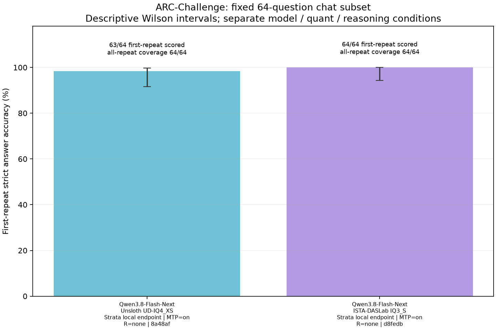
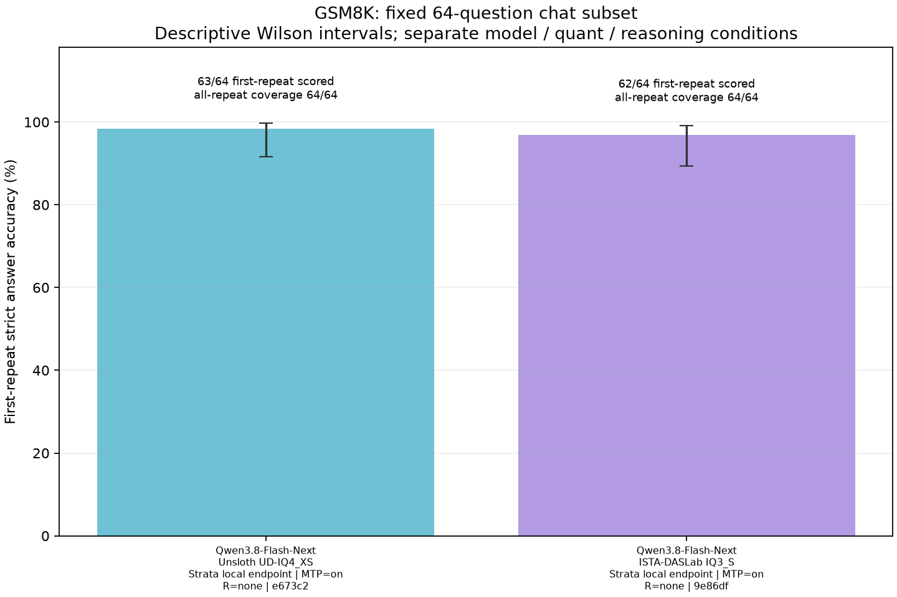
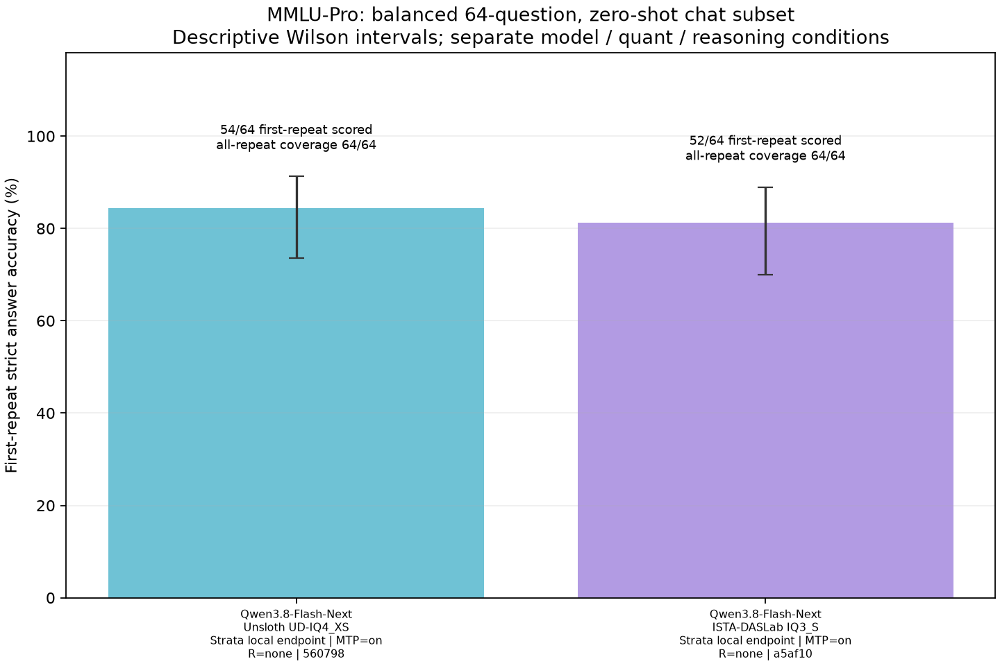

# Flash-Next task accuracy on two RTX 5070 Ti cards

This collection evaluates Qwen3.8-Flash-Next in the original Unsloth
`UD-IQ4_XS` and ISTA-DASLab `IQ3_S` packages on fixed public questions. Each question has one primary
generation, with its prompt, visible answer and deterministic grading retained.
These are **64-question samples**, separate from full-dataset or official
leaderboard results.

| Quantization | Suite | Correct / planned | Graded coverage | Accuracy | First-repeat descriptive 95% interval | Request errors / output limits |
| --- | --- | ---: | ---: | ---: | ---: | ---: |
| Unsloth UD-IQ4_XS | ARC-Challenge, science multiple choice | 63 / 64 | 64 / 64 | 98.4% | 91.7–99.7% | 0 / 0 |
| Unsloth UD-IQ4_XS | GSM8K, math word problems | 63 / 64 | 64 / 64 | 98.4% | 91.7–99.7% | 0 / 0 |
| Unsloth UD-IQ4_XS | MMLU-Pro, 14 subjects | 54 / 64 | 64 / 64 | 84.4% | 73.6–91.3% | 0 / 0 |
| ISTA-DASLab IQ3_S | ARC-Challenge, science multiple choice | 64 / 64 | 64 / 64 | 100.0% | 94.3–100.0% | 0 / 0 |
| ISTA-DASLab IQ3_S | GSM8K, math word problems | 62 / 64 | 64 / 64 | 96.9% | 89.3–99.1% | 0 / 0 |
| ISTA-DASLab IQ3_S | MMLU-Pro, 14 subjects | 52 / 64 | 64 / 64 | 81.2% | 70.0–88.9% | 0 / 0 |

ARC and GSM8K are close to the ceiling; the MMLU-Pro sample produces more
answer-key mismatches. These results establish auditable performance
on the selected questions, with limited ability to resolve small differences
between configurations. Public benchmark questions may have appeared in
training. The interval is a descriptive Wilson approximation over distinct
first-repeat questions, rather than a model-ranking significance test or an
intelligence rating.

The same selected questions, prompts and grading rules are used for both
packages. Pairing individual answers gives the following descriptive comparison:

| Suite | Both correct | Only UD-IQ4_XS correct | Only IQ3_S correct | Both incorrect |
| --- | ---: | ---: | ---: | ---: |
| ARC-Challenge | 63 | 0 | 1 | 0 |
| GSM8K | 62 | 1 | 0 | 1 |
| MMLU-Pro | 51 | 3 | 1 | 9 |

Total scores differ by one or two answers per suite. They do not establish a
general quality ranking or quality equivalence. These are different publisher
packages, including different quantization recipes, rather than an isolated
bit-width experiment. Evaluate their throughput separately using the
[dual-card performance results](two-5070-ti-comparison.md).

## Collection protocol

| Setting | Recorded condition |
| --- | --- |
| Machine | Intel Core i7-5960X, 64 GiB RAM, PNY plus ASUS Prime RTX 5070 Ti, 16 GiB per card, Windows |
| Engine | Native Strata 0.1.52; Strata Control owns model loading |
| Weights | Original [Unsloth UD-IQ4_XS](https://huggingface.co/unsloth/Qwen3.8-Flash-Next-GGUF/tree/766911a6b7369840a91dbcd95f9f997acaab6cd6/UD-IQ4_XS) and [ISTA-DASLab GSQ-RCO IQ3_S](https://huggingface.co/ISTA-DASLab/Qwen3.8-Flash-Next-GSQ-RCO-GGUF/tree/ed59f92082b1e93c0e96d60a8b11aab089b52f09); revisions retained in configuration metadata |
| Context / KV | 65,536 tokens / INT8 |
| Serving | One backend slot; both GPUs available to the native engine |
| Reasoning | Requested `none`; recorded native template control `enable_thinking:false` with a closed think prefix |
| MTP | Configured on, requested four draft tokens; activity observed in native engine logs. Public API configuration keeps requested, reported and unknown effective state separate |
| Expert policy | All selected experts participate; route-tail skipping disabled |
| Sampling | Temperature 0, top-p 1; one generation per selected question |
| Selection | ARC/GSM: 64 SHA-256-ranked IDs per split. MMLU-Pro: four or five questions per each of 14 subjects. Seed 73,129; selection is independent of answers or model results |
| Generation | 32,768-token total ceiling; no client wall-clock deadline; selection seed is not sent as an API generation seed |
| Grading | ARC and MMLU-Pro generated final letter; GSM8K final numeric answer; visible content only |

Native draft-count extracts retain all 193 request summaries per package:
one budget check followed by the 192 capability questions. Each question's
prompt and output counts match the corresponding engine summary in order.

| Package | Offered / accepted drafts | Request summaries | Extract and scope/hash record |
| --- | ---: | ---: | --- |
| UD-IQ4_XS | 108,685 / 77,430 | 193 | [Rows](../results/aggregates/flash-next-quality/ud4-native-draft-full193-rows.txt), [evidence](../results/aggregates/flash-next-quality/ud4-native-draft-full193-evidence.json) |
| IQ3_S | 102,931 / 73,098 | 193 | [Rows](../results/aggregates/flash-next-quality/iq3-native-draft-full193-rows.txt), [evidence](../results/aggregates/flash-next-quality/iq3-native-draft-full193-evidence.json) |

There is no zero-offer request in either extract. MTP is configured on, and
the engine also logs suffix drafting. The totals do not isolate mechanisms
or establish an MTP speed or quality benefit. Internal draft proposals are
not additional inference repeats. The initial
[124-summary UD-IQ4_XS extract](../results/aggregates/flash-next-quality/ud4-native-draft-rows.txt)
and its [scope record](../results/aggregates/flash-next-quality/ud4-native-draft-evidence.json)
remain available separately.

The full source splits contain 1,172 ARC-Challenge, 1,319 GSM8K and 12,032
MMLU-Pro questions. The fixed MMLU-Pro sample has a different subject weighting
from its full test split; it uses all 64 questions in the balanced suite.
These runs use the versioned zero-shot Wattever chat adaptations described in
[capability evaluation](capabilities.md). AI2 ARC-Challenge is a school-science
multiple-choice dataset, distinct from ARC-AGI grid reasoning. MMLU-Pro uses
zero-shot generated letters, separate from its official five-shot CoT protocol.

Background model downloading overlapped accuracy collection. **Do not use these
quality runs for speed or energy comparisons.** Per-question timings and
telemetry remain audit observations. The separate
[dual-card throughput study](two-5070-ti-comparison.md) defines the performance
and energy comparison conditions.

## Inspect the answers

All answers marked incorrect completed naturally, with a valid final output. The UD-IQ4_XS ARC
answer selected fertilization where the source key selects maturation in a
plant-life-cycle question. The GSM8K answer split a dinner bill including its
tip, where the source key assigns the full tip to one payer. The recorded
decisions are answer-key mismatches, rather than truncated output or parser
failures. The source keys remain unchanged.

UD-IQ4_XS MMLU-Pro used 73,772 output tokens across 64 questions. Its longest response,
engineering item `mmlu-pro-test-11438`, used 10,522 tokens and ended naturally;
it was not truncated. The published question has compressed spacing and an
undefined variable `y`. Its recorded final answer disagrees with the source
key. The prompt and key remain unchanged: source ambiguity can limit the
interpretation of an individual answer-key mismatch.

Open **Capabilities** in the helper or hosted application to inspect published
question evidence. The raw files are independently importable:

- UD-IQ4_XS: [ARC64](../results/capabilities/cap-20261104-011521-b0148a48af.json), [GSM64 derived coverage record](../results/capabilities/cap-derived-20261104-ud4-gsm64-21b02ce673c2.json), [MMLU-Pro balanced64](../results/capabilities/cap-20261104-021604-96f2560798.json).
- IQ3_S: [ARC64](../results/capabilities/cap-20261104-031500-dd84d8fedb.json), [GSM64](../results/capabilities/cap-20261104-032720-214f9e86df.json), [MMLU-Pro balanced64](../results/capabilities/cap-20261104-034240-e076a5af10.json).
- [Summary CSV](../results/aggregates/flash-next-quality/summary.csv).

The GSM64 record is the exact union of two disjoint collection segments from
the same loaded engine instance and model configuration: 59 retained answers
and five previously unobserved questions. No question was generated twice.
All 64 answers are re-scored against the original fixed selection. Its
[59-answer source](../results/aggregates/flash-next-quality/ud4-source/cap-20261104-013428-1da798dd1e.json)
retains terminal status `error`; its
[five-answer source](../results/aggregates/flash-next-quality/ud4-source/cap-20261104-021212-1ca9064533.json)
is complete. Input hashes, zero overlap, per-item provenance and separate
telemetry segments are recorded in the derived JSON. Segment references are
paths from the repository root. No joined duration, averaged rate or combined
energy is calculated.

Dataset-specific sources, attribution and licenses are in
[dataset provenance](../corpora/capabilities/README.md). See
[sharing results](sharing-results.md) for audit imports and public contributions.
