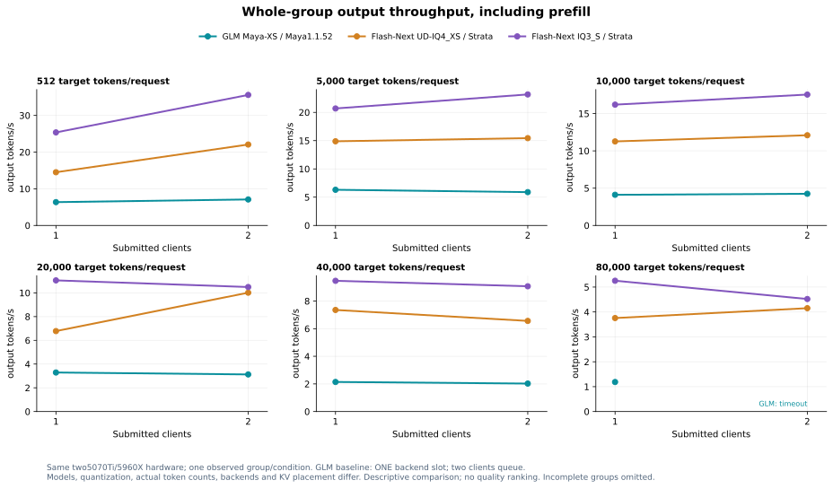

# GLM-5.3-Flash on two RTX 5070 Ti cards

GLM-5.3-Flash runs on the i7-5960X, 64 GiB RAM and two 16 GB RTX 5070 Ti
cards using Project Maya's mixed Maya-XS quantization. The original model shards
and compatibility pack are on the existing 256 GB AirDisk NVMe. Complete verified
SATA backups are retained but are not the inference source. The Samsung 990 Pro
has not been installed or measured in this capture.

These are **preliminary diagnostic results**, separate from the normal machine
benchmark aggregates. The Maya 1.1.52 baseline matrix is complete: **11 successful
cases and one timeout**, across six prompt targets and one/two submitted clients.
There is one measured repeat per condition. The runtime-only update screen is
complete; F32-pack, RAM optimization and model-quality evaluation are pending.

See the [raw snapshots, CSV and manifest](../results/studies/20261106-glm53-flash/README.md).

## First measured results

| Prompt target | Actual input / output tokens | Client prefill | Client decode | First token | Group time | Combined decode GPU power | Peak temperature |
|---|---:|---:|---:|---:|---:|---:|---:|
| 512 | 503 / 238 | 38.18 tok/s | 9.77 tok/s | 13.17 s | 37.44 s | 138.12 W | 54 C |
| 5k | 4,662 / 256 | 243.52 tok/s | 11.90 tok/s | 19.14 s | 40.57 s | 142.24 W | 54 C |
| 10k | 9,321 / 233 | 253.69 tok/s | 11.64 tok/s | 36.74 s | 56.67 s | 142.76 W | 56 C |
| 20k | 17,341 / 256 | 313.39 tok/s | 11.34 tok/s | 55.33 s | 77.82 s | 143.42 W | 66 C |
| 40k | 38,220 / 256 | 391.55 tok/s | 11.66 tok/s | 97.61 s | 119.49 s | 144.25 W | 59 C |
| 80k | 80,259 / 256 | 414.09 tok/s | 11.64 tok/s | 193.82 s | 215.72 s | 147.34 W | 62 C |

The backend reports 38.3/315.4 tok/s prompt evaluation and 9.8/11.4 tok/s
generation respectively. Client prefill is actual input tokens divided by TTFT;
backend prompt evaluation is recorded separately and is not isolated GPU compute.
The first output token is excluded from the client decode interval/count.

MTP is active: the two cases report 209/236 and 212/254 accepted/offered drafts.
Those counters describe observed activity, not a measured MTP-on/off speedup.
Output lengths differ because generation stops naturally, with a 256-token cap.
Target prompt lengths are estimates; comparisons must retain the actual counts.

## Submitted concurrency and serving capacity

The baseline has **one engine slot**. Two clients queue; they do not establish
two simultaneous decoders. The following whole-group rates include prefill and
use the actual output total divided by the common group wall time.

| Target per request | Two-client actual input counts | Completed requests | Group time | Whole-group output |
|---|---:|---:|---:|---:|
| 512 | 561 / 559 | 2/2 | 68.01 s | 7.09 tok/s |
| 5k | 5,236 / 5,235 | 2/2 | 78.93 s | 5.89 tok/s |
| 10k | 10,043 / 10,042 | 2/2 | 118.42 s | 4.25 tok/s |
| 20k | 19,475 / 19,472 | 2/2 | 159.56 s | 3.13 tok/s |
| 40k | 39,278 / 39,281 | 2/2 | 237.37 s | 2.03 tok/s |
| 80k | 80,082 reported for the completed request; second unavailable | 1/2 | 300.01 s, timeout | Unavailable for a complete group |

The second 80k request was cancelled during prefill. This is a configured-deadline
result, not a demonstrated VRAM capacity failure. Partial output is retained in
the raw capture and excluded from successful group throughput/efficiency curves.

Each metric has its own figure:
[client prefill](../results/studies/20261106-glm53-flash/figures/prefill-concurrency.svg),
[client decode](../results/studies/20261106-glm53-flash/figures/decode-concurrency.svg), and
[combined GPU energy](../results/studies/20261106-glm53-flash/figures/energy-concurrency.svg).
Missing or incomplete measurements do not become zeros. Native reference energy
uses verified per-card prefill/decode windows for a single client, and one shared
group window for concurrent requests; low-confidence windows are omitted.

## Comparison with the existing Flash-Next observations

These are single-client observations at the nominal 20k target on the same two-card
hardware setup. They use different models, quantization, backends, KV placement,
effective speculation and prompt/output counts. They are descriptive serving
comparisons, not isolated hardware, quantization or quality comparisons.

| Model / quantization | Backend | Actual input / output | Client prefill | Client decode | First token | Combined decode GPU power |
|---|---|---:|---:|---:|---:|---:|
| GLM-5.3-Flash / Maya-XS mixed IQ1_S + IQ2_XXS + BF16-compat | Project Maya | 17,341 / 256 | 313.39 tok/s | 11.34 tok/s | 55.33 s | 143.42 W |
| Flash-Next / UD-IQ4_XS | Native Strata | 18,927 / 192 | 1,062.01 tok/s | 18.18 tok/s | 17.82 s | 121.65 W |
| Flash-Next / IQ3_S | Native Strata | 18,928 / 226 | 1,089.00 tok/s | 73.26 tok/s | 17.38 s | 168.04 W |

Flash-Next values come from the retained
[paired-case table](../results/aggregates/two-5070-ti-paired-cases.csv) and
[two-card report](two-5070-ti-comparison.md). No historical timings are adjusted.
The initial GLM configuration is slower in both observed phases. Speed does not
establish which model answers tasks better.

## Placement and optimization lead

The GUI requests a **40 GiB global expert RAM tier**, but startup reports only
**20.46 + 7.25 GiB pinned**. The second partition reduces its allocation after a
CUDA pinning refusal. GPU expert pools are approximately 9.59 and 9.61 GiB;
these are not the entire VRAM allocation. Dense weights, KV/state, activation
scratch and staging consume additional VRAM. Reported startup sizes are rounded.

For one observed 8192-token prompt chunk, the first partition reports 3.76 GB of
expert reads from disk and the second 15.03 GB. Their reported chunk wall times
are 5.75 and 17.97 seconds. These are backend copy-path counters, not independent
physical NVMe measurements. The imbalance and disk waits make more balanced
host residency a useful test; a smaller requested RAM tier is not yet a measured
performance improvement. No driver or operating-system changes are involved.

A separate read-only OS capture maps F: to PhysicalDrive1, the AirDisk NVMe.
It records **110.41 GB of physical NVMe reads over 179.16 seconds**, versus
0.034 GB from the SATA system drive. The observation covers part of the final
80k workload and the following idle transition; its mean of 616 MB/s includes
idle time and is not a drive throughput benchmark. It confirms physical storage
activity rather than identifying every backend file-path read as physical I/O.

The physical order is ASUS Prime then PNY, represented by GPU selection `1,0`.
Automatic layer splitting places trunk layers 0–24 on the first logical GPU
and 25–44 on the second, with the MTP head on the second. The fixed context is
98,304 tokens, with one backend request slot. INT8 latent KV is authoritative in
pinned host memory, with a requested 32,768-position VRAM subset. This differs
from the native Flash-Next all-VRAM KV condition.

## Updated-runtime screen

[Maya 1.1.56](https://github.com/mw00/project-maya/releases/tag/v1.1.56), released
on 2026-11-06, addresses a two-GPU GLM drafting regression introduced in 1.1.52.
Its packer also preserves the expert-selection bias in F32. The baseline above
retains the original runtime and pack. The comparison sequence holds the old
pack and RAM settings while changing runtime first, then tests the F32-preserving
pack, then the requested RAM tier. These are distinct conditions.

| Runtime, original pack and RAM40 request | Actual input / output at 20k target | Client prefill | Client decode | First token | Total time |
|---|---:|---:|---:|---:|---:|
| Maya 1.1.52 | 17,341 / 256 | 313.39 tok/s | 11.34 tok/s | 55.33 s | 77.82 s |
| Maya 1.1.56 | 17,342 / 241 | 308.46 tok/s | 10.98 tok/s | 56.22 s | 78.07 s |

The 1.1.56 512-target screen also passed: 502 input / 243 output tokens,
38.48 tok/s client prefill and 9.57 tok/s decode. The observed rates remain
similar. With one repeat, different natural stopping lengths and no quality
evaluation yet, these results do not establish a material speed or quality gain
from the update on this machine. Its documented correctness fixes remain a
separate reason to evaluate the updated runtime.

## Protocol and provenance

The F32-preserving pack on Maya 1.1.56 is recorded separately. At the 20k target
it processed 17,415 input / 256 output tokens at 303.76 tok/s client prefill and
10.72 tok/s decode, with 57.33 s to first token. Preserving selection biases
does not establish a quality improvement without a task evaluation. The
original expert weights and tokenizer are unchanged; 42 selection-bias tensors
retain F32 precision rather than being rounded to BF16.

A 28 GiB requested expert-RAM condition failed during startup with an
out-of-memory error before any measured inference. It contributes no throughput
or efficiency result. A smaller allocation is an independent diagnostic
condition, rather than a retry of an inference observation.

- Model revision: `6728cf78a5b198a6a6f84b7fb88956a17ec56521`; two verified shards total 73,411,389,088 bytes.
- Runtime: Project Maya 1.1.52, revision `3c935e411cd6625a9af0f292dd0af52598e866d8`.
- Vendor-standard compatibility conversion: 849 non-expert tensors rounded to BF16; original GGUF expert bytes remain unchanged. This is a separate treatment from the quantizer's published scores.
- Sampling: temperature 0, top-p 1, seed 73129, natural stopping with maximum 256 output tokens.
- Reasoning: Maya's forced-off closed-think prompt treatment; it is distinct from official GLM LOW reasoning. A separate readiness pilot returned `READY` and stopped normally; that pilot is excluded from speed results.
- A separate eight-token-cap warmup precedes each measured case in this screen and is excluded. The expansion preserves the initial two cases and requests ten missing cases, with zero retries or reruns.
- Timeout: 300 seconds per measured case. Request count is separate from the engine's one backend slot.
- All target experts participate; disk/miss expert skipping is disabled. Background downloads are paused for timed collection.
- The existing Wattever process remains version 2.5.5, build `190ae30841a1b95272a4`. On-disk 2.6.0 sources are captured separately and are not claimed to identify already-imported helper code.
- Per-card and combined power samples are retained. Concurrent energy uses one shared group window, never summed overlapping request windows. GPU board energy is not whole-system wall-meter energy.
- Thermal monitoring cancels only the owned benchmark job at 83 C. CPU package and GPU memory-junction temperatures are unavailable.

For the general metric definitions and concurrency views, see
[Measurements](measurements.md) and [Concurrency comparisons](concurrency.md).
