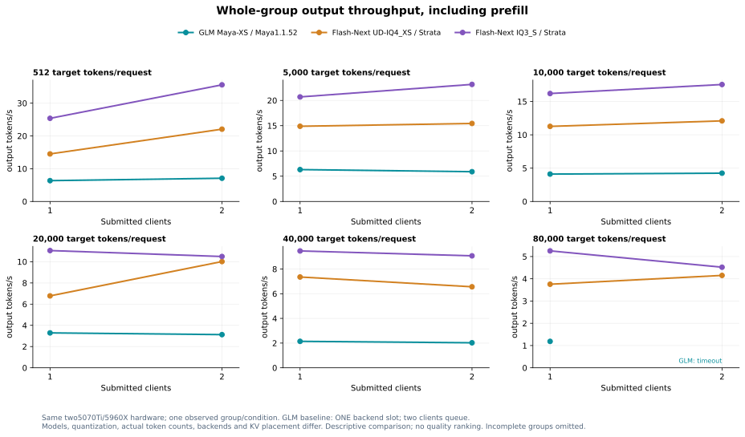
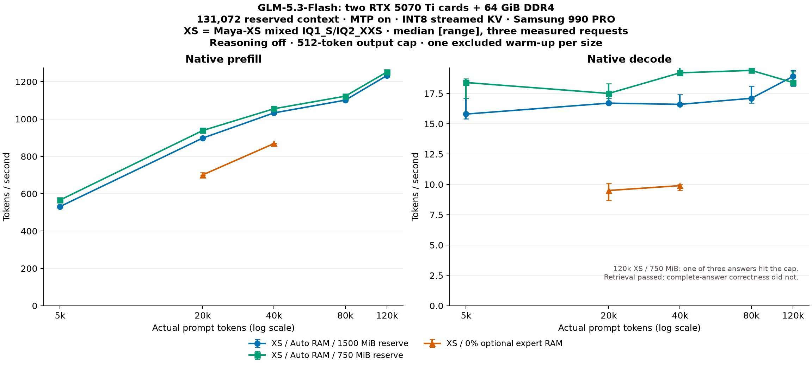

# GLM-5.3-Flash on two RTX 5070 Ti cards

For the 2026-11-14 Samsung 990 PRO experiments, start with the
[completed tuning tables](#driver-aware-ram-planning-and-completed-tuning-results):
native prefill/decode times and speeds, client TTFT/wall, applied RAM, per-GPU
readings, expert fetches, MTP and retrieval grades. They include the three-repeat
131,072-context XS matrix through approximately 120k actual prompt tokens.
The tested model is **GLM-5.3-Flash, 321B total / about 18B active**, using
Maya-XS mixed IQ1_S/IQ2_XXS; the separate full 744B model is outside these tests.
Maya-S24 IQ2_XXS_S is the higher-quant candidate.

The [matched reasoning screen](#matched-local-quality-screen),
[public 5070-class comparisons](#public-5070-class-comparisons) and
[ten upgrade options](local-inference-upgrades.md) are separate from the
historical cohorts below. A loaded model or a successful warm-up is not counted
as a completed three-repeat result.

<!-- quality-wait:start -->
## Four-model quality versus waiting time

Updated 2026-11-14T17:21:28+00:00. **Paused at the user's request; saved attempts and completed downloads are retained.** No overall winner is established.

The primary question is which model supplies correct, complete answers quickly on this machine. The common frozen set has 32 ARC-Challenge, 32 GSM8K and 64 balanced MMLU-Pro questions, plus 16 logical/structured questions and 8 executable coding questions. Public128 and practical24 scores remain separate. Each condition has one attempt per question, a 2,048-token total generation cap, greedy sampling and 32,768 reserved context. Downloads must be complete or freshly acknowledged paused for timed requests.

| Exact candidate | Requested mode | Completed public questions | Public strict correct | Practical progress / correct | Condition status |
|---|---|---:|---:|---|---|
| qwen3.8-flash-next-iq3_s | none | pending | pending | pending | not measured |
| qwen3.8-flash-next-iq3_s | low | pending | pending | pending | not measured |
| qwen3.8-flash-next-unsloth-ud-iq4_xs | none | pending | pending | pending | not measured |
| qwen3.8-flash-next-unsloth-ud-iq4_xs | low | pending | pending | pending | not measured |
| glm-5.3-flash-maya-xs-iq1_s | none | 106/128 | 81 | 8/24 attempted; 6 correct | stopped_after_request |
| glm-5.3-flash-maya-xs-iq1_s | low | 0/128 | pending | 8/24 attempted; 8 correct | functionality_screen_saved |
| glm-5.3-flash-maya-s24-iq2_xxs_s | none | pending | pending | pending | not measured |
| glm-5.3-flash-maya-s24-iq2_xxs_s | low | pending | pending | pending | not measured |

An 8-question screen is functionality evidence only. Its attempts are retained when the rest of the same condition resumes; questions are not silently rerun. Previous XS public128 results collected with a background download are retained below as a separate accuracy cohort and are excluded from controlled answer-time comparisons.

### Saved results at pause

The in-flight request completed and was saved before stopping. The benchmark client exited. Control closed its experimental panel and unloaded the model; the ownership registry is empty and port 8097 is closed. No other model was restored. The guarded experimental profile and exact configuration snapshots remain available for a future explicit resume. No inference or download will restart automatically.

| XS / 2,048 total tokens / 32,768 context | Strict correct | Content correct | Correct completed within 30 / 60 / 120 s | Completed-answer median [range], s | p95, s | Truncated |
|---|---:|---:|---|---|---:|---:|
| none; public128; partial | 81/106 | 91/106 | 80 / 81 / 81 of 106 | 4.45 [1.98-34.82] | 9.62 | 0 |
| none; practical24; partial | 6/8 | 6/8 | 6 / 6 / 6 of 8 | 4.88 [3.37-8.29] | 8.29 | 0 |
| low; practical24; partial | 8/8 | 8/8 | 8 / 8 / 8 of 8 | 5.73 [4.12-8.14] | 8.14 | 0 |

The XS Off public subset is 106/128 questions: ARC32 and GSM32 are complete, MMLU-Pro is 42/64. Strict/content scores are ARC 25/32 and 30/32; GSM 30/32 and 30/32; partial MMLU-Pro 26/42 and 31/42. Ten correct-content public answers failed the strict requested format. These partial results cannot be ranked against the earlier completed Low public128 cohort.

S24 preparation is complete: three independently readback-verified GGUF shards, 94,701,676,224 bytes (88.20 GiB), and the official Maya 1.1.59 BF16-compatible pack with F32 expert-selection bias preserved. It has not been inference-benchmarked. All download/conversion workers have exited; a cooperative download pause marker is retained. No files were discarded.

### Observable timing and reasoning behavior

Record first output of any kind, first visible final-channel text, and terminal completed-answer arrival separately. Visible analysis is not proof that a useful answer has arrived. The 30/60/120-second metric requires a correct completed answer by that deadline; truncated/incomplete responses never count. Slow tails, reasoning/output counts, repetition and category accuracy remain in each per-question record.

Offline Chat/Responses rendering parity passed 12 cases across the pinned frontends and both Qwen templates. Live XS probes confirmed Off produces 0 provider reasoning tokens and Low can produce positive counts. Responses exposes the provider reasoning counter that Chat Completions omits. Greedy sampling is explicit; these Responses implementations do not expose a seed setting, and bitwise hardware determinism is not claimed.

| Family/runtime | Thinking off | Enabled Low | Effective budget difference at 2,048 total tokens |
|---|---|---|---|
| Qwen / Strata server 0.1.53 | enable_thinking=false; template writes an empty thinking block | low prompt instruction | Default answer_room closes thinking near 1,536 tokens to leave answer room; verify active config |
| GLM / Maya 1.1.59 reviewed native variant | enable_thinking=false; frontend closes the template’s thinking prefix | Low effort header | Current thinking_budget=0 allows reasoning to consume the total cap; this is not the same reasoning partition as Qwen |

The common total output budget is identical; the backend closing policies are explicitly different. If truncation limits a conclusion, use a separately labelled complete MMLU-Pro64 cohort at 4,096 tokens rather than replacing individual failed answers.

### Coding-grader review

The functionality screen caught two over-restrictive grader rules. Basic type-name lookup and equivalent ordered Python interval pairs are now accepted. Exact scalar values, explicit list-container contracts, input immutability, memory/time limits and forbidden I/O/import checks remain enforced. Earlier grades and source versions are retained; saved answers were regraded without repeating inference. All candidates use the corrected policy.

### Scope and current storage qualification

GPU inventory/placement and RAM budgets remain Auto. The GLM 750 MiB reserve is a scoped measured tuning candidate, not a production default. Requested configuration, native applied information and actual per-GPU observations are retained separately. Long-context comparisons at approximately 20k/80k/120k will grade retrieval, combining distant evidence, contradictions and missing evidence separately from short reasoning. Expensive S24/190k grids are deferred until quality justifies them.

The existing 500,000-reservation XS probe is saved: 489,998 actual prompt tokens, all five records correct, natural stop, 338 output tokens, 487.04 s wall for one measured request with downloading active. It demonstrates capacity, not a three-repeat throughput result or a practical latency recommendation.

A read-only check found D: is exFAT with 1 MiB allocation units and Windows reports Full Repair Needed. The physical 990 PRO reports Healthy/OK. Detailed reliability/dirty-bit queries were denied. No repair, reformat, partition or OS change was performed. This observation is not proof of an SSD speed bottleneck. S24 checksums, independent readback verification and conversion are complete; inference remains untested.

[Frozen protocol, question-level results and source/grade history](../results/studies/20261114-quality-versus-waiting/README.md). [Upgrade investigation](local-inference-upgrades.md) prioritizes unproven native-Linux feasibility and fully costed used RAM platforms; no extra SSD or expensive GPU is justified by assumption.

<!-- quality-wait:end -->

## Historical AirDisk captures

The 2026-11-06 GLM-5.3-Flash capture uses the i7-5960X, 64 GiB RAM and two
16 GB RTX 5070 Ti cards with Project Maya's mixed Maya-XS quantization. The
original model shards and compatibility pack use the 256 GB AirDisk NVMe.
Verified SATA backups are outside that inference path. These historical
captures use the AirDisk; the 2026-11-14 GLM and Flash memory studies use the
Samsung 990 PRO and remain separate cohorts.

These are **preliminary results**. The historical Maya 1.1.52 baseline cohort is
consolidated into the existing dual-5070 machine entry; tuning screens remain
separate diagnostic studies. The baseline matrix has **11 successful
cases and one timeout**, across six prompt targets and one/two submitted clients.
There is one measured repeat per condition. The runtime-only update screen is
complete, as are the runtime, F32-pack, RAM, two-slot and read-chunk screens.
That historical cohort contains no model-quality evaluation or full matrix for
the selected updated-runtime profile. The separate
[2026-11-14 Samsung 990 Pro baseline](#samsung-990-pro-glm-baseline-2026-11-14)
adds three-repeat native/client timing tables and a sixteen-task quality screen.

See the [raw snapshots, CSV and manifest](../results/studies/20261106-glm53-flash/README.md).

## First measured results

| Prompt target | Actual input / output tokens | Client prefill | Client decode | First token | Group time | Combined decode GPU power | Peak temperature |
|---|---:|---:|---:|---:|---:|---:|---:|
| 512 | 503 / 238 | 38.18 tok/s | 9.77 tok/s | 13.17 s | 37.44 s | 138.12 W | 54 C |
| 5k | 4,662 / 256 | 243.52 tok/s | 11.90 tok/s | 19.14 s | 40.57 s | 142.24 W | 54 C |
| 10k | 9,321 / 233 | 253.69 tok/s | 11.64 tok/s | 36.74 s | 56.67 s | 142.76 W | 56 C |
| 20k | 17,341 / 256 | 313.39 tok/s | 11.34 tok/s | 55.33 s | 77.82 s | 143.42 W | 66 C |
| 40k | 38,220 / 256 | 391.55 tok/s | 11.66 tok/s | 97.61 s | 119.49 s | 144.25 W | 59 C |
| 80k | 80,259 / 256 | 414.09 tok/s | 11.64 tok/s | 193.82 s | 215.72 s | 147.34 W | 62 C |

For the initial 512/20k screen, the backend reports 38.3/315.4 tok/s prompt
evaluation and 9.8/11.4 tok/s generation respectively. Client prefill is actual input tokens divided by TTFT;
backend prompt evaluation is recorded separately and is not isolated GPU compute.
The first output token is excluded from the client decode interval/count.

MTP is active: the two cases report 209/236 and 212/254 accepted/offered drafts.
Those counters describe observed activity, not a measured MTP-on/off speedup.
Output lengths differ because generation stops naturally, with a 256-token cap.
Target prompt lengths are estimates; comparisons must retain the actual counts.

## Submitted concurrency and serving capacity

The baseline has **one engine slot**. Two clients queue; they do not establish
two simultaneous decoders. The following whole-group rates include prefill and
use the actual output total divided by the common group wall time.

| Target per request | Two-client actual input counts | Completed requests | Group time | Whole-group output |
|---|---:|---:|---:|---:|
| 512 | 561 / 559 | 2/2 | 68.01 s | 7.09 tok/s |
| 5k | 5,236 / 5,235 | 2/2 | 78.93 s | 5.89 tok/s |
| 10k | 10,043 / 10,042 | 2/2 | 118.42 s | 4.25 tok/s |
| 20k | 19,475 / 19,472 | 2/2 | 159.56 s | 3.13 tok/s |
| 40k | 39,278 / 39,281 | 2/2 | 237.37 s | 2.03 tok/s |
| 80k | 80,082 reported for the completed request; second unavailable | 1/2 | 300.01 s, timeout | Unavailable for a complete group |

A separate Maya 1.1.56/F32-pack screen enables **two real engine slots**, with
RAM26 requested. Backend activity confirms two admitted requests and no waiting
HTTP request; engine output records interleaved generation. Default multi-request
decode does not speculate while both requests are active, although solo tails can
use the loaded MTP head. This serving mode is distinct from the baseline.

| Two-slot target | Actual input counts | Actual output counts | Group time | Whole-group output | Peak GPU temperature |
|---|---:|---:|---:|---:|---:|
| 512 | 501 / 501 | 256 / 248 | 163.53 s | 3.08 tok/s | 58 C |
| 20k | 17,204 / 17,203 | 219 / 256 | 197.77 s | 2.40 tok/s | 63 C |

Both cases completed, but extra slots alone did not improve the observed group
rate. Runtime, pack, host allocation and actual counts also differ from the
one-slot baseline, so this is not a pure slot-count ablation. The short group's
combined GPU energy was 37.66 J per output token, including prefill. The 20k
group's power capture was flagged incomplete; it has no reported combined energy
or energy-per-token result. Per-request draft deltas can include activity from
another request and do not by themselves prove concurrent MTP.

An explicit concurrent-MTP screen retains RAM26/two slots and enables
`MAYA_GLM_SPLIT_ROWS=1`, `MAYA_GLM_EVEN_GROUPS=1` and
`MAYA_GLM_MULTI_MTP=1`. Both 501-token inputs completed, producing 254 and 232
tokens in 186.10 s: **2.61 tok/s whole-group output**, versus 3.08 for stock
two-slot decode. Request-specific engine events verify 105/125 and 106/124
accepted drafts, with 126/125 verification steps. This confirms active concurrent
MTP, rather than inferring it from a loaded head. Peak temperature was 58 C.
Its additional row/window buffers also reduce expert pools from 9.13/9.21 to
9.02/9.05 GiB. The observed screen does not support enabling this mode for speed;
the 20k extension was not attempted.

The second 80k request was cancelled during prefill. This is a configured-deadline
result, not a demonstrated VRAM capacity failure. Partial output is retained in
the raw capture and excluded from successful group throughput/efficiency curves.

Each metric has its own figure:
[client prefill](../results/studies/20261106-glm53-flash/figures/prefill-concurrency.svg),
[client decode](../results/studies/20261106-glm53-flash/figures/decode-concurrency.svg), and
[combined GPU energy](../results/studies/20261106-glm53-flash/figures/energy-concurrency.svg).
Missing or incomplete measurements do not become zeros. Native reference energy
uses verified per-card prefill/decode windows for a single client, and one shared
group window for concurrent requests; low-confidence windows are omitted.

## Comparison with the existing Flash-Next observations

These are single-client observations at the nominal 20k target on the same two-card
hardware setup. They use different models, quantization, backends, KV placement,
effective speculation and prompt/output counts. They are descriptive serving
comparisons, not isolated hardware, quantization or quality comparisons.

| Model / quantization | Backend | Actual input / output | Client prefill | Client decode | First token | Combined decode GPU power |
|---|---|---:|---:|---:|---:|---:|
| GLM-5.3-Flash / Maya-XS mixed IQ1_S + IQ2_XXS + BF16-compat | Project Maya | 17,341 / 256 | 313.39 tok/s | 11.34 tok/s | 55.33 s | 143.42 W |
| Flash-Next / UD-IQ4_XS | Native Strata | 18,927 / 192 | 1,062.01 tok/s | 18.18 tok/s | 17.82 s | 121.65 W |
| Flash-Next / IQ3_S | Native Strata | 18,928 / 226 | 1,089.00 tok/s | 73.26 tok/s | 17.38 s | 168.04 W |

Flash-Next values come from the retained
[paired-case table](../results/aggregates/two-5070-ti-paired-cases.csv) and
[two-card report](two-5070-ti-comparison.md). No historical timings are adjusted.
The initial GLM configuration is slower in both observed phases. Speed does not
establish which model answers tasks better.

The separate [2026-11-14 Flash expert-RAM comparison](two-5070-ti-comparison.md#flash-next-expert-ram-controls-2026-11-14)
adds the complete three-repeat Auto-versus-0% timing table at a 40,960-token
reservation, plus the separate 131,072-token RAM-allowance screen. Its native
prefill/decode timings, client TTFT/wall and physical disk observations are
reported separately. It uses the Samsung 990 Pro and Strata 0.1.53, so it is not
a matched repeat of the GLM or Flash rows above. In particular, 0% expert RAM
budget still permits Windows file caching; it is not uncached NVMe execution.
No updated GLM result is implied by those Flash measurements.

## Placement and optimization lead

The GUI requests a **40 GiB global expert RAM tier**, but startup reports only
**20.46 + 7.25 GiB pinned**. The second partition reduces its allocation after a
CUDA pinning refusal. GPU expert pools are approximately 9.59 and 9.61 GiB;
these are not the entire VRAM allocation. Dense weights, KV/state, activation
scratch and staging consume additional VRAM. Reported startup sizes are rounded.

For one observed 8192-token prompt chunk, the first partition reports 3.76 GB of
expert reads from disk and the second 15.03 GB. Their reported chunk wall times
are 5.75 and 17.97 seconds. These are backend copy-path counters, not independent
physical NVMe measurements. The imbalance and disk waits make more balanced
host residency a useful test; a smaller requested RAM tier is not yet a measured
performance improvement. No driver or operating-system changes are involved.

A separate read-only OS capture maps F: to PhysicalDrive1, the AirDisk NVMe.
It records **110.41 GB of physical NVMe reads over 179.16 seconds**, versus
0.034 GB from the SATA system drive. The observation covers part of the final
80k workload and the following idle transition; its mean of 616 MB/s includes
idle time and is not a drive throughput benchmark. It confirms physical storage
activity rather than identifying every backend file-path read as physical I/O.

The physical order is ASUS Prime then PNY, represented by GPU selection `1,0`.
Automatic layer splitting places trunk layers 0-24 on the first logical GPU
and 25-44 on the second, with the MTP head on the second. The fixed context is
98,304 tokens, with one backend request slot. INT8 latent KV is authoritative in
pinned host memory, with a requested 32,768-position VRAM subset. This differs
from the native Flash-Next all-VRAM KV condition.

## Updated-runtime screen

[Maya 1.1.56](https://github.com/mw00/project-maya/releases/tag/v1.1.56), released
on 2026-11-06, addresses a two-GPU GLM drafting regression introduced in 1.1.52.
Its packer also preserves the expert-selection bias in F32. The baseline above
retains the original runtime and pack. The comparison sequence holds the old
pack and RAM settings while changing runtime first, then tests the F32-preserving
pack, then the requested RAM tier. These are distinct conditions.

| Runtime, original pack and RAM40 request | Actual input / output at 20k target | Client prefill | Client decode | First token | Total time |
|---|---:|---:|---:|---:|---:|
| Maya 1.1.52 | 17,341 / 256 | 313.39 tok/s | 11.34 tok/s | 55.33 s | 77.82 s |
| Maya 1.1.56 | 17,342 / 241 | 308.46 tok/s | 10.98 tok/s | 56.22 s | 78.07 s |

The 1.1.56 512-target screen also passed: 502 input / 243 output tokens,
38.48 tok/s client prefill and 9.57 tok/s decode. The observed rates remain
similar. With one repeat, different natural stopping lengths and no quality
evaluation yet, these results do not establish a material speed or quality gain
from the update on this machine. Its documented correctness fixes remain a
separate reason to evaluate the updated runtime.

## Protocol and provenance

The F32-preserving pack on Maya 1.1.56 is recorded separately. At the 20k target
it processed 17,415 input / 256 output tokens at 303.76 tok/s client prefill and
10.72 tok/s decode, with 57.33 s to first token. Preserving selection biases
does not establish a quality improvement without a task evaluation. The
original expert weights and tokenizer are unchanged; 42 selection-bias tensors
retain F32 precision rather than being rounded to BF16.

A 28 GiB requested expert-RAM condition failed during startup with an
out-of-memory error before any measured inference. It contributes no throughput
or efficiency result. A 26 GiB request successfully pinned 13.29 + 12.70 GiB,
compared with 20.46 + 7.25 GiB for the 40 GiB request. Both smaller-budget cases
completed, but their observed speeds were lower:

| Maya 1.1.56, F32-preserving pack | Target | Actual input / output | Client prefill | Client decode | Combined GPU energy / output token, including prefill |
|---|---:|---:|---:|---:|---:|
| RAM40 requested | 512 | 501 / 240 | 37.56 tok/s | 9.10 tok/s | 19.27 J |
| RAM26 requested | 512 | 503 / 254 | 34.46 tok/s | 7.67 tok/s | 21.86 J |
| RAM40 requested | 20k | 17,415 / 256 | 303.76 tok/s | 10.72 tok/s | 40.52 J |
| RAM26 requested | 20k | 17,344 / 256 | 274.47 tok/s | 9.57 tok/s | 44.78 J |

Balanced host bytes are not equivalent to balanced expert hit rates. The smaller
request also reduces total pinned capacity by approximately 1.72 GiB. These are
one-observation screens with different nonce text and natural output lengths;
they do not isolate the contribution of each cache effect. No memory allocation
that failed at startup is presented as an inference observation.

## Selected storage-read screen

With Maya 1.1.56, the F32-preserving pack, one slot and RAM40 requested,
`MAYA_GLM_READ_CHUNKS=4` changes expert-read scheduling from the default eight
pieces. Original experts, reasoning treatment and expert participation remain
unchanged. The actual pinned parts remain 20.46 + 7.25 GiB.

| Target | Actual input / output | Client prefill | Client decode | First token | Combined GPU energy / output token, including prefill |
|---|---:|---:|---:|---:|---:|
| 512 | 501 / 244 | 38.28 tok/s | 9.63 tok/s | 13.09 s | 18.15 J |
| 20k | 17,414 / 256 | 317.39 tok/s | 11.11 tok/s | 54.87 s | 38.95 J |

The corresponding eight-piece F32 screen records 37.56/303.76 tok/s prefill and
9.10/10.72 tok/s decode. Four pieces are the selected candidate for follow-up:
observed decode gains are approximately 6%/4%, with lower whole-case GPU energy
per output token. One observation per condition does not establish a repeatable
effect or a global optimum. The updated-profile full matrix and all capability
scores remain unmeasured; the six-context matrix above belongs to the original
1.1.52 compatibility profile. A future capability comparison is prepared with the
same 192 frozen ARC/GSM8K/MMLU-Pro tasks, 32,768-token output budget and no
per-request deadline as the retained Flash-Next references.

Reproduce the selected condition by preparing the pinned F32 pack using
[`pack-preparation.json`](../results/studies/20261106-glm53-flash/pack-preparation.json),
setting the read-chunk environment option in its model configuration, then
loading it through Strata Control: context 98,304, GPU order `1,0`, one request
slot, INT8 KV, RAM + VRAM KV placement, RAM40 requested, reasoning None and MTP
head enabled. The captured JSON retains exact active settings, software revisions,
request configuration, token counts and telemetry. Strata Control owns model
starts; its gateway can load a prepared model selected by a chat client. The
historical GLM captures above use an explicitly loaded Control session.
The NVMe has approximately 60 GiB free, so no model relocation was needed. Storage
temperature counters were unavailable to this process; GPU memory-junction and
CPU package temperature also remain unavailable.

- Model revision: `6728cf78a5b198a6a6f84b7fb88956a17ec56521`; two verified shards total 73,411,389,088 bytes.
- Runtime: Project Maya 1.1.52, revision `3c935e411cd6625a9af0f292dd0af52598e866d8`.
- Vendor-standard compatibility conversion: 849 non-expert tensors rounded to BF16; original GGUF expert bytes remain unchanged. This is a separate treatment from the quantizer's published scores.
- Sampling: temperature 0, top-p 1, seed 73129, natural stopping with maximum 256 output tokens.
- Reasoning: Maya's forced-off closed-think prompt treatment; it is distinct from official GLM LOW reasoning. A separate readiness pilot returned `READY` and stopped normally; that pilot is excluded from speed results.
- A separate eight-token-cap warmup precedes each measured case in this screen and is excluded. The expansion preserves the initial two cases and requests ten missing cases, with zero retries or reruns.
- Timeout: 300 seconds per measured case. Request count is separate from the engine's one backend slot.
- All target experts participate; disk/miss expert skipping is disabled. Background downloads are paused for timed collection.
- The existing Wattever process remains version 2.5.5, build `190ae30841a1b95272a4`. On-disk 2.6.0 sources are captured separately and are not claimed to identify already-imported helper code.
- Per-card and combined power samples are retained. Concurrent energy uses one shared group window, never summed overlapping request windows. GPU board energy is not whole-system wall-meter energy.
- Thermal monitoring cancels only the owned benchmark job at 83 C. CPU package and GPU memory-junction temperatures are unavailable.

## Samsung 990 Pro GLM baseline: 2026-11-14

**Preliminary optimization study.** The completed baseline below is a new,
separate cohort on the i7-5960X, 64 GiB RAM, two RTX 5070 Ti cards and Samsung
990 Pro model storage. It does not add repeats to the AirDisk cohort above.
There are **nine measured single-client requests**, three each at nominal 512,
5k and 20k prompt targets. Later runtime, allocation and I/O experiments require
their own results; no performance improvement from an unmeasured candidate is
claimed here.

The model is the same Maya-XS IQ1_S + IQ2_XXS + BF16 compatibility package with
F32 expert-selection biases. The runtime is Maya **1.1.56**, revision
`22fc101f2c109b7e7174c975ff3c2d8e9ce0a867`. Strata Control loads context 98,304,
one serving slot, GPU order `1,0`, automatic layer splitting, INT8 host-streamed
KV with 32,768 requested VRAM positions, MTP enabled, automatic prefill/expert
cache, four read chunks and 1,024 MiB pinning pieces. All target experts
participate; disk/miss skipping remains disabled.

The global expert RAM request is 40 GiB with 12 GiB headroom. Initial engine
status reports **27.7 native-reported GB of RAM expert storage** and 19.2 GB of
GPU expert pools. Those expert-pool figures are distinct from total host RAM or
VRAM allocation. Its expert RAM request is not proof that all 40 GiB were
successfully pinned. Windows available RAM includes reclaimable standby/file
cache, so the available-memory readings below do not measure empty physical RAM
or guarantee that another large pinned allocation will succeed.

### Complete baseline timing table

Cells are **median [minimum-maximum] of three requests**. One distinct warmup
per prompt target is excluded from these statistics. Prompt text is frozen,
SHA-256 checked and sized using the package's official tokenizer and rendered
chat template. Sampling is temperature 0, top-p 1, seed 20261114, reasoning none
and a 128-token output cap; natural stopping can produce fewer output tokens.
There is no substantial prefix reuse: all measured cached-token counts are zero.
All **45/45 measured BENCH_LEDGER records** are returned correctly, five per
request. This retrieval check does not establish general reasoning correctness.

| Prompt target | n | Actual prompt tk | Actual output tk | Cached tk | Native prefill time (s) | Native prefill tk/s | Native decode time (s) | Native decode tk/s | Client TTFT (s) | Client wall time (s) |
|---|---:|---:|---:|---:|---:|---:|---:|---:|---:|---:|
| 512 | 3 | 512 [511-512] | 128 [120-128] | 0 | 6.321 [6.291-6.348] | 81.0 [80.6-81.2] | 8.056 [7.506-8.139] | 15.9 [15.7-16.0] | 6.347 [6.332-6.688] | 14.389 [13.855-14.829] |
| 5k | 3 | 5,001 [5,001-5,001] | 128 [128-128] | 0 | 9.322 [9.299-9.377] | 536.5 [533.3-537.8] | 8.610 [8.432-9.039] | 14.9 [14.2-15.2] | 9.600 [9.411-9.605] | 18.034 [18.022-18.646] |
| 20k | 3 | 20,002 [20,000-20,003] | 128 [128-128] | 0 | 25.914 [25.818-25.952] | 771.9 [770.8-774.7] | 8.860 [8.373-8.929] | 14.4 [14.3-15.3] | 26.246 [26.192-26.262] | 35.108 [34.566-35.193] |

Native timings/rates are the completed request's provider-reported engine
counters. Client TTFT measures dispatch to first observed output; client wall
measures dispatch to completed stream. These direct Maya API measurements do
not include model loading, and are distinct from Control gateway E2E timing.
Column medians can belong to different requests and need not add. Native decode
rates retain the provider's generated-token convention, which can differ from
the client's visible-output convention.

### Memory, disk and GPU observations

Peaks/minima below cover the three measured requests at each target. Physical
D: reads and combined average GPU power use median [minimum-maximum] per
request. GPU indices are physical sensor indices; the engine's logical order is
`1,0`. Power covers each entire request, including prefill, and is board power
rather than a wall-meter whole-system reading.

| Target | Peak physical RAM | Minimum available RAM (GiB) | Physical D: reads (GiB/request) | GPU0 / GPU1 peak VRAM (MiB) | Combined request-average GPU power (W) | GPU0 / GPU1 peak temperature (C) |
|---|---:|---:|---:|---:|---:|---:|
| 512 | 64.44% | 22.797 | 24.907 [23.745-26.644] | 14,804 / 13,832 | 130.94 [130.56-131.18] | 55 / 42 |
| 5k | 64.40% | 22.775 | 31.635 [31.172-33.599] | 14,861 / 13,832 | 151.98 [151.23-153.15] | 60 / 47 |
| 20k | 64.31% | 22.820 | 71.425 [70.311-72.477] | 14,689 / 13,832 | 177.47 [176.44-177.82] | 61 / 49 |

D: physical-drive read counters are systemwide, not per-process attribution.
They are separate from the engine's logical disk fetch counters. No global
cache purge is performed, so these are warm serving observations rather than a
drive bandwidth benchmark. Whether an engine file-read path bypasses the OS
cache is a separate runtime condition; available-memory counters alone do not
establish it. No measured request records page-outs in the
sampled global counter; mmap page-ins and process faults alone do not establish
pagefile thrashing.

The decoder's per-request statistics and observed MTP acceptance are:

| Target | MTP drafts accepted (%) | Decode GPU expert hit (%) | Logical disk reads / output tk | Logical disk wait time (ms/output tk) |
|---|---:|---:|---:|---:|
| 512 | 88.98 [88.89-92.06] | 69.39 [68.89-69.46] | 17.42 [16.87-19.38] | 31.37 [30.46-35.43] |
| 5k | 89.68 [88.10-91.27] | 69.14 [68.87-69.36] | 19.84 [19.44-22.58] | 36.06 [34.70-40.60] |
| 20k | 85.71 [84.13-92.06] | 69.82 [69.25-71.81] | 20.84 [18.36-22.14] | 38.14 [33.54-39.75] |

Observed drafts verify active MTP, not an isolated MTP-on/off speedup. Logical
fetch/wait counters describe the engine's expert path and do not directly measure
physical NVMe I/O. Both GPUs retain expert pools and record work; installed card
count alone is not the placement evidence.

### Functional and quality scope

The explicit preliminary functional screen passes multiplication and ascending
sorting, then returns **40 instead of 30** for
`print(sum(i*i for i in range(5)))`: **2/3 checks pass**. An earlier sorting
prompt omitted the requested ordering and is excluded from this correctness
count; that response does not establish a model bug. These checks are separate
from the nine-request speed cohort, whose complete marker retrievals all pass.

The separate **sixteen-task exact-answer screen scores 8/16** with reasoning
none and a 512-token cap, one attempt per task. It uses explicit JSON response
shapes and locally generated expected answers; model-produced code is never
executed. Arithmetic passes 0/2, Python state 2/4, formal constraints 2/3, JSON
tool arguments 2/2, data transformations 1/3 and state tracking 1/2. No failure
is classified as an otherwise-correct single result/answer/output wrapper.
One nested-loop response exhausts the 512-token cap, and another failed task
returns non-JSON text. The remaining failures include incorrect exact answers;
this count is not sixteen independent estimates of general reasoning ability.

The quality screen's short-task native rate medians are 26.0 tk/s prefill and
17.0 tk/s decode. These are task-mix summaries, separate from the fixed-length
speed table. The diagnostic score must not be pooled with speed/retrieval checks
or presented as a comprehensive capability evaluation. Reasoning-enabled,
updated-runtime and S24 candidate scores require separate completed captures.

[Saved raw measurements, request logs and checksum manifest](../results/studies/20261114-glm53-optimization/README.md)
retain exact configuration, tokenizer hashes, outputs, timing provenance and
telemetry. The [Flash memory-control comparison](two-5070-ti-comparison.md#flash-next-expert-ram-controls-2026-11-14)
uses different prompts, model/quantization and cache/KV conditions. The historical
AirDisk baseline also differs in runtime, actual counts, sampling and output
budget; neither is a controlled storage-only speedup comparison.

## Matched buffered-I/O screen: Maya 1.1.59

This preliminary pair uses the **same locally patched native binary** for both
conditions: SHA-256
`ff3256f8f7dbaa06d163cc8b794609fec28641f38f4bfd5b727103019807076c`.
Its upstream parent is Maya 1.1.59 commit
`027992cb1f09829488e650e466233ca351d3d6ef`, with an opt-in buffered-file-I/O
patch. Buffered I/O off retains the normal direct-read path; on allows Windows
file caching. These are measurements of that declared patched build, not an
unmodified upstream binary. The [source/build receipt and patch](../results/studies/20261114-glm53-optimization/software-provenance/v1.1.59-buffered-io.json)
retain their hashes and build identity.

Both conditions use the same frozen user prompt bytes, tokenizer, effective
runtime chat template, sampling, 98,304-token context, one slot, INT8 streamed
KV, MTP, 1,024 MiB pinning pieces, four read chunks and fixed trunk split at
layer 25. The global expert RAM request is **26 GiB**, with startup allocations
of **13.29 + 12.70 GiB** (25.99 GiB total). Attempts to start this runtime with
40 GiB requested fail during CUDA table upload and contribute no inference
throughput. The 26 GiB configurations complete the measured cohorts; that is
not a certification of every larger or longer workload.

This screen cannot isolate an upstream runtime gain against the earlier
1.1.56/40 GiB-request baseline: that capture has a different template/runtime,
27.71 GiB actual expert RAM and automatic layer splitting. Within this pair,
automatic startup probes also produce slightly different GPU slot counts
(3,779 versus 3,777) and PCIe-share estimates (0.75 versus 0.69). These recorded
load-to-load differences remain part of the observed serving configurations.

### Full timing table

Each cell is **median [minimum-maximum] of three requests**. One excluded
warmup per target precedes measurement in each condition. Sampling remains
temperature 0, top-p 1, seed 20261114, reasoning none and a 128-token output cap.
Paired prompt bytes and actual input counts match by target/repeat, and all
cached-token counts are zero. Both conditions return **45/45 ledger records**
correctly across their nine measured requests. Natural stopping lengths at 512
can differ; actual output counts are retained below.

| Buffered I/O | Target | n | Actual prompt tk | Actual output tk | Cached tk | Native prefill time (s) | Native prefill tk/s | Native decode time (s) | Native decode tk/s | Client TTFT (s) | Client wall time (s) |
|---|---:|---:|---:|---:|---:|---:|---:|---:|---:|---:|---:|
| Off | 512 | 3 | 512 [511-512] | 128 [118-128] | 0 | 5.525 [5.441-5.673] | 92.7 [90.3-93.9] | 7.440 [7.347-7.923] | 16.2 [16.1-17.2] | 5.565 [5.459-5.962] | 12.913 [12.901-13.887] |
| Off | 5k | 3 | 5,001 [5,001-5,001] | 128 [128-128] | 0 | 8.456 [8.309-8.544] | 591.4 [585.3-601.9] | 8.089 [7.614-8.268] | 15.8 [15.5-16.8] | 8.530 [8.480-8.863] | 16.621 [16.478-16.749] |
| Off | 20k | 3 | 20,002 [20,000-20,003] | 128 [128-128] | 0 | 24.517 [24.457-24.742] | 815.8 [808.5-817.8] | 7.882 [7.736-8.016] | 16.2 [16.0-16.5] | 24.898 [24.846-25.025] | 32.781 [32.763-32.863] |
| On | 512 | 3 | 512 [511-512] | 126 [119-128] | 0 | 4.430 [4.296-5.070] | 115.6 [101.0-119.0] | 7.258 [6.973-7.298] | 17.4 [17.1-17.5] | 4.461 [4.317-5.424] | 11.617 [11.435-12.684] |
| On | 5k | 3 | 5,001 [5,001-5,001] | 128 [128-128] | 0 | 9.683 [8.211-9.770] | 516.5 [511.9-609.1] | 7.383 [7.149-7.989] | 17.3 [16.0-17.9] | 9.936 [8.255-10.056] | 17.207 [15.640-17.926] |
| On | 20k | 3 | 20,002 [20,000-20,003] | 128 [128-128] | 0 | 22.101 [22.093-22.378] | 904.9 [893.9-905.4] | 7.658 [7.465-7.684] | 16.7 [16.7-17.1] | 22.514 [22.446-22.643] | 30.200 [29.913-30.302] |

Buffered I/O on improves median 20k native prefill from 815.8 to 904.9 tk/s and
decode from 16.2 to 16.7 tk/s. At 5k it **reduces** median prefill from 591.4 to
516.5 tk/s while improving decode from 15.8 to 17.3 tk/s. Its 5k client wall
median is correspondingly higher. The short condition also improves, but this
is not a universal speed gain. Three repeats, overlapping ranges, automatic
probes and unpurged filesystem caches limit causal and statistical conclusions.
Native phases, direct-client TTFT and completed-stream wall retain the timing
boundaries defined above; per-column medians need not add.

### Physical reads and reclaimable OS cache

Physical-read cells are median [minimum-maximum] per request. RAM/RSS values
are sampled peaks/minima across the three-request group. Cache columns show
sampled minimum-maximum across requests, not confidence intervals. System cache
resident bytes and normal-priority standby bytes are separate Windows counters;
standby is reclaimable and contributes to available RAM. These columns must not
be added as a complete non-overlapping RAM accounting.

| Buffered I/O | Target | Physical D: reads (GiB/request) | Peak physical RAM used | Minimum available RAM (GiB) | Peak Maya RSS (GiB) | Resident system cache range (GiB) | Normal standby cache range (GiB) |
|---|---:|---:|---:|---:|---:|---:|---:|
| Off | 512 | 22.347 [22.279-25.374] | 61.62% | 24.555 | 32.827 | 0.151-0.165 | 10.408-10.601 |
| Off | 5k | 31.529 [30.162-32.338] | 61.75% | 24.468 | 32.764 | 0.151-0.153 | 10.534-10.957 |
| Off | 20k | 74.885 [73.772-75.543] | 61.51% | 24.608 | 32.827 | 0.151-0.155 | 11.053-11.743 |
| On | 512 | 5.763 [4.727-8.509] | 70.55% | 18.898 | 32.824 | 4.326-6.217 | 18.692-20.500 |
| On | 5k | 19.452 [13.397-21.204] | 70.50% | 18.884 | 32.761 | 2.875-6.253 | 18.663-22.056 |
| On | 20k | 20.308 [19.683-20.665] | 70.70% | 18.729 | 32.824 | 2.894-6.159 | 18.500-21.987 |

The on condition lowers median physical D: reads at 20k from 74.885 to
20.308 GiB/request while retaining substantial physical reads. Resident system
cache grows to several GiB and normal standby reaches roughly 22 GiB.
Available RAM therefore does not describe empty physical memory, and buffered
I/O is not equivalent to all experts fitting in explicit pinned RAM. D: counters
are device-wide, including other reads. No global cache purge is performed.
No measured request in either condition records page-outs in the sampled global
counter; this does not attribute all faults or disk activity to the model.

### Per-GPU observations

VRAM and temperatures below are sampled group maxima. Utilization and power
are medians of the three whole-request averages; they include prefill. Values
are GPU0 / GPU1 in physical sensor order, while engine logical order is `1,0`.
MTP acceptance is median [minimum-maximum] of per-request draft counters.

| Buffered I/O | Target | GPU0 / GPU1 peak VRAM (MiB) | GPU0 / GPU1 average utilization (%) | GPU0 / GPU1 board power (W) | GPU0 / GPU1 peak temperature (C) | MTP drafts accepted (%) |
|---|---:|---:|---:|---:|---:|---:|
| Off | 512 | 14,645 / 13,834 | 57.9 / 66.5 | 68.97 / 65.76 | 55 / 47 | 89.68 [85.34-91.27] |
| Off | 5k | 14,690 / 13,834 | 58.9 / 67.8 | 80.32 / 78.14 | 59 / 50 | 89.68 [88.89-89.68] |
| Off | 20k | 14,747 / 13,834 | 52.5 / 59.6 | 91.99 / 93.59 | 62 / 50 | 88.89 [85.71-94.44] |
| On | 512 | 14,784 / 13,834 | 60.4 / 72.8 | 71.34 / 68.57 | 53 / 43 | 88.03 [87.30-89.52] |
| On | 5k | 14,833 / 13,834 | 52.9 / 64.7 | 76.97 / 74.95 | 60 / 47 | 90.48 [88.89-92.06] |
| On | 20k | 14,709 / 13,834 | 57.8 / 66.4 | 94.96 / 98.32 | 61 / 49 | 84.92 [82.54-92.06] |

These observations verify work and expert storage on both cards; they do not
establish a universal multi-GPU scaling factor or an isolated MTP speedup.
[Raw paired captures, request logs, cache/paging samples and grouped summary](../results/studies/20261114-glm53-optimization/README.md)
preserve the exact rows. Mmap-only expert mode, separate warm diagnostics and a
hardware-adaptive Maya RAM policy have no measured result in this pair and are
not included in its performance claims.

## Mmap expert reads with sequential Auto RAM allocation

This exploratory screen uses a **different declared native build** from the
buffered-I/O pair: Maya 1.1.59 with mmap expert reads and warm-copy diagnostics,
SHA-256 `874d0e2485900299771023dfa67b5fe65ae854f8893ecbf4b6a8618fea754807`.
The [source/build receipt](../results/studies/20261114-glm53-optimization/software-provenance/v1.1.59-io-modes-warm-checks.json)
records the patch and parent revision. Mmap-only I/O is enabled, buffered
ReadFile mode is off, loading is sequential, pin-room is 2,048 MiB, and the
expert RAM allowance is the native per-part Auto policy. Context 98,304,
split 25, one slot, INT8 streamed KV, MTP, four read chunks, 1,024 MiB pinning
pieces and sampling remain recorded conditions.

Startup reaches ready in **122.920 s**, but the actual pinned expert tiers are
**20.28 GiB on the first logical partition and 0.18 GiB on the second**. The
sequential Auto calculation for the second partition sees memory occupied by
the first partition's mmap warmup and reaches its 32-slot floor. This combination
of allocation, load order, I/O mode and native changes is not an isolated mmap
versus buffered-I/O comparison.

The load monitor records **99.6% peak physical RAM use**, **0.285 GiB minimum
available RAM**, and a **0.508 s** continuous episode at or above 1,024 global
page-outs/s. An earlier monitor-interrupted startup attempt is excluded: it has
no observed native fatal error and is **not an OOM or context-capacity result**.
Its exclusion annotation is retained with the raw evidence.

### All six measured requests

These are individual requests, **not medians**. One excluded warmup at each
prompt target precedes three measured requests per target. Frozen user prompts,
seed 20261114, temperature 0, top-p 1, reasoning none and a 128-token cap match
the speed protocol. All **30/30 ledger records** pass, with zero cached prompt
tokens. The native and direct-client timing boundaries remain separate.

| Target | Repeat | Actual prompt tk | Actual output tk | Cached tk | Native prefill time (s) | Native prefill tk/s | Native decode time (s) | Native decode tk/s | Client TTFT (s) | Client wall time (s) |
|---|---:|---:|---:|---:|---:|---:|---:|---:|---:|---:|
| 5k | 1 | 5,001 | 128 | 0 | 7.997 | 625.3 | 9.780 | 13.1 | 8.474 | 18.256 |
| 5k | 2 | 5,001 | 128 | 0 | 9.695 | 515.8 | 21.562 | 5.9 | 10.022 | 31.585 |
| 5k | 3 | 5,001 | 128 | 0 | 11.940 | 418.9 | 9.431 | 13.6 | 12.468 | 21.901 |
| 20k | 1 | 20,003 | 128 | 0 | 21.468 | 931.7 | 8.910 | 14.4 | 21.901 | 30.812 |
| 20k | 2 | 20,002 | 128 | 0 | 21.075 | 949.1 | 8.950 | 14.3 | 21.590 | 30.541 |
| 20k | 3 | 20,000 | 128 | 0 | 21.083 | 948.6 | 8.204 | 15.6 | 21.570 | 29.776 |

At 5k, native decode spans **5.9 to 13.6 tk/s**, with a median of 13.1 tk/s;
median native prefill is 515.8 tk/s. At 20k, median native prefill reaches
**948.6 tk/s** and decode **14.4 tk/s**. Those prefill readings do not establish
a serving improvement when output latency becomes variable.

### Memory pressure, physical reads and output stalls

The measured requests remain under substantial pressure after startup. Values
below are per-request sampled peaks/minima and observed output-event gaps.
The heavy-page-out column is the longest sampled continuous interval at or
above 1,024 global pages/s; it is not per-process attribution.

| Target | Repeat | Physical D: reads (GiB) | Peak physical RAM use | Minimum available RAM (GiB) | Longest output gap (s) | Heavy page-outs duration (s) |
|---|---:|---:|---:|---:|---:|---:|
| 5k | 1 | 1.321 | 99.800% | 0.150028 | 0.271 | 0.000 |
| 5k | 2 | 0.705 | 99.942% | 0.036694 | 5.505 | 0.521 |
| 5k | 3 | 1.906 | 100.000% | 0.000607 | 0.591 | 0.000 |
| 20k | 1 | 1.090 | 100.000% | 0.022415 | 0.199 | 0.000 |
| 20k | 2 | 0.935 | 99.958% | 0.057377 | 0.179 | 0.000 |
| 20k | 3 | 0.716 | 99.820% | 0.115059 | 0.188 | 0.000 |

The 5k second repeat takes 21.562 s in native decode and has an observed
**5.505 s output gap**. Across the measured screen, available memory falls as
low as approximately **0.62 MiB**, with sampled RAM use rounded to 100.0% in
some requests. Brief global page-out bursts occur; these samples do not prove
that every model fault is pagefile I/O or establish sustained thrashing.
The 20k requests read only 0.716-1.090 GiB physically from D: despite a large
expert working set. Mmap/OS caching can reduce physical reads while still
consuming resident/reclaimable memory; lower disk traffic alone is not a speed
or stability improvement.

**This measured combination is not recommended as the default.** Its unbalanced
expert tiers, slower/variable decode and observed output stall are the practical
limits; a high RAM-use percentage alone is not the rejection criterion. A
cleaner global allocation policy or different load order requires its own
completed measurements before drawing conclusions. The later fixed-RAM direct
serial startup experiment is outside this screen.

[Raw requests, startup logs, load telemetry and checksum manifest](../results/studies/20261114-glm53-optimization/README.md)
preserve both the valid run and the separately excluded startup attempt.

For the general metric definitions and concurrency views, see
[Measurements](measurements.md) and [Concurrency comparisons](concurrency.md).

## Additional no-resident-cache and reasoning screens

These are GLM-5.3-Flash Maya-XS measurements, not the separate full 744B model. All use both RTX 5070 Ti cards, 98,304 reserved tokens, MTP on, int8 KV with RAM streaming, and the Samsung 990 PRO on D:.

The no-resident-cache profile requests 0 GiB but retains 0.42 GiB of mandatory expert landing slots plus other essential buffers. It uses the held 874d native binary, buffered I/O, stable prefill, no saved conversation slots, request PCIe fraction 1.0 and decode read chunks 4. These extra settings differ from the earlier 26 GiB cohort; this is a strategy screen, not an isolated RAM-budget effect. One warm-up per size precedes three measured requests. Native and client timing scopes remain separate.

| Actual prompt tk | Output tk | Prefill s | Prefill tk/s | Decode s | Decode tk/s | Client TTFT s | Client wall s |
|---|---|---|---|---|---|---|---|
| 5,001-5,001 | 128 | 14.89 [14.84-15.08] | 335.80 [331.70-336.90] | 13.88 [13.51-14.04] | 9.20 [9.10-9.50] | 14.94 [14.89-15.11] | 28.83 [28.62-28.93] |
| 20,000-20,003 | 128 | 28.79 [28.39-28.90] | 694.70 [692.10-704.70] | 13.88 [13.20-14.34] | 9.20 [8.90-9.70] | 28.86 [28.50-28.96] | 42.84 [42.06-42.84] |

Values are medians [minimum-maximum]. All 30 distributed retrieval records passed. Peak sampled physical RAM usage was 29.7%, minimum available RAM 44.95 GiB; available memory includes reclaimable file cache. The measured profile was slower than the 26 GiB buffered profile. A request for zero resident cache does not mean every byte comes from physical NVMe.

### Matched local quality screen

Both following runs use the same held 874d XS binary and the above 0 GiB/buffered/stable-prefill/no-slot-cache/PCIe-1.0 configuration, the same 16 frozen tasks, greedy sampling, seed 20261114, and a 2,048-token total generation cap. Only requested reasoning effort and its corresponding chat-template rendering differ.

| Reasoning effort | Exact answers | Generation caps exhausted | Scope |
|---|---:|---:|---|
| none | 8/16 | 0 | Small local exact-answer screen; not a general model-quality benchmark |
| low | 14/16 | 0 | Small local exact-answer screen; not a general model-quality benchmark |

Reasoning tokens are not explicitly counted by this provider; captured streamed reasoning text is retained separately from final answers. Both runs completed without output-budget exhaustion. The higher S24 quant has not yet been downloaded completely or benchmarked.

### Native validation scope

The opt-in Maya 1.1.59 variant has completed CPU validation (21 budget/floor cases and 982 I/O byte-parity checks) and the live startup and inference measurements below. Native binary SHA256: `bf3bd7baeed0fa7aad3e365aab4cc510fa8fa19f922bd1446219d17ca4748283`.

## Public 5070-class comparisons

No verified public result with exactly two RTX 5070 Ti cards, this i7-5960X,
64 GiB DDR4 and the same prompt protocol was found. Closest firsthand reports
provide context, rather than a directly comparable score.

| Public machine / quant | Actual prompt size | Prefill tk/s | Decode tk/s | Important difference |
|---|---|---:|---:|---|
| RTX 5070 Ti + RTX 5060 Ti 16 GB / Maya-S24 | 2k | about 463 | mean 27.85 (27.2-28.5) | Core Ultra 7 265, 96 GB DDR5; author reports 67.7 GB host experts and zero expert-file reads |
| Same author's single RTX 5070 Ti / Maya-S24 | 2k / 8k | about 835 / 1,347 | about 17.25 | Newer CPU and more host RAM; chart readings are approximate |
| Same author's two-card setup / Maya-S24 | 8k | about 786 | about 27-28 | Additional GPU raises decode while split prefill is slower in this report |

The two-card numbers come from the
[author's upstream measurements](https://github.com/mw00/project-maya/issues/417#issuecomment-6382885384)
and [firsthand chart](https://note.com/r_terminal/n/na5c167994aee).
They use 98,304 reserved positions, MTP and INT8 KV, but a different quant,
CPU, RAM capacity/speed, GPU links and output protocol. They do not establish
what this machine should achieve. The local XS runs still perform logical
expert-file fetches and substantial physical NVMe reads; reducing that miss
working set is a practical reason to test more host memory before buying a
faster GPU. The reported single/two-card prefill difference also shows why
GPU count alone is not a throughput predictor.

See [ten upgrade options](local-inference-upgrades.md) for compatible capacity
routes, cost evidence and limits. Raw research observations are preserved in
`online-glm-comparison.json` and `upgrades-research.json` in the study archive.

## Driver-aware RAM planning and completed tuning results

Updated 2026-11-14T16:14:38+00:00.

**Model:** GLM-5.3-Flash, approximately 321B total / 18B active parameters; Maya-XS mixed IQ1_S/IQ2_XXS quantization (`glm-5.3-flash-maya-xs-iq1_s`). This is the Flash model. XS GGUF shards total 73,411,389,088 bytes (68.37 GiB); routed expert payload is 62.74 GiB. Exact source hashes and mixed tensor types are preserved in the evidence.

**Hardware:** i7-5960X, 64 GiB DDR4-2133, two 16 GiB RTX 5070 Ti cards, Windows 10, Samsung 990 PRO NVMe on D:. All starts and unloads use Strata Control; benchmark clients only send HTTP requests. Downloads pause during measured groups.

**Protocol:** MTP on; INT8 streamed KV; one slot; no expert skipping; temperature 0, top-p 1, seed 20261114, reasoning none. Output caps are listed per cohort. Each size has one excluded warm-up and three measured requests. Native prefill/decode phases, client TTFT, and client end-to-end wall time have separate columns. Values are median [minimum-maximum]. Substantial cached prompt reuse is rejected.

The opt-in native WDDM cap queries fresh driver budgets for the selected GPUs before pinning experts. It caps plans before allocation and avoids destructive capacity probes when the driver query succeeds. The 40 GiB requested direct-I/O configuration reached ready in 57.04 s with about 26.62 GiB applied, 62.3% peak physical RAM usage and 24.07 GiB minimum available RAM. This validates startup for that measured configuration; inference results are listed separately. The cap uses equipment and live driver data, rather than a fixed 26 GiB machine allowance.

| Condition | Quant | Reserved context | Output cap | Actual prompt tk | Output tk | Cached tk | Prefill s | Prefill tk/s | Decode s | Decode tk/s | Client TTFT s | Client wall s |
|---|---|---:|---:|---:|---:|---:|---|---|---|---|---|---|
| C1 | XS | 131,072 | 512 | 5,001-5,001 | 138-325 | 0 | 10.27 [9.63-10.54] | 486.70 [474.70-519.40] | 9.32 [9.14-21.06] | 15.40 [14.80-15.40] | 10.32 [9.65-10.56] | 19.71 [18.98-31.38] |
| C1 | XS | 131,072 | 512 | 20,000-20,003 | 143-155 | 0 | 27.31 [27.22-27.36] | 732.40 [730.90-734.90] | 9.86 [8.75-10.11] | 15.30 [15.00-16.30] | 27.39 [27.29-27.44] | 37.31 [36.05-37.50] |
| C1 | XS | 131,072 | 512 | 79,999-80,000 | 194-207 | 0 | 80.02 [79.38-80.11] | 999.80 [998.70-1007.90] | 11.81 [11.01-12.88] | 16.80 [16.10-17.60] | 80.21 [79.60-80.28] | 92.03 [91.30-92.48] |
| C2 | XS | 131,072 | 128 | 5,001-5,001 | 128-128 | 0 | 11.56 [10.47-11.56] | 432.60 [432.60-477.50] | 7.55 [7.22-7.59] | 17.00 [16.90-17.70] | 11.60 [10.52-11.60] | 18.81 [18.10-19.15] |
| C2 | XS | 131,072 | 128 | 20,000-20,003 | 128-128 | 0 | 25.74 [24.62-25.75] | 777.10 [776.80-812.40] | 7.45 [7.25-7.79] | 17.20 [16.40-17.70] | 25.82 [24.69-25.82] | 33.27 [31.94-33.61] |
| C3 | XS | 131,072 | 512 | 5,001-5,001 | 142-164 | 0 | 9.41 [9.34-9.49] | 531.40 [527.10-535.60] | 9.29 [9.22-9.58] | 15.80 [15.40-17.10] | 9.46 [9.36-9.54] | 18.76 [18.66-19.04] |
| C3 | XS | 131,072 | 512 | 20,000-20,003 | 128-152 | 0 | 22.27 [22.10-22.28] | 898.00 [897.70-905.00] | 8.01 [7.65-8.90] | 16.70 [16.60-17.10] | 22.33 [22.19-22.35] | 30.34 [29.83-31.25] |
| C3 | XS | 131,072 | 512 | 39,998-40,004 | 150-168 | 0 | 38.72 [38.59-39.03] | 1033.00 [1025.00-1036.40] | 9.55 [9.03-10.16] | 16.60 [16.50-17.40] | 38.85 [38.70-39.18] | 48.40 [48.20-48.86] |
| C3 | XS | 131,072 | 512 | 79,999-80,000 | 189-215 | 0 | 72.65 [72.56-72.91] | 1101.20 [1097.30-1102.60] | 11.25 [11.06-12.91] | 17.10 [16.70-18.10] | 72.84 [72.78-73.09] | 84.03 [83.90-86.00] |
| C3 | XS | 131,072 | 512 | 119,999-120,000 | 137-168 | 0 | 97.30 [96.92-97.66] | 1233.40 [1228.70-1238.10] | 8.87 [7.07-9.02] | 18.90 [18.10-19.40] | 97.53 [97.20-97.92] | 106.07 [104.99-106.55] |
| C4 | XS | 131,072 | 512 | 5,001-5,001 | 146-167 | 0 | 9.33 [9.19-9.36] | 535.90 [534.50-544.10] | 10.19 [9.91-12.33] | 14.30 [13.50-15.30] | 9.36 [9.23-9.40] | 19.54 [19.14-21.73] |
| C4 | XS | 131,072 | 512 | 20,000-20,003 | 131-154 | 0 | 22.16 [22.11-22.40] | 902.80 [892.90-904.70] | 9.56 [8.94-9.91] | 14.70 [14.30-16.10] | 22.18 [22.16-22.43] | 31.99 [31.13-32.07] |
| C5 | XS | 131,072 | 512 | 5,001-5,001 | 158-179 | 0 | 9.20 [9.12-9.29] | 543.90 [538.40-548.60] | 10.44 [9.95-10.86] | 16.30 [15.90-16.50] | 9.23 [9.14-9.32] | 19.77 [19.18-20.00] |
| C5 | XS | 131,072 | 512 | 20,000-20,003 | 128-150 | 0 | 22.05 [21.90-22.38] | 907.20 [893.60-913.20] | 8.29 [7.44-8.92] | 16.90 [16.80-17.20] | 22.12 [21.93-22.42] | 30.41 [29.86-30.85] |
| C6 | XS | 131,072 | 512 | 39,998-40,004 | 148-164 | 0 | 37.91 [37.74-38.09] | 1055.20 [1050.00-1060.10] | 7.81 [7.69-7.99] | 19.20 [19.10-20.50] | 38.02 [37.84-38.20] | 45.84 [45.83-45.90] |
| C6 | XS | 131,072 | 512 | 119,999-120,000 | 164-512 | 0 | 95.82 [95.57-96.12] | 1252.30 [1248.50-1255.60] | 11.47 [8.48-27.78] | 18.40 [18.20-19.30] | 96.13 [95.84-96.43] | 107.31 [104.61-124.22] |
| C7 | XS | 131,072 | 512 | 5,001-5,001 | 144-202 | 0 | 8.83 [8.77-8.95] | 566.30 [558.80-570.40] | 8.22 [7.84-11.78] | 18.40 [17.10-18.70] | 8.87 [8.81-8.98] | 17.19 [16.66-20.66] |
| C7 | XS | 131,072 | 512 | 20,000-20,003 | 147-159 | 0 | 21.31 [21.20-21.37] | 938.50 [935.90-943.40] | 8.77 [8.71-9.02] | 17.50 [16.80-18.30] | 21.39 [21.25-21.47] | 30.24 [30.10-30.28] |
| C7 | XS | 131,072 | 512 | 79,999-80,000 | 186-231 | 0 | 71.26 [71.21-71.37] | 1122.60 [1120.90-1123.40] | 9.89 [9.61-11.92] | 19.40 [19.40-19.80] | 71.45 [71.43-71.57] | 81.32 [81.18-83.38] |
| C8 | XS | 200,000 | 512 | 79,999-80,000 | 192-192 | 0 | 72.32 [72.18-72.60] | 1106.30 [1101.90-1108.40] | 10.70 [10.35-11.46] | 17.90 [16.70-18.50] | 72.51 [72.34-72.79] | 83.21 [83.14-83.81] |
| C8 | XS | 200,000 | 512 | 189,999-190,000 | 146-233 | 0 | 146.92 [146.88-147.47] | 1293.30 [1288.40-1293.50] | 8.03 [7.12-12.44] | 19.70 [18.70-20.50] | 147.34 [147.32-147.90] | 155.94 [154.45-159.78] |
| C9 | XS | 131,072 | 512 | 20,000-20,003 | 127-207 | 0 | 28.54 [28.08-28.55] | 700.90 [700.50-712.50] | 16.34 [14.56-20.56] | 9.50 [8.70-10.10] | 28.61 [28.12-28.62] | 44.95 [42.68-49.18] |
| C9 | XS | 131,072 | 512 | 39,998-40,004 | 163-177 | 0 | 46.04 [46.02-46.37] | 868.70 [862.60-869.30] | 17.25 [17.19-17.69] | 9.90 [9.50-10.00] | 46.14 [46.14-46.54] | 63.39 [63.33-64.23] |
| C10 | XS | 131,072 | 512 | 5,001-5,001 | 156-175 | 0 | 10.23 [9.74-10.23] | 489.00 [488.90-513.70] | 10.76 [9.59-10.90] | 16.10 [15.10-16.30] | 10.27 [9.76-10.28] | 20.52 [19.86-21.18] |
| C10 | XS | 131,072 | 512 | 20,000-20,003 | 144-176 | 0 | 22.76 [22.70-22.81] | 878.70 [877.00-881.10] | 9.96 [9.72-11.22] | 15.70 [14.80-16.00] | 22.81 [22.78-22.86] | 32.74 [32.54-34.08] |
| C11 | XS | 98,304 | 128 | 5,001-5,001 | 128-128 | 0 | 9.46 [9.41-9.52] | 528.40 [525.10-531.50] | 7.86 [7.66-7.92] | 16.30 [16.20-16.70] | 9.50 [9.45-9.55] | 17.41 [17.11-17.42] |
| C12 | XS | 98,304 | 128 | 5,001-5,001 | 128-128 | 0 | 9.45 [9.43-9.48] | 529.10 [527.30-530.30] | 7.84 [7.57-7.92] | 16.30 [16.20-16.90] | 9.49 [9.46-9.51] | 17.31 [17.08-17.41] |
| C12 | XS | 98,304 | 128 | 20,000-20,003 | 128-128 | 0 | 21.90 [21.86-22.22] | 913.10 [900.10-915.00] | 7.59 [6.93-8.21] | 16.90 [15.60-18.50] | 21.98 [21.93-22.27] | 29.52 [28.91-30.49] |
| C13 | XS | 98,304 | 128 | 5,001-5,001 | 128-128 | 0 | 9.30 [9.26-9.47] | 538.00 [528.00-539.90] | 7.78 [7.58-7.89] | 16.50 [16.20-16.90] | 9.33 [9.28-9.49] | 17.11 [17.07-17.17] |
| C13 | XS | 98,304 | 128 | 20,000-20,003 | 122-128 | 0 | 22.09 [21.50-22.30] | 905.50 [897.20-930.40] | 7.29 [7.07-7.58] | 17.60 [16.10-18.10] | 22.12 [21.56-22.32] | 29.41 [28.63-29.90] |
| C14 | XS | 98,304 | 128 | 5,001-5,001 | 128-128 | 0 | 8.21 [8.19-8.25] | 609.00 [606.50-610.60] | 7.64 [7.46-7.68] | 16.80 [16.70-17.20] | 8.51 [8.41-8.52] | 16.04 [15.97-16.20] |
| C14 | XS | 98,304 | 128 | 20,000-20,003 | 128-128 | 0 | 24.11 [24.09-24.23] | 829.50 [825.60-830.40] | 7.93 [7.32-8.18] | 16.10 [15.70-17.50] | 24.46 [24.45-24.57] | 32.39 [31.78-32.75] |

[Standalone SVG](../results/studies/20261114-glm53-optimization/glm53-context-throughput.svg) and [CSV medians/ranges](../results/studies/20261114-glm53-optimization/completed-tuning.csv). The figure selects comparable 131,072-context cohorts; it does not combine accuracy-only timings.

### Configuration and memory observations

`cap1-direct-ram40` requests 40 GiB with unbuffered I/O. `bufdirect1-ram999` requests 99.9% of fresh available headroom after the existing 12 GiB guard, uses exact buffered reads, and has no saved conversation disk slots. The driver cap can reduce the requested allowance. `rd1` and `rd4` are per-request decode read-chunk settings; prefill retains its startup chunk setting. `auto`/`pcie1` in the label denotes request PCIe routing. These strategic cohorts differ in more than one knob unless explicitly stated; small differences with overlapping ranges are not established gains.

| Run | Measured requests | Retrieval records correct | Peak RAM % | Min available GiB | Max output gap s | Max heavy page-out interval s |
|---|---:|---:|---:|---:|---:|---:|
| C1 | 9 | 45 | 70.70 | 18.73 | 0.198 | 3.593 |
| C2 | 6 | 30 | 71.70 | 18.10 | 0.167 | 0.000 |
| C3 | 15 | 75 | 71.90 | 17.99 | 0.181 | 2.081 |
| C4 | 6 | 30 | 68.30 | 20.24 | 0.213 | 1.530 |
| C5 | 6 | 30 | 69.20 | 19.67 | 0.170 | 0.000 |
| C6 | 6 | 30 | 73.10 | 17.20 | 0.156 | 0.000 |
| C7 | 9 | 45 | 72.10 | 17.81 | 0.166 | 0.000 |
| C8 | 6 | 30 | 72.30 | 17.71 | 0.165 | 0.000 |
| C9 | 6 | 30 | 31.10 | 44.07 | 0.300 | 0.000 |
| C10 | 6 | 30 | 67.60 | 20.73 | 0.188 | 0.000 |
| C11 | 3 | 15 | 67.30 | 20.92 | 0.175 | 0.000 |
| C12 | 6 | 30 | 71.30 | 18.32 | 0.173 | 0.000 |
| C13 | 6 | 30 | 69.50 | 19.49 | 0.186 | 0.000 |
| C14 | 6 | 30 | 62.80 | 23.76 | 0.181 | 0.000 |

| Condition | Raw cohort | Requested RAM | Native expert RAM GiB | Split requested / applied | VRAM reserve MiB | Prefill request | Decode request tune |
|---|---|---|---:|---|---:|---|---|
| C1 | [xs1159-cap1-bufdirect1-auto-ctx131-pp16384-pcie1-cap512](../results/studies/20261114-glm53-optimization/xs1159-cap1-bufdirect1-auto-ctx131-pp16384-pcie1-cap512.json) | Auto | 24.2 | auto / 25 | 1500 | 16384 | {'pcie_frac': 1.0} |
| C2 | [xs1159-cap1-bufdirect1-auto-ctx131-pp4096-pcie1](../results/studies/20261114-glm53-optimization/xs1159-cap1-bufdirect1-auto-ctx131-pp4096-pcie1.json) | Auto | 27.5 | auto / 24 | 1500 | 4096 | {'pcie_frac': 1.0} |
| C3 | [xs1159-cap1-bufdirect1-auto-ctx131-ppauto-pcie1-cap512](../results/studies/20261114-glm53-optimization/xs1159-cap1-bufdirect1-auto-ctx131-ppauto-pcie1-cap512.json) | Auto | 26.4 | auto / 24 | 1500 | auto | {'pcie_frac': 1.0} |
| C4 | [xs1159-cap1-bufdirect1-auto-ctx131-ppauto-pcie1-rd16-cap512](../results/studies/20261114-glm53-optimization/xs1159-cap1-bufdirect1-auto-ctx131-ppauto-pcie1-rd16-cap512.json) | Auto | 26.4 | auto / 24 | 1500 | auto | {'pcie_frac': 1.0, 'read_chunks': 16} |
| C5 | [xs1159-cap1-bufdirect1-auto-ctx131-ppauto-pcie1-rd8-cap512](../results/studies/20261114-glm53-optimization/xs1159-cap1-bufdirect1-auto-ctx131-ppauto-pcie1-rd8-cap512.json) | Auto | 26.4 | auto / 24 | 1500 | auto | {'pcie_frac': 1.0, 'read_chunks': 8} |
| C6 | [xs1159-cap1-bufdirect1-auto-ctx131-vram750-pcie1-cap512-long](../results/studies/20261114-glm53-optimization/xs1159-cap1-bufdirect1-auto-ctx131-vram750-pcie1-cap512-long.json) | Auto | 26.4 | auto / 24 | 750 | auto | {'pcie_frac': 1.0} |
| C7 | [xs1159-cap1-bufdirect1-auto-ctx131-vram750-pcie1-cap512](../results/studies/20261114-glm53-optimization/xs1159-cap1-bufdirect1-auto-ctx131-vram750-pcie1-cap512.json) | Auto | 26.4 | auto / 24 | 750 | auto | {'pcie_frac': 1.0} |
| C8 | [xs1159-cap1-bufdirect1-auto-ctx200-vram750-pcie1-cap512](../results/studies/20261114-glm53-optimization/xs1159-cap1-bufdirect1-auto-ctx200-vram750-pcie1-cap512.json) | Auto | 26.0 | auto / 25 | 750 | auto | {'pcie_frac': 1.0} |
| C9 | [xs1159-cap1-bufdirect1-ram0-ctx131-ppauto-pcie1-cap512](../results/studies/20261114-glm53-optimization/xs1159-cap1-bufdirect1-ram0-ctx131-ppauto-pcie1-cap512.json) | 0.0% | 0.4 | auto / 24 | 1500 | auto | {'pcie_frac': 1.0} |
| C10 | [xs1159-cap1-bufdirect1-ram24-ctx131-ppauto-pcie1-cap512](../results/studies/20261114-glm53-optimization/xs1159-cap1-bufdirect1-ram24-ctx131-ppauto-pcie1-cap512.json) | 24 | 24.0 | auto / 25 | 1500 | auto | {'pcie_frac': 1.0} |
| C11 | [xs1159-cap1-bufdirect1-ram999-rd1-auto](../results/studies/20261114-glm53-optimization/xs1159-cap1-bufdirect1-ram999-rd1-auto.json) | 99.9% | 26.6 | 25 / 25 | 1500 | auto | {'read_chunks': 1} |
| C12 | [xs1159-cap1-bufdirect1-ram999-rd4-auto](../results/studies/20261114-glm53-optimization/xs1159-cap1-bufdirect1-ram999-rd4-auto.json) | 99.9% | 26.6 | 25 / 25 | 1500 | auto | {} |
| C13 | [xs1159-cap1-bufdirect1-ram999-rd4-pcie1](../results/studies/20261114-glm53-optimization/xs1159-cap1-bufdirect1-ram999-rd4-pcie1.json) | 99.9% | 26.6 | 25 / 25 | 1500 | auto | {'pcie_frac': 1.0} |
| C14 | [xs1159-cap1-direct-ram40-ctx98](../results/studies/20261114-glm53-optimization/xs1159-cap1-direct-ram40-ctx98.json) | 40 | 26.6 | 25 / 25 | 1500 | auto | {} |

### Native expert-cache and MTP observations

| Condition | Prompt target | VRAM hit % | RAM fetches / output token | Expert-file reads / output token | MTP acceptance % | Physical D: reads GiB | Ledger requests passed | Natural stops | Cap hits |
|---|---:|---|---|---|---|---|---:|---:|---:|
| C1 | 5,000 | 69.48 [69.10-69.96] | 85.25 [84.56-87.33] | 23.11 [20.40-24.57] | 89.70 [89.20-94.40] | 24.62 [22.92-34.35] | 3/3 | 3 | 0 |
| C1 | 20,000 | 71.79 [71.55-72.40] | 82.37 [81.97-82.76] | 21.03 [17.92-21.75] | 85.60 [84.20-86.50] | 50.57 [48.17-50.97] | 3/3 | 3 | 0 |
| C1 | 80,000 | 74.85 [73.61-75.21] | 71.52 [69.94-74.27] | 19.64 [16.56-20.43] | 90.40 [89.30-91.10] | 123.88 [122.56-125.85] | 3/3 | 3 | 0 |
| C2 | 5,000 | 68.86 [68.27-69.70] | 96.34 [94.63-98.51] | 14.31 [11.74-15.25] | 90.50 [89.70-92.10] | 16.44 [12.67-17.21] | 3/3 | 0 | 3 |
| C2 | 20,000 | 69.55 [69.32-70.02] | 96.69 [94.64-99.74] | 12.53 [11.12-15.16] | 84.90 [84.90-89.70] | 15.52 [10.37-16.05] | 3/3 | 0 | 3 |
| C3 | 5,000 | 68.91 [68.64-71.94] | 96.26 [85.76-96.73] | 17.22 [15.73-17.40] | 86.90 [83.60-87.00] | 21.00 [20.27-21.65] | 3/3 | 3 | 0 |
| C3 | 20,000 | 69.59 [69.29-70.69] | 92.27 [91.70-95.67] | 14.70 [13.79-17.12] | 87.30 [85.70-90.10] | 19.53 [18.64-19.91] | 3/3 | 3 | 0 |
| C3 | 40,000 | 70.58 [70.27-70.87] | 88.45 [85.74-91.58] | 16.45 [15.95-17.46] | 87.80 [86.70-93.30] | 20.70 [20.21-21.10] | 3/3 | 3 | 0 |
| C3 | 80,000 | 72.90 [72.61-73.79] | 81.40 [78.44-82.53] | 15.62 [14.30-17.48] | 87.30 [86.60-91.60] | 20.03 [19.88-23.41] | 3/3 | 3 | 0 |
| C3 | 120,000 | 72.68 [72.40-73.92] | 82.91 [80.31-85.13] | 11.35 [11.20-14.48] | 92.20 [91.90-92.60] | 17.80 [15.01-18.54] | 3/3 | 3 | 0 |
| C4 | 5,000 | 70.10 [70.07-71.94] | 90.55 [84.99-92.19] | 17.12 [15.97-17.44] | 87.50 [84.20-88.00] | 19.97 [18.07-20.66] | 3/3 | 3 | 0 |
| C4 | 20,000 | 70.03 [69.42-72.10] | 90.89 [86.10-96.65] | 16.37 [13.99-17.38] | 86.80 [82.10-88.80] | 18.63 [18.13-19.48] | 3/3 | 3 | 0 |
| C5 | 5,000 | 70.62 [70.01-71.40] | 90.74 [87.59-91.89] | 16.54 [16.39-16.58] | 85.90 [85.10-86.50] | 20.33 [20.05-20.69] | 3/3 | 3 | 0 |
| C5 | 20,000 | 70.29 [70.09-70.99] | 92.26 [89.09-95.18] | 14.52 [13.38-16.81] | 85.70 [83.10-89.90] | 18.68 [14.15-19.10] | 3/3 | 3 | 0 |
| C6 | 40,000 | 73.57 [71.61-77.70] | 83.21 [67.93-88.53] | 10.75 [10.55-11.54] | 90.40 [90.10-93.90] | 15.96 [14.52-17.27] | 3/3 | 3 | 0 |
| C6 | 120,000 | 74.41 [73.08-74.76] | 79.57 [76.46-81.10] | 12.20 [12.09-14.35] | 93.20 [85.00-94.90] | 17.71 [15.89-29.86] | 3/3 | 2 | 1 |
| C7 | 5,000 | 71.91 [71.81-72.01] | 86.56 [85.69-86.98] | 13.16 [12.18-14.71] | 90.80 [86.50-94.70] | 18.14 [16.65-19.93] | 3/3 | 3 | 0 |
| C7 | 20,000 | 73.70 [71.54-73.82] | 85.58 [84.63-87.29] | 13.09 [10.59-16.62] | 83.40 [80.80-84.80] | 17.61 [17.30-18.32] | 3/3 | 3 | 0 |
| C7 | 80,000 | 75.93 [74.48-76.40] | 74.23 [70.57-78.32] | 12.08 [11.40-12.32] | 92.90 [88.60-93.30] | 18.09 [14.82-18.45] | 3/3 | 3 | 0 |
| C8 | 80,000 | 74.39 [73.55-74.78] | 78.22 [76.31-82.31] | 14.53 [12.42-14.74] | 88.90 [84.70-91.10] | 19.84 [19.56-20.32] | 3/3 | 3 | 0 |
| C8 | 190,000 | 75.49 [74.26-77.66] | 77.99 [67.84-78.37] | 10.36 [8.95-12.27] | 93.10 [91.00-93.10] | 17.69 [17.57-19.09] | 3/3 | 3 | 0 |
| C9 | 20,000 | 72.02 [71.31-73.88] | 2.21 [2.03-2.24] | 98.59 [93.22-103.80] | 86.30 [83.20-88.90] | 41.08 [38.32-43.59] | 3/3 | 3 | 0 |
| C9 | 40,000 | 73.50 [72.27-73.64] | 1.86 [1.84-1.96] | 93.79 [92.00-98.45] | 88.70 [88.20-91.40] | 41.35 [40.20-42.42] | 3/3 | 3 | 0 |
| C10 | 5,000 | 71.28 [69.97-71.45] | 80.87 [80.61-86.15] | 20.53 [20.23-22.70] | 92.50 [86.90-92.90] | 23.60 [22.55-25.26] | 3/3 | 3 | 0 |
| C10 | 20,000 | 69.89 [69.65-72.32] | 85.01 [76.99-87.75] | 23.24 [22.25-23.52] | 86.80 [83.10-92.40] | 23.24 [22.70-25.53] | 3/3 | 3 | 0 |
| C11 | 5,000 | 69.57 [69.08-70.55] | 81.74 [80.34-82.23] | 13.76 [12.70-16.21] | 88.90 [88.10-88.90] | 18.80 [18.64-19.02] | 3/3 | 0 | 3 |
| C12 | 5,000 | 69.59 [69.34-70.05] | 70.30 [67.95-76.33] | 15.39 [15.09-17.21] | 88.90 [88.10-89.70] | 19.84 [19.33-20.14] | 3/3 | 0 | 3 |
| C12 | 20,000 | 69.81 [69.08-71.74] | 75.11 [71.07-81.20] | 17.02 [14.16-17.38] | 89.70 [79.40-91.30] | 19.55 [18.53-19.79] | 3/3 | 0 | 3 |
| C13 | 5,000 | 68.75 [68.21-69.08] | 95.52 [93.79-96.09] | 15.90 [14.57-19.00] | 90.50 [89.70-91.30] | 18.81 [17.82-18.99] | 3/3 | 0 | 3 |
| C13 | 20,000 | 71.19 [70.51-71.75] | 91.30 [91.07-92.38] | 11.79 [10.54-17.19] | 87.30 [84.20-88.10] | 17.98 [12.61-19.21] | 3/3 | 1 | 2 |
| C14 | 5,000 | 69.83 [69.77-71.75] | 74.62 [71.29-75.70] | 14.00 [13.96-14.65] | 91.30 [88.90-92.10] | 29.23 [28.79-29.67] | 3/3 | 0 | 3 |
| C14 | 20,000 | 70.97 [69.19-71.63] | 75.27 [71.60-76.31] | 15.79 [13.66-16.77] | 91.30 [81.70-92.10] | 72.10 [70.86-72.67] | 3/3 | 0 | 3 |

### Per-GPU readings for C8

Power and utilization are median [range] of each complete request average, covering both prefill and decode. VRAM is the largest sampled reading. GPU indices are physical NVIDIA indices; native CUDA indices follow the configured order.

| Prompt target | Physical GPU | Peak VRAM MiB | Request-average utilization % | Request-average power W |
|---:|---:|---:|---|---|
| 80,000 | 0 | 15594 | 59.89 [59.35-60.85] | 113.43 [113.00-113.69] |
| 80,000 | 1 | 14582 | 70.08 [69.08-70.66] | 117.86 [117.73-118.33] |
| 190,000 | 0 | 15611 | 70.45 [70.08-70.86] | 135.87 [134.51-136.31] |
| 190,000 | 1 | 14582 | 82.43 [81.31-83.04] | 142.90 [141.54-143.31] |

**Output-quality diagnostics:** the separate 131,072-context / Auto-prefill / 128-token-cap matrix stopped during its 119,999-token warm-up: visible analysis consumed the cap before a completed ledger JSON. The cap-512 / 750 MiB-reserve cohort also has a 119,999-token measured request that retrieved all five values, then repeated its answer until the cap. A ledger pass is a retrieval subtask result, not proof of a complete, non-repetitive answer. Natural stops and cap hits are retained separately above. These failures do not demonstrate context overflow or OOM. Low-reasoning correctness checks are separate from the None throughput protocol.

Available RAM includes reclaimable standby cache. File-backed input faults and logical expert-file reads do not alone prove pagefile thrashing. Systemwide physical D: reads, per-GPU power/utilization/VRAM, native cache-hit/read counters and MTP acceptance remain in every request JSON and associated logs.

### Current exact-answer and long-prompt accuracy checks

These are separate accuracy cohorts. Background downloading is allowed; their timing diagnostics are not controlled throughput comparisons. The local screen uses sixteen frozen, strictly graded JSON answers, one attempt each, with a 2,048-token cap. It is a small diagnostic, not an intelligence score. Each raw file includes its complete prepared profile.

| Cohort | Exact model ID | Reasoning | Exact passes | Answer-content passes | Output-cap hits |
|---|---|---|---:|---:|---:|
| xs-best-low2048 | glm-5.3-flash-maya-xs-iq1_s | low | 13/16 | 13 | 0 |
| xs-best-none2048 | glm-5.3-flash-maya-xs-iq1_s | none | 8/16 | 8 | 0 |

| Long-retrieval cohort | Reserved context | Actual input tk | Output tk | Measured requests | Correct records | Natural stops | Cap hits | Repeated ledger answers |
|---|---:|---:|---:|---:|---:|---:|---:|---:|
| xs-best-low-long120-cap2048 | 131072 | 119,998-119,999 | 299-338 | 3 | 15 | 3 | 0 | 0 |
| xs-best-low-long490-cap2048 | 500000 | 489,998-489,998 | 338-338 | 1 | 5 | 1 | 0 | 0 |

### Frozen public-question accuracy checks

The public screen requests Low reasoning, greedy sampling and a 2,048-token total output cap, with one attempt per selected question. ARC-Challenge and GSM8K each have 32 questions; MMLU-Pro has a balanced 64-question subset. Selections and suite digests are frozen across quantizations in public-quality-plan.json. Cap-truncated answers count as incorrect. Small-subset scores are descriptive; do not interpret them as full-dataset scores. Only completed suites appear below.

| Cohort | Suite | Correct / planned | Scored | Errors | Truncated | Accuracy |
|---|---|---:|---:|---:|---:|---:|
| xs-best-low-public128 | arc-challenge-test-chat-v1 | 28/32 | 32 | 0 | 0 | 87.50% |
| xs-best-low-public128 | gsm8k-test-chat-v1 | 30/32 | 32 | 0 | 0 | 93.75% |
| xs-best-low-public128 | mmlu-pro-balanced64-chat-v1 | 41/64 | 64 | 0 | 4 | 64.06% |

### Higher-quant comparison status

The S24 mixed IQ2_XXS_S candidate comes from `peasantsmith/GLM-5.3-Flash-Maya-GGUF`, revision `5ca1df1d2436bd1ab270b169c5ea6c47aad23641`: three shards totaling 94,701,676,224 bytes (88.20 GiB). Latest recorded download state: **downloading**, 1/3 verified shards, 76.48/94.70 GB received. It must finish all three checksum verifications and receive its own converted pack before any performance or quality claim. Download completion and a successful load do not establish a better configuration.

[Portable raw evidence and checksum manifest](../results/studies/20261114-glm53-optimization/README.md)

### Quality versus waiting-time comparison: revised roadmap

The user reprioritized practical answer quality, completed-answer latency and minimum-cost improvements. Completed results and ongoing downloads are preserved. The in-flight 490k capacity request is saved before changing models; further large-context grids are deferred.
1. Compare these exact candidates: qwen3.8-flash-next-iq3_s; qwen3.8-flash-next-unsloth-ud-iq4_xs; glm-5.3-flash-maya-xs-iq1_s; and the verified/converted GLM-5.3-Flash Maya-S24. Audit each family’s actual template and backend behavior for thinking disabled and enabled; matching effort strings alone are not evidence of matching modes.
2. Freeze the existing 32 ARC, 32 GSM8K and 64 balanced MMLU-Pro questions as the common 128-question cohort. Add paired executable coding, logical/state-tracking and structured-output tasks. Keep strict formatting, answer content and completed-generation status separate. A small functionality screen cannot establish a winner.
3. Use a common 2,048-token total generation allowance, including reasoning, one attempt per question per condition, deterministic sampling, and paused/completed downloads for timing. Keep the existing background-download accuracy cohort separate. Investigate a larger allowance where truncation changes the conclusion, using a separately frozen complete cohort rather than selectively replacing failed attempts.
4. Measure first visible answer, completed final-answer time, reasoning/output tokens, truncation/repetition, category accuracy, latency ranges/tails, and correct completed answers within 30/60/120 seconds. A partial answer at the deadline does not count.
5. Compare common approximately 20k/80k/120k prompts for distributed retrieval, combining distant evidence, contradictions and missing evidence. Grade final answers; marker presence alone is insufficient. Initially reuse completed representative speed evidence and add warm-up plus three repeats at short/80k only where missing. Expand costly S24/190k work only if quality justifies it.
6. Recommend measured Control presets for daily speed, reasoning quality and long context, with exact runtime/quant/mode/output allowance and requested versus applied GPU/RAM settings. Preserve hardware-based Auto planning and production memory guards.
7. Investigate native Linux feasibility without installing or repartitioning. Price complete used 128–256 GB platforms retaining both cards/NVMe, with delivered cost, fit/power and resale assumptions explicitly verified or left pending. Additional SSDs/expensive GPUs need measured justification; network download improvements remain separate.
8. Publish positive and negative paired results with uncertainty, restore experimental overrides, and unload through Control without automatically loading another model.
