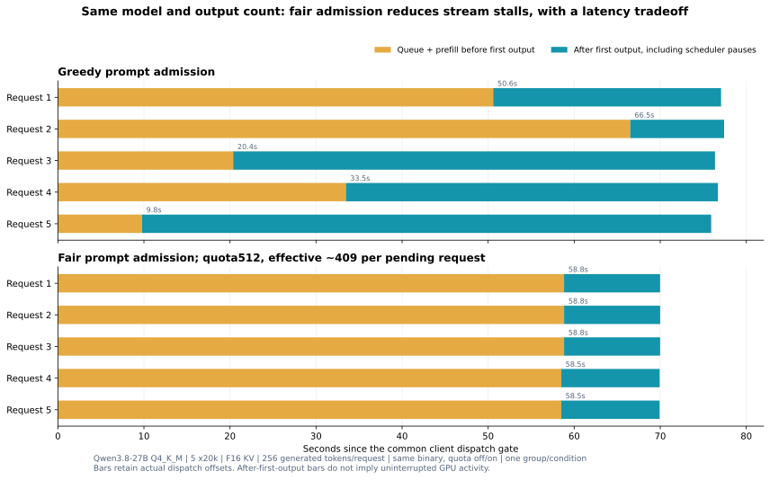
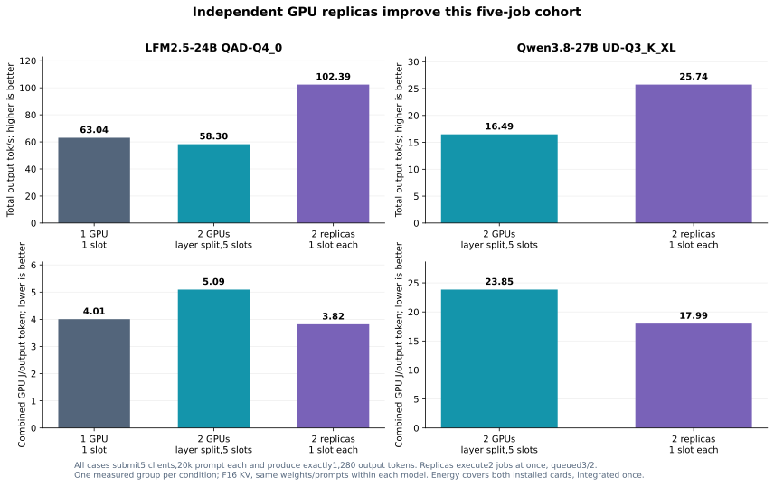

# Prefill scheduling and concurrent execution on two RTX 5070 Ti cards

On an i7-5960X with 64 GiB RAM, a PNY RTX 5070 Ti and an ASUS Prime RTX 5070 Ti,
the measured execution strategy matters as much as the number of installed cards.
Independent instances improve the five-job throughput of models that fit on each
card. A tested fair-prefill scheduler makes prompt admission and streaming more
consistent, while increasing the first-token wait for early requests. An explicit
Q8 K/V configuration demonstrates a larger Qwen27 workload with verified cache
precision and full GPU layer offload.

This study contains **19 valid performance conditions, one measured request group
per condition**, plus separate correctness checks. It uses a distinct diagnostic
protocol and does not modify or enter the canonical machine benchmark aggregates.
See the [raw evidence and reproduction guide](../results/studies/20261106-prefill-scheduling/README.md),
[CSV](../results/studies/20261106-prefill-scheduling/summary.csv),
[capture manifest](../results/studies/20261106-prefill-scheduling/manifest.json), and
the existing [two-card placement study](two-5070-ti-placement.md).

## What sequential-looking prefill means

In the pinned llama.cpp scheduler, generated tokens enter the logical batch first.
Pending prompts then fill the remaining batch in slot order. One unfinished prompt
can consume that entire remaining budget. Continuous batching permits decode and
prefill to mix; it does not guarantee equal prompt progress across requests.
The [upstream scheduler](https://github.com/ggml-org/llama.cpp/blob/b12058/tools/server/server-context.cpp#L3978)
implements this policy. Qwen's hybrid memory implementation supports multiple
sequences with equal-length physical microbatches; its architecture does not
fundamentally require one prompt at a time.

Logical batch size and physical microbatch size are separate controls. Large
logical batches can reduce scheduling overhead while extending pauses in existing
streams. Large physical microbatches can increase memory requirements and reduce
opportunities to overlap pipeline stages across cards. GPU utilization describes
observed activity, not the fraction of advertised arithmetic throughput achieved.

## Controlled scheduler comparison

All rows below use the same Qwen3.8-27B Q4_K_M file, five matched approximately 20k
prompts, F16 K/V, 256 generated tokens per request, disabled speculation, and the
same experimental binary with the scheduler quota enabled or disabled. Startup
confirms **66/66 offloadable layers on GPU** and pipeline parallelism enabled.
Embeddings remain CPU-mapped. Requests use explicit IPv4 and a common dispatch gate.

First-output times below are offsets from that common gate. Individual client
TTFTs and dispatch offsets are retained separately in the raw capture.

| Prompt policy; logical / physical batch | Group completion | Total output tok/s | First / median / last first output | Largest observed stream-chunk gap |
|---|---:|---:|---:|---:|
| Greedy; 2048 / 512 | 77.42 s | 16.53 | 9.77 / 33.47 / 66.52 s | 2.07 s |
| Fair; 2048 / 512, quota 512 | 69.99 s | 18.29 | 58.49 / 58.82 / 58.82 s | 0.33 s |
| Greedy; 8192 / 512 | 69.52 s | 18.41 | 20.76 / 42.80 / 58.31 s | 6.82 s |
| Fair; 8192 / 512, quota 2048 | 68.23 s | 18.76 | 56.62 / 57.02 / 57.03 s | 0.40 s |
| Greedy; 2048 / 2048 | 91.66 s | 13.96 | 9.66 / 40.52 / 80.74 s | 2.66 s |

At the 2048/512 setting, fair admission increases measured group throughput by
10.6% and reduces the last first-output wait by 11.6%. However, median first-output
wait increases by 75.7%. The corresponding measured GPU energy falls only 1.1%,
from 24.54 to 24.27 J/output token; this single observation does not establish a
robust energy advantage. At 5k, throughput rises 3.3%, but energy/token increases 1.4%.

The tuned greedy 8192 condition approaches fair 8192's aggregate throughput, while
retaining longer streaming pauses. Fair admission is therefore a policy choice
for consistent progress and smoother responses, rather than a universal latency
optimization. Stream-chunk gaps are client-observed arrival intervals, not GPU
token-generation intervals. After-first-token decode rates include scheduler waits.

Increasing the physical microbatch to 2048 slows this 20k cohort and raises combined
peak VRAM from 25,223 to 28,875 MiB. Keep logical and physical batch tuning separate.

## Independent instances versus splitting one model

Each row submits five approximately 20k prompts and generates exactly 1,280 output
tokens in total. Within each model, weights, prompt hashes/counts, F16 K/V,
sampling, output policy and CPU thread settings match. Full GPU layer offload and
zero reported prompt-cache reuse are verified.

The replica strategy loads one complete model on each GPU, with **one backend
slot per instance**. Five submitted clients queue three jobs on the PNY card and
two on the ASUS card. It does not execute five decoders simultaneously. Energy
covers both installed cards over one group window, including idle portions.

| Model and execution | Group time | Total output tok/s | GPU J/output token | Combined peak VRAM |
|---|---:|---:|---:|---:|
| LFM2.5-24B QAD-Q4_0; PNY only, one slot | 20.31 s | 63.04 | 4.005 | 14,325 MiB |
| Same LFM; two-card layer split, five slots | 21.95 s | 58.30 | 5.095 | 17,371 MiB |
| Same LFM; two replicas, one slot each | 12.50 s | 102.39 | 3.818 | 28,235 MiB |
| Qwen3.8-27B UD-Q3_K_XL; two-card layer split, five slots | 77.63 s | 16.49 | 23.854 | 21,807 MiB |
| Same Qwen27; two replicas, one slot each | 49.72 s | 25.74 | 17.993 | 27,922 MiB |
| Qwen3.6-35B-A3B Q4_K_M; two-card layer split, five slots | 30.40 s | 42.11 | 7.796 | 24,672 MiB |

For LFM, replication increases aggregate throughput 75.6% over layer splitting
and 62.4% over the single-card queue. Compared with splitting, it reduces measured
GPU energy/token 25.1%, while increasing average combined board power from 297 to
391 W and increasing VRAM occupancy. The five-job 3/2 distribution limits finite
cohort scaling even when both instances are efficient.

For Qwen27 Q3, replicas improve group throughput 56.1% and reduce measured GPU
energy/token 24.6% relative to splitting. Model replication avoids inter-card layer
dependencies, while consuming memory for two model copies. These are measured
serving-strategy results; they do not rank model quality or establish behavior at
arbitrary context lengths. Use the largest-model strategy when a complete copy
cannot fit on one card.

## LM Studio controls and context capacity

LM Studio 0.4.24 with the selected CUDA12 engine 2.70.0 was tested using server-reported
five-session, unified-KV, flash-attention, cache-precision and disabled-MTP settings.
Its documented load controls include batch size, flash attention and KV placement;
there is no documented fair-prefill scheduler control in the
[load API](https://lmstudio.ai/docs/developer/rest/load).
The experimental scheduler patch operates in the separate llama.cpp build and
does not replace LM Studio's engine.

These 20k LM Studio rows use natural EOS with a 256-token maximum. Their output
counts differ, so throughput and joules/token do not isolate batch efficiency.

| Evaluation batch | Actual output tokens | Group time | First / median / last first output | Total measured GPU energy |
|---|---:|---:|---:|---:|
| 2048 | 1,192 | 55.61 s | 8.83 / 25.26 / 41.13 s | 22.09 kJ |
| 4096 | 1,243 | 53.40 s | 10.29 / 25.95 / 38.09 s | 21.83 kJ |
| 8192 | 1,249 | 51.76 s | 14.38 / 29.08 / 36.19 s | 21.52 kJ |

Batch 4096 is a measured compromise for this workload. Batch 8192 reduces the
last first-output wait further, while worsening early and median waits. Total GPU
energy spans 21.52–22.09 kJ across these different-output observations. None of these settings
makes LM Studio's prompt admission fair.

Explicit **Q8 cache precision**, retaining the Q4_K_M weights, demonstrates larger
usable workloads. The following 5x40k cases allocate 215,040 shared context tokens,
43,008 per slot, and both produce 1,280 output tokens successfully:

| Serving condition | K/V precision | Group time | Last first output | Combined peak VRAM | Peak GPU temperature |
|---|---|---:|---:|---:|---:|
| LM Studio, batch 4096, natural EOS | Q8_0 | 114.47 s | 89.89 s | 28,893 MiB / 28.22 GiB | 77 C |
| Experimental llama.cpp fair 8192/512, fixed 256 output | Q8_0 | 199.34 s | 178.42 s | 27,901 MiB / 27.25 GiB | 78 C |

These are different serving conditions, not a scheduler-only paired comparison.
For reference, the earlier 5x40k LM Studio experiment, with unverified cache
precision, failed full-GPU loading and its CPU-fallback case completed only two of
five requests. Keep that historical observation separate: this is not a controlled
F16-versus-Q8 capacity comparison at 40k. Q8 changes cache arithmetic and requires its own quality
evaluation; it is not a free or verified quality-equivalent capacity increase.

## Reproduction, telemetry and limits

The performance binary uses upstream llama.cpp commit
`3f8af15a76ac8675812e856da45454bafc90f12c` with the optional
[v1 scheduler patch](../results/studies/20261106-prefill-scheduling/patches/fair-prefill-v1.patch).
It was built using MSVC 19.39 with dynamic backends and the unchanged official
b12058 CUDA 13.4 backend/runtime DLLs. File hashes, build controls, weight hash,
actual request counts, slot progress, chunk arrivals, raw power samples and
per-card counter summaries are retained. Canonical prompts use explicit UTF-8;
submission hashes verify the actual HTTP input against the retained text. The release binary's separate 20k control
measured 16.63 tok/s versus 16.53 for the compiled quota-disabled control; scheduler
claims use the same compiled binary on both sides.

The [v2 patch](../results/studies/20261106-prefill-scheduling/patches/fair-prefill-v2.patch)
adds explicit shared-parent/child exclusions. Its separate natural-stopping,
mixed-length unique-code checks pass 15/15 replies across greedy F16, fair F16 and
fair Q8. They test sequence isolation only. They are not a general capability or
quality-equivalence benchmark, and no performance gain is attributed to v2's guard.

Both cards negotiate PCIe Gen3 x16 during active dual-card work. PCIe counters
are driver-reported KB/s samples, not integrated transfer bytes. Shared-memory
allocations and global paging counters are captured; shared allocation alone does
not prove GPU spill or page-file traffic. CPU and RAM counters cover the whole
client machine. Per-process diagnostic counters are available for owned standalone
engines; LM Studio per-process attribution and a new kernel trace are not provided
by this campaign. CPU/package and memory-junction temperatures remain unavailable.

Measured inference die-temperature peaks across the campaign are 78 C on PNY and
66 C on ASUS. An 85 C stop guard monitors diagnostic engines. No temperature stop
occurred. Background model downloads were paused for timed collection. Model
weights used the existing SATA files; there is no Samsung 990 Pro measurement here.

Use these results by objective:

- **Early first response:** retain greedy admission and test moderate logical batches.
- **Smoother simultaneous streams:** evaluate the optional fair scheduler, accepting its early/median latency cost.
- **Aggregate job throughput:** use one replica per card when the full model and its per-instance context fit.
- **Larger tested context:** evaluate Q8 K/V as a separate condition; 5x40k is demonstrated here.
- **GPU energy:** compare complete matched-output groups; replication is the stronger measured improvement in this cohort.

For the application views and metric definitions, see
[Concurrency comparisons](concurrency.md) and [Measurements and sessions](measurements.md).
