# Two RTX 5070 Ti 16 GB cards: performance, energy and temperature

This benchmark compares a PNY RTX 5070 Ti plus an ASUS Prime RTX 5070 Ti with
the same PNY card alone and with a PNY RTX 5070 Ti plus ASUS RTX 5060 Ti. All
three configurations use an Intel Core i7-5960X and 64 GiB of RAM. The two-5070
configuration records **180 cases: 179 successful and one timeout**, with one
measured inference repeat per condition.

Native Strata Flash-Next IQ3_S showed higher observed throughput on two 5070 Ti
cards. Most LM Studio models had decode rates closer to the single-card rates,
while Gemma E2B retained a large regression. These are comparisons of complete
observed configurations: endpoint transport, automatic placement and host-memory
registration also affect their interpretation.

[Two-card raw measurements](../results/runs/20261103-100532_rtx-5070-ti_0a91ddc850.json)
· [Single-PNY baseline](../results/runs/20261102-041639_rtx-5070-ti_6b6060174b.json)
· [Mixed-card baseline](../results/runs/20261102-175334_rtx-5070-ti_9116ad932f.json)
· [Every paired case and eligibility gate](../results/aggregates/two-5070-ti-paired-cases.csv)
· [Per-model summaries](../results/aggregates/two-5070-ti-model-summary.csv)
· [Absolute case measurements](../results/aggregates/two-5070-ti-absolute-cases.csv)

## Hardware and protocol

| Setting | Recorded condition |
|---|---|
| CPU and memory | Intel Core i7-5960X, 8 cores / 16 threads, 64 GiB RAM |
| GPU0 / GPU1 | PNY RTX 5070 Ti 16 GB / ASUS Prime RTX 5070 Ti 16 GB |
| GPU driver | NVIDIA 617.42 |
| Backend versions | LM Studio 0.4.24+1; native Strata engine 0.1.52 |
| Prompt targets | 512, 5k, 10k, 20k, 40k and 80k tokens |
| Simultaneous clients | One and two |
| Generation settings | 256-token maximum output budget, temperature 0, requested reasoning none |
| Inference repeats | One per model / target / client-count condition |
| Case deadline | 300 seconds |
| Outcome | 179 successful; native Qwen35 at 80k / two clients timed out |

The 15 model variants comprise **144 LM Studio and 36 native Strata cases**.
Against the single-PNY baseline, **13 shared model IDs cover 156 common
model/target/client cells**. Two additional LM Studio Qwen Q4_K_M variants
contribute 24 supplemental cells. They remain separate from native Strata and
other-quantization variants. The mixed-card baseline contains all 15 variants.

The final native Qwen35 cases were measured in a separate session after a reboot.
Two partial LM Studio attempts from monitoring interruptions remain archived
outside the 180 primary observations. Successful observations were preserved;
the final native timeout was recorded without a retry.

LM Studio uses its recorded managed context and allocation settings. Native
Strata uses a 98,304-token context and one serving slot; submitting two clients
therefore includes queueing at that server. Two installed cards do not establish
that a backend executes across both. Runtime evidence below distinguishes them.

## How to interpret the measurements

### Hardware probe references

The normal JSON also retains fresh hardware probes, outside inference timing.
Four 16 GiB DIMMs report A1/B1/C1/D1 placement at 2133 MT/s: four populated
firmware channels are inferred; active controller mode is not independently
verified. Native RAM-copy throughput counts copied payload once, not physical
DRAM bus traffic.

| Probe | Observed result |
|---|---:|
| Single-worker native RAM copy | 8.30 GB/s |
| Eight-worker native RAM copy | 22.86 GB/s |
| Matched six-worker native RAM copy | 23.41 GB/s |
| Samsung 870 EVO sequential read, queue depth 1, OS cache bypassed | 0.539 GB/s |
| Pinned RAM to PNY / ASUS GPU, fresh automatic probe | 13.51 / 13.56 GB/s |

That storage reading measures the SATA probe volume, not the separate NVMe.
The [communication study](two-5070-ti-placement.md) retains later transfer
controls with a distinct protocol and verifies both loaded GPU links at Gen3 x16.

At 8192-square dense GEMM, the measured medians below use CUDA-event batches,
five warmups and 15 internal samples with analytical readback checks. They are
observed arithmetic throughput, not advertised peak specifications or inference
predictions. The actual library algorithm is retained; its instruction path was
not independently profiled.

| Arithmetic | PNY 5070 Ti | ASUS Prime 5070 Ti |
|---|---:|---:|
| FP32, TF32 disabled | 36.41 TFLOP/s | 36.25 TFLOP/s |
| FP16-input GEMM | 101.15 TFLOP/s | 96.57 TFLOP/s |
| INT8-input GEMM | 347.97 TOPS | 346.63 TOPS |

Integer throughput uses TOPS. No INT4 arithmetic measurement was made, and
GGUF weight bit-width is not the precision of every inference operation.

### Timing, matching and energy boundaries

**Client prefill is actual prompt tokens divided by client-observed TTFT.** It
includes transport, queueing and other work before observable output. Backend
prompt-evaluation counters, where available, remain separate. See the
[measurement definitions](measurements.md).

Managed LM Studio requests in the two-5070 pass use explicit IPv4; the historical
normal baselines used `localhost`. A separate metadata-GET diagnostic observed
approximately 2.06 seconds through `localhost` versus 22 milliseconds through
IPv4. That does not measure a fixed chat-request delay. Historical timings are
unchanged, and no guessed delay is subtracted. **LM Studio prefill and TTFT
changes cannot be attributed wholly to the extra GPU.** Native Strata used IPv4
in both cohorts.

Ratios below are unweighted medians of eligible per-case ratios. Each metric has
its own eligible-pair count, **N**; N counts workload cells, not independent
repeats. Input/output proximity gates allow up to the larger of eight tokens or
2%; TTFT input gates allow four tokens or 0.5%. Whole-case comparisons also
require output-count proximity. The CSVs retain a separate strict exact-count
subset. Equal counts do not prove equal generated text or token sequences.

GPU energy covers both installed boards, including an idle secondary card.
Concurrent case energy is integrated once over the shared group interval; it
is not the sum of overlapping request energies. Decode J/token covers the
observed generation interval after first output, whereas whole-case energy
includes the group's prompt and generation work.
CPU/system power is estimated, not measured at a wall socket. Historical
physically single-card energy keeps its original one-board boundary.

## Matched performance and energy

Each cell reports median percentage change and eligible N. Positive throughput
and negative energy changes are favorable. LM Studio and native Strata remain
separate cohorts.

| Reference | Backend | Clients | Client prefill change (N) | Decode change (N) | Decode GPU J/token change (N) | Whole-case GPU energy change (N) |
|---|---|---:|---:|---:|---:|---:|
| Single PNY 5070 Ti | LM Studio | 1 | +108.4% (57) | −5.1% (57) | +31.4% (40) | Unavailable (0) |
| Single PNY 5070 Ti | LM Studio | 2 | +91.1% (55) | −2.8% (55) | Unavailable (0) | +11.0% (27) |
| Single PNY 5070 Ti | Native Strata | 1 | +7.9% (12) | +45.6% (12) | +15.4% (12) | Unavailable (0) |
| Single PNY 5070 Ti | Native Strata | 2 | +19.0% (12) | +67.3% (12) | Unavailable (0) | +30.0% (6) |
| 5070 Ti + 5060 Ti | LM Studio | 1 | +106.2% (72) | +29.3% (72) | +0.2% (53) | Unavailable (0) |
| 5070 Ti + 5060 Ti | LM Studio | 2 | +79.7% (72) | +28.4% (72) | Unavailable (0) | −7.3% (40) |
| 5070 Ti + 5060 Ti | Native Strata | 1 | +9.1% (18) | +21.8% (18) | +9.1% (18) | Unavailable (0) |
| 5070 Ti + 5060 Ti | Native Strata | 2 | +13.3% (17) | +50.3% (17) | Unavailable (0) | +7.5% (9) |

Native Strata versus the single-PNY baseline includes the two Flash-Next
variants. Native Qwen35 is excluded because its host allocation differs, as
explained below. The mixed-card native comparison includes Qwen35 where both
conditions have compatible evidence. These different eligible populations are
not interchangeable.

### Native Flash-Next by quantization

These single-client medians span the six prompt targets. Registration policy
and expert-cache placement are part of the observed configuration treatment.

| Quantization | Reference | Client prefill change (N) | Decode change (N) | GPU decode J/token change (N) |
|---|---|---:|---:|---:|
| IQ3_S | Single PNY 5070 Ti | +24.9% (6) | +74.8% (6) | −7.2% (6) |
| UD-IQ4_XS | Single PNY 5070 Ti | +5.4% (6) | +23.5% (6) | +31.4% (6) |
| IQ3_S | 5070 Ti + 5060 Ti | +12.6% (6) | +83.5% (6) | −22.6% (6) |
| UD-IQ4_XS | 5070 Ti + 5060 Ti | +34.5% (6) | +21.8% (6) | +16.4% (6) |

## Absolute single-client throughput

Values are **client prefill / decode, in tokens per second**. Prompt lengths
label target groups; actual token counts and output lengths are retained in the
raw measurements. Each row is a separate engine/quantization condition.

| Model / quantization | Backend | 20k target | 80k target |
|---|---|---:|---:|
| Gemma 4 12B QAT / Q4_0 | LM Studio | 5,258.79 / 73.90 | 3,934.48 / 66.42 |
| Gemma 4 26B-A4B QAT / Q4_0 | LM Studio | 5,738.35 / 116.68 | 4,885.77 / 99.67 |
| Gemma 4 E2B / Q4_K_M | LM Studio | 8,801.83 / 29.90 | 5,456.91 / 10.08 |
| Gemma 4 E4B / Q4_K_M | LM Studio | 7,348.75 / 82.22 | 5,913.20 / 66.06 |
| LFM2.5-24B-A2B / Q4_0, QAD | LM Studio | 8,034.16 / 175.28 | 7,228.24 / 128.68 |
| GPT-OSS-20B / MXFP4 | LM Studio | 8,077.44 / 124.58 | 5,735.17 / 100.77 |
| Bonsai-27B / Q1_0 | LM Studio | 3,168.79 / 71.26 | 2,157.14 / 51.72 |
| Qwen3.5-9B / Q4_K_M | LM Studio | 7,316.71 / 82.08 | 5,356.02 / 64.41 |
| Qwen3.8-27B / Q3_K_XL, UD | LM Studio | 2,795.28 / 41.60 | 1,976.39 / 33.77 |
| Spark-X2.6-4B / Q4_K_M | LM Studio | 8,956.42 / 115.06 | 6,166.78 / 83.05 |
| Qwen3.6-35B-A3B / Q4_K_M | LM Studio, supplemental | 5,797.96 / 130.13 | 4,902.14 / 105.96 |
| Qwen3.8-27B / Q4_K_M | LM Studio, supplemental | 2,810.55 / 37.76 | 1,977.97 / 31.51 |
| Flash-Next / UD-IQ4_XS | Native Strata | 1,062.01 / 18.18 | 1,971.69 / 17.55 |
| Flash-Next / IQ3_S | Native Strata | 1,089.00 / 73.26 | 2,359.37 / 69.58 |
| Qwen3.6-35B-A3B / UD-Q4_K_XL | Native Strata | 493.06 / 33.09 | 460.58 / 11.59 |

For example, the native IQ3_S 80k case used 80,996 prompt tokens and generated
195 tokens. The UD-IQ4_XS case used 81,008 / 196; native Qwen35 used 80,999 / 229.
These stopping lengths differ. Speed does not establish model-quality or
quantization-quality equivalence.

Gemma E2B's LM Studio single-client decode median was 72.9% below the
single-PNY baseline across six eligible cells. The normal cohort establishes
the observed regression; communication and placement causality require the
separate diagnostic study.

## Native execution and speculative decoding

Qwen's model card distinguishes a **125B language model with 6B activated**,
plus **51B n-gram embeddings and a 4B MTP component**. Approximately 180B across
those components is different from the activated language-model count; quant
file size is not a parameter-count measurement. [Publisher model overview](https://huggingface.co/Qwen/Qwen3.8-Flash-Next/raw/main/README.md).

| Model / quantization | Selected GPUs | Serving slots | Expert memory evidence | Draft configuration | Observed offered / accepted |
|---|---|---:|---|---|---:|
| Flash-Next / UD-IQ4_XS | GPU1 then GPU0 | 1 | 55.44 GiB resident arena; 5,311 GPU-cached experts | Four drafts requested | 3,569 / 2,019 |
| Flash-Next / IQ3_S | GPU1 then GPU0 | 1 | 46.84 GiB resident arena; 7,196 GPU-cached experts | Four drafts requested | 3,426 / 2,027 |
| Qwen3.6-35B / UD-Q4_K_XL | GPU0 only | 1 | 18.75 GiB pageable host experts; 19 per layer cached on GPU | MTP requested; head loaded | 0 / 0 |

The draft counters cover each loaded engine's lifetime, including warmups;
they are not per-case acceptance measurements. GPU order does not by itself
verify every tensor or KV-cache placement. Flash-Next records INT8 KV and a
96k allocation. Native Qwen35's actual KV dtype is unreported.

Native Qwen35 executes on **one GPU** despite two installed cards. Its
single-PNY baseline reported pinned host experts, while this pass used pageable
host experts. Those single-to-dual ratios are excluded (N=0). Against the
pageable mixed-card condition, six single-client and five two-client cells are
eligible. Pageable allocation alone is not evidence of pagefile traffic.

## Resident RAM is not the same as CUDA registration

Startup logs account for resident Flash expert arenas using a combination of
CUDA-registered slices and Windows VirtualLock. VirtualLock keeps pages resident
but does not register those pages with CUDA. Reported CUDA-registered GiB below
are **integer floors**, not exact byte counts.

| Quant / arena | Setup | VirtualLock MiB | Registered slices | Registered GiB floor |
|---|---|---:|---:|---:|
| UD-IQ4_XS / 55.44 GiB | Single PNY 5070 Ti | 27,365 | 25 | 28 |
| UD-IQ4_XS / 55.44 GiB | 5070 Ti + 5060 Ti | 48,978 | 6 | 7 |
| UD-IQ4_XS / 55.44 GiB | Two 5070 Ti | 48,978 | 6 | 7 |
| IQ3_S / 46.84 GiB | Single PNY 5070 Ti | 17,977 | 31 | 29 |
| IQ3_S / 46.84 GiB | 5070 Ti + 5060 Ti | 40,290 | 8 | 7 |
| IQ3_S / 46.84 GiB | Two 5070 Ti | 40,290 | 8 | 7 |

Both dual-card captures log the engine's 8 GiB registration cap for multi-GPU
Windows/WDDM execution. The version-pinned upstream documentation describes a
pinned staging ring for the remainder. This is an engine policy rather than a
universal hardware limit. The exposed registration override was not tested in
this study. [Strata 0.1.52 source documentation](https://github.com/Niko1221/Strata/blob/a42cc3d7df70/docs/MULTI_GPU.md#L133-L138).

Single-to-dual native comparisons change registration composition alongside
GPU/cache placement. Their performance differences are complete-configuration
outcomes, not isolated GPU-compute or DMA effects. For each quant, the
mixed-card and two-5070 captures have identical reported pin/lock composition;
that difference does not distinguish those two dual-card configurations.

## Temperature, fans and measurement coverage

The continuous 1 Hz observer spans idle periods, loading, hardware probes and
inference. Its recorded peaks are distinct from the helper's per-case phase
readings, which can catch shorter events.

| Measurement boundary | PNY 5070 Ti | ASUS Prime 5070 Ti |
|---|---:|---:|
| Continuous observer: peak GPU-core temperature | 77°C | 63°C |
| Continuous observer: peak intended fan duty | 65% | 42% |
| Continuous observer: peak reported board power | 300.87 W | 287.48 W |
| Recorded case/phase GPU-core maximum | 77°C | 64°C |
| Observed hardware/software thermal-throttle samples | 0 / 0 | 0 / 0 |

The observer used 78°C warning and 83°C pause thresholds. No sampled warning or
thermal-throttle event occurred in the normal-run capture segments. Power-limit
activity is reported separately and is not thermal throttling. Driver fan duty
does not verify physical fan RPM. GPU memory and hotspot temperatures are
unavailable.

Sampling gaps and the reboot interval remain explicit; no temperatures are
interpolated across them. Monitoring interruptions are separate from
overtemperature events. One-Hz samples can miss shorter peaks, and this workload
does not establish cooling capability at uninterrupted maximum board power.
Different card positions and uncontrolled ambient conditions prevent treating
the temperature difference as an isolated board-design comparison.

The single-PNY baseline lacks the newer structured per-GPU breakdown, but its
legacy one-board fields retain 76 single-client case readings with a 65°C
maximum and 78 whole-case readings with a 68°C maximum. These historical
boundaries remain separate from the dual-card channels.

## Figures and detailed evidence

The client-prefill and TTFT figures retain the transport qualification above.
Temperature and clock traces retain their recorded sampling gaps.

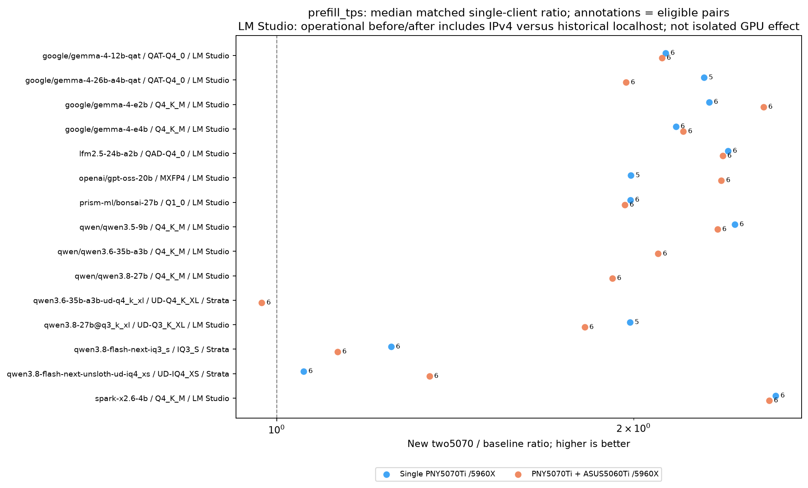

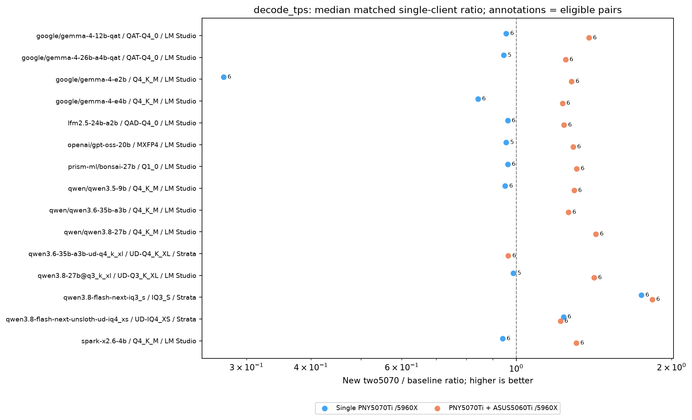

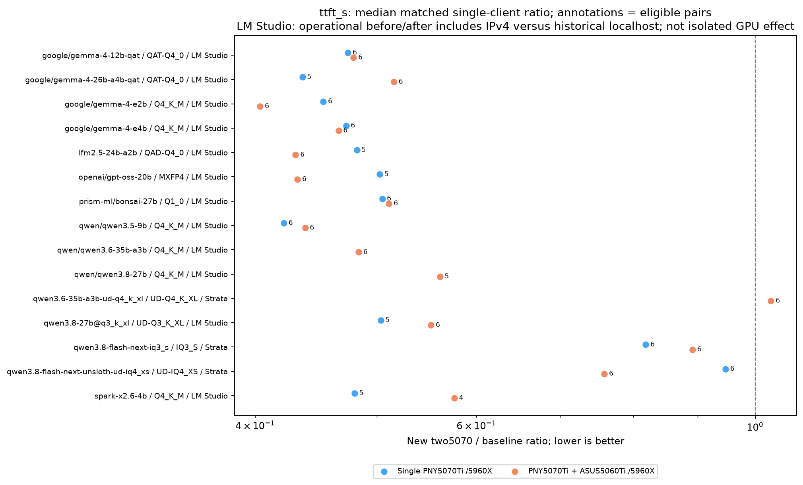

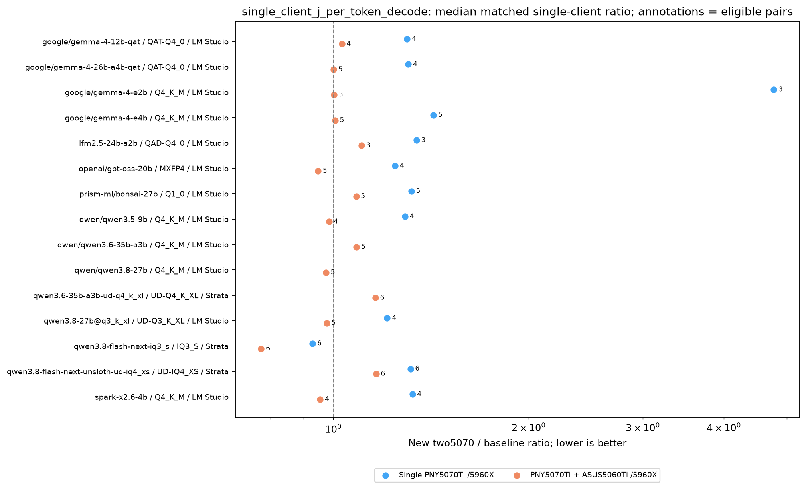

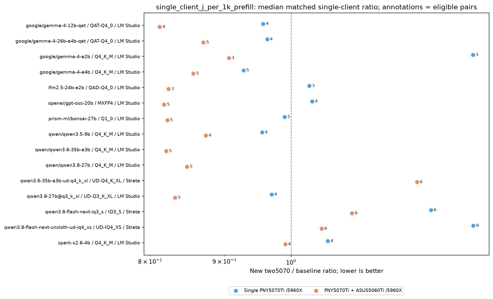

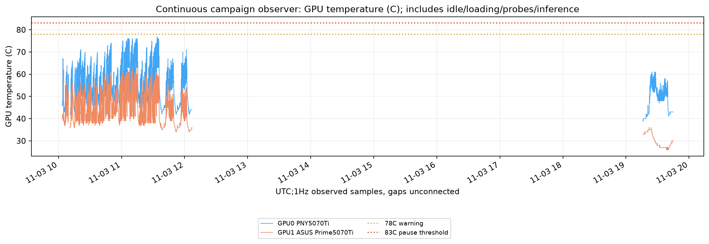

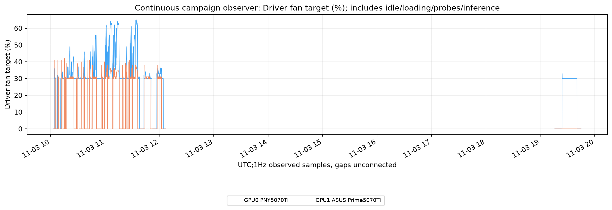

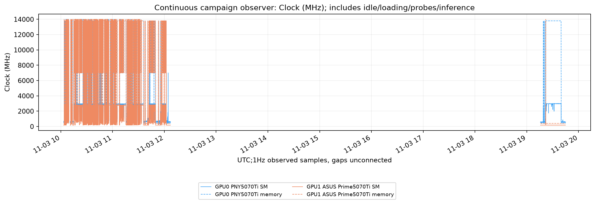

[Thermal observations](../results/aggregates/two-5070-ti-thermal-observations.csv)
and [segment/coverage summary](../results/aggregates/two-5070-ti-thermal-summary.json)
retain the thermal sampling scope.

## Standalone communication and placement study

The [two-card communication and placement study](two-5070-ti-placement.md)
records 153 unprofiled inference conditions, three separate traces, transfer
samples and workload-specific recommendations. Those diagnostic observations
remain separate from this normal benchmark cohort. Conditions overlapping
background activity retain an explicit confound flag.

## Limits and related reports

These are one-pass engineering observations. Automatic clocks, ambient
conditions, filesystem caches, natural stopping lengths, endpoint transport and
runtime allocation policies limit causal and statistical conclusions. A shared
model ID or public configuration fingerprint does not authenticate identical
weight bytes or effective server behavior. Failures remain part of the dataset;
unavailable readings are not zeros. No intelligence or model-quality benchmark
was performed as part of this hardware comparison.

See [measurements and sessions](measurements.md), the
[mixed-card comparison](5070-plus-5060-comparison.md), and
[sharing results](sharing-results.md) for metric boundaries, recorded-condition
selection and public exports. The
[multi-GPU communication study](dual-gpu-communication-and-placement.md)
describes the separate diagnostic methodology and its measured coverage.

## Complete campaign thermal boundary

A separate frozen capture through 2026-11-04 00:24 UTC includes the normal
cohort, standalone diagnostics, loading and idle periods. Adjacent valid samples
cover approximately 7.077 hours per card across four segments; the reboot and
sensor gaps are excluded. Later GLM work is outside this boundary.

| Observation | PNY 5070 Ti | ASUS Prime 5070 Ti |
|---|---:|---:|
| Valid temperature samples | 25,196 | 25,195 |
| Sampled GPU-core maximum | 77°C | 67°C |
| Maximum intended fan duty | 65% | 42% |
| Peak reported board power | 302.04 W | 287.48 W |
| Samples at or above 78°C / 83°C | 0 / 0 | 0 / 0 |
| Hardware / software thermal-active samples | 0 / 0 | 0 / 0 |
| Software power-cap-active samples | 1,667 | 133 |

Power-cap activity is distinct from thermal throttling. These sampled maxima do
not bound unsampled peaks, memory or hotspot temperature. No heat value is
interpolated across gaps, and case energy is not recalculated from these samples.
The 83°C interlock also limits what this experiment can establish about
unrestricted continuous operation.

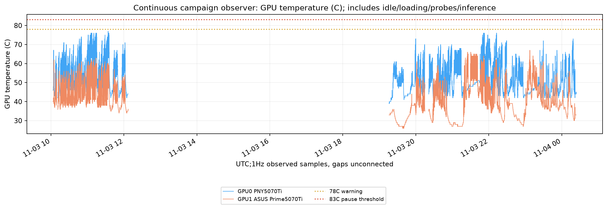

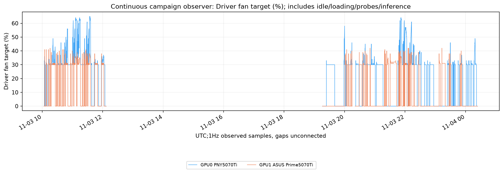

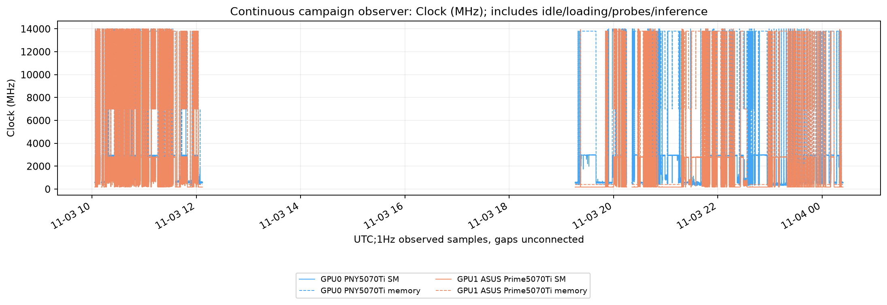

[All thermal samples](../results/aggregates/two-5070-ti-campaign-thermal.csv)
and [coverage summary](../results/aggregates/two-5070-ti-campaign-thermal-summary.json)
retain the recorded segment boundary.
