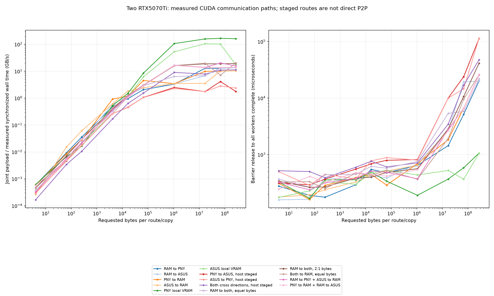
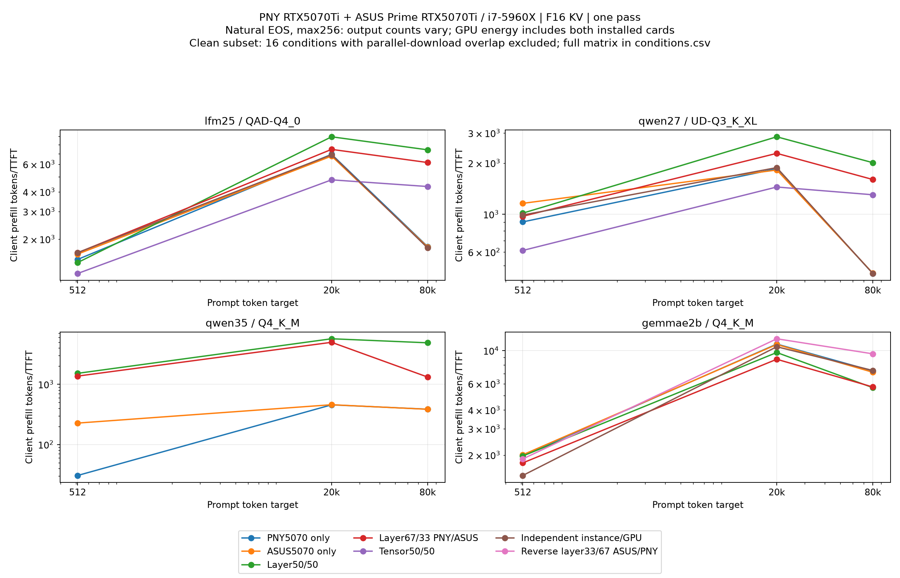
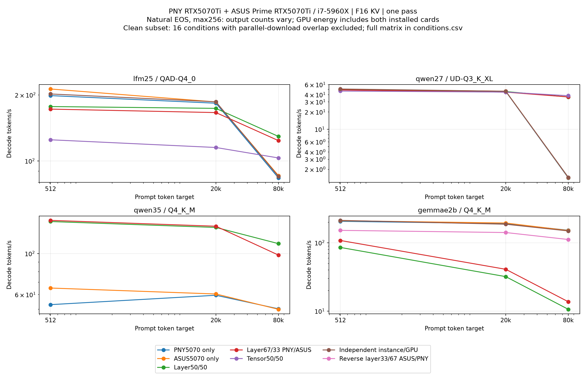
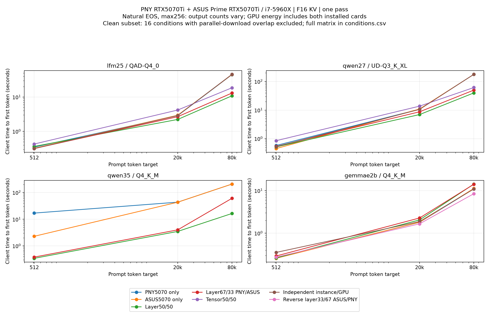
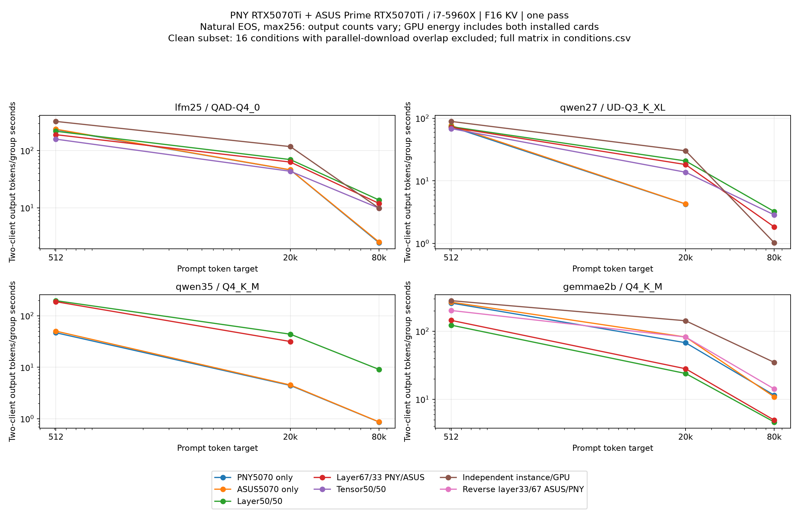
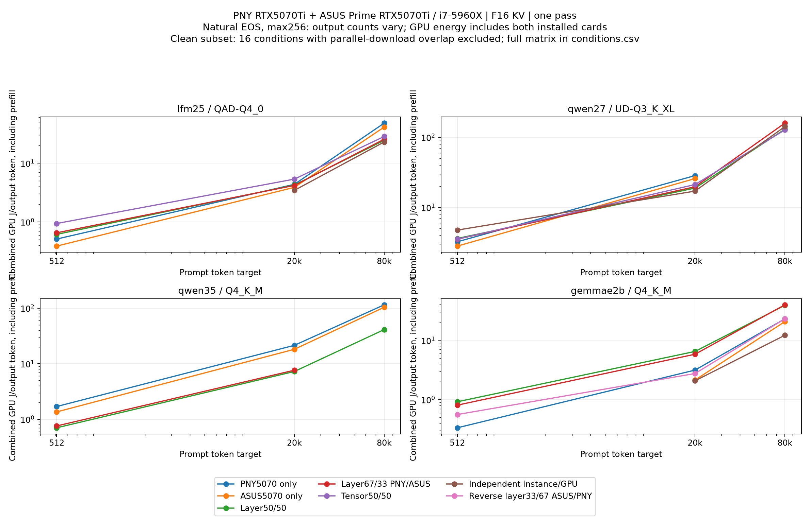
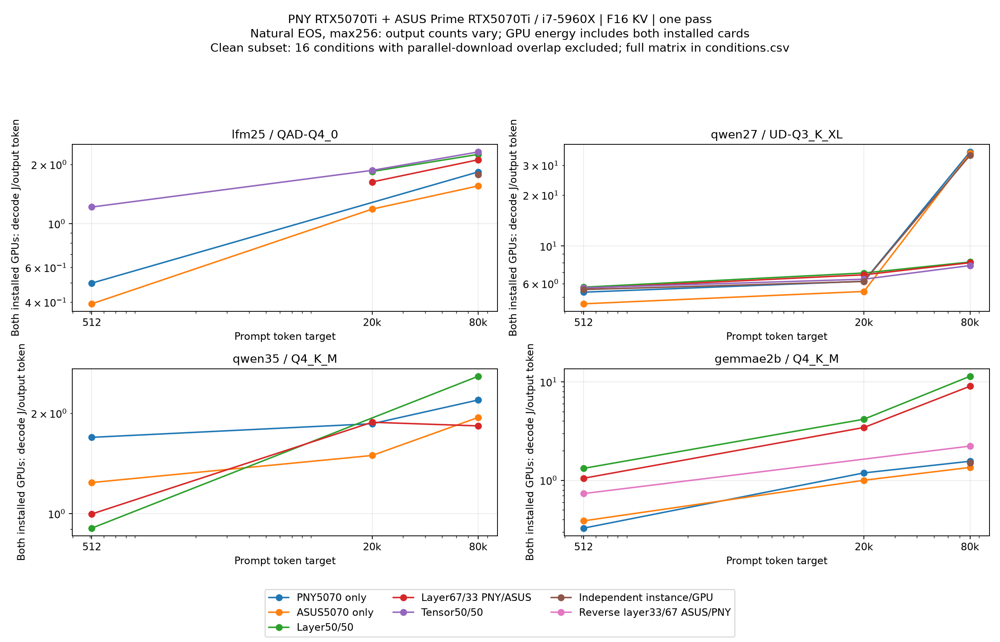

# Two RTX 5070 Ti cards: communication and execution strategies

Two equal-capacity GPUs benefit different workloads differently. On this
i7-5960X / 64 GiB Windows machine, balanced layer placement substantially
improves long-context LFM and Qwen inference. Gemma E2B's equal split instead
causes a severe decode regression. Independent instances improve concurrent
job throughput when each instance fits comfortably on one card.

These standalone llama.cpp diagnostics are separate from the
[180-case LM Studio/native Strata comparison](two-5070-ti-comparison.md).
They do not replace historical measurements or enter normal Wattever aggregates.

## Protocol and coverage

The hardware is a PNY RTX 5070 Ti and ASUS Prime RTX 5070 Ti, both 16 GB,
with NVIDIA driver 617.42. The standalone build is llama.cpp b12058,
commit `3f8af15a7`, executable SHA256
`ff552b19fe6038bd45a00ead5e4a8d49422e3d6735cfc9672acc34b0c9767115`.
Nsight Systems is 2026.3.2.476.

| Measurement family | Recorded coverage |
|---|---|
| Transfer microbenchmarks | 280 conditions: 14 routes, 10 sizes from 4 B to 256 MiB, two timing modes |
| Inference screening | 153 unprofiled conditions |
| Instrumented inference | Three separate Gemma traces |
| Inference outcomes, including profiles | 146 successful, six unsupported, three failed, one allocation failure |
| Background-activity overlap | 19 conditions retained with an explicit confound flag |
| Measured inference repeats | One per measured condition; unsupported/failed attempts remain separate |

The main inference matrix uses the same existing GGUF files, F16 K/V,
Flash Attention, reasoning off, MTP off, temperature 0, top-p 1 and seed 73129.
Prompt targets are 512, 20k and 80k, with one or two clients and a 256-token
maximum output budget. Actual counts and natural EOS remain recorded.
Per-slot context is target plus 5%, 512 headroom and the output budget, rounded
up to a multiple of 256. Batch/ubatch sizes are 2048/512, with eight CPU and
batch threads. Each fresh engine has an excluded short warmup.

All requests use explicit IPv4 with prompt caching, idle-slot caching and
context shifting disabled. Historical localhost timings are unchanged.
Backend prompt-evaluation timings remain separate from client prompt tokens
divided by TTFT. Filesystem-cache equality and complete mapped-weight residency
are unverified. Q8 K/V and fixed-output closeouts are separate treatments.

Socket/inactivity timeout is 900 seconds per request, with a 920-second wait
per awaited concurrent future, then cancellation and worker cleanup. This is
not a hard 900-second whole-condition deadline. Unsupported or failed attempts
remain in the evidence; their token rates are not treated as successful runs.

Two-card power is integrated once over the shared client-group interval.
Single-card execution includes the installed idle second board. Whole-case
GPU joules per output token include prompt processing; decode-phase joules
per token have a different boundary. Neither measures wall-socket system power.

## PCIe paths and transfer measurements

Both GPUs negotiate **PCIe Gen 3 x16 under load**. The 256 GB NVMe remains
installed. OS device/parent relationships are recorded, but physical motherboard
slot labels and undocumented NVMe lane sharing are unverified. An idle lower
generation is not reported as the loaded link.

CUDA peer access is **false in both directions**. The cross-card probe below
explicitly stages through portable-pinned host RAM. A CUDA peer-copy API name
does not establish direct physical P2P transport.

Rates are median validated joint payload GB/s at 256 MiB per route. Simultaneous
rates use an actual shared barrier-to-completion interval; independent rates
are never added and presented as simultaneous throughput.

| Route | Mixed 5070 Ti + 5060 Ti | Two 5070 Ti |
|---|---:|---:|
| Pinned RAM to GPU0 | 13.57 | 13.58 |
| Pinned RAM to GPU1 | 6.88 | 13.56 |
| GPU0 to pinned RAM | 10.42 | 10.39 |
| GPU1 to pinned RAM | 7.08 | 10.42 |
| Explicit staged GPU0 to GPU1 | 2.37 | 1.77 |
| Explicit staged GPU1 to GPU0 | 4.66 | 2.37 |
| Simultaneous equal RAM-to-GPU routes | 13.77 | 13.96 |
| Simultaneous 2:1 RAM-to-GPU routes | 19.69 | 19.47 |
| Simultaneous GPU-to-RAM routes | 14.12 | 20.42 |
| Bidirectional staged cross-card routes | 7.68 | 11.31 |

The second card's host link improves, while these particular one-way staged
microcopies do not. This is evidence against treating link width alone as a
complete predictor of cross-card performance. Dispatch, context handling,
synchronization and the unpipelined DtoH-then-HtoD route are included.
Small-transfer host latency likewise is not intrinsic PCIe hardware latency.
The raw samples retain sizes, copy counts, direction, validation and timing mode.

Sustained sequential local-VRAM controls measured **375.66 / 384.24 GB/s** of
copied payload by CUDA events on PNY/ASUS, with approximately 80 ms batches.
Short host-timed microcopies measured 162.03 / 17.15 GB/s under a different
protocol. Those short figures do not establish degraded ASUS memory bandwidth.
Payload bytes are counted once; a separate read-plus-write traffic convention
would double the accounting, not the measured payload rate.

Monolithic host-pinning and concurrently held pooled allocations are separate
controls. The pooled 8 + 8 + 2.75 GiB sequence succeeded and was released.
This does not prove identical behavior for a production Runtime API allocation
inside an already loaded model process.

## Single-request prefill and decode

Values below are observed **prefill / decode tok/s**, using client timing.
All rows use one client and F16 K/V. Balanced means a 1:1 layer split.
The output-count column makes stopping differences explicit.

| Model / quant | Prompt target | PNY only | Balanced two-card | Actual output tokens, PNY / balanced |
|---|---:|---:|---:|---:|
| LFM2.5-24B, QAD-Q4_0 | 20k | 6,934 / 183.39 | 8,965 / 173.72 | 256 / 256 |
| LFM2.5-24B, QAD-Q4_0 | 80k | 1,792 / 83.69 | 7,405 / 129.38 | 256 / 256 |
| Qwen3.8-27B, UD-Q3_K_XL | 20k | 1,853 / 45.54 | 2,853 / 45.31 | 250 / 250 |
| Qwen3.8-27B, UD-Q3_K_XL | 80k | 449 / 1.41 | 2,010 / 36.42 | 221 / 221 |
| Qwen3.6-35B-A3B, Q4_K_M | 20k | 456 / 59.45 | 5,697 / 138.59 | 244 / 215 |
| Qwen3.6-35B-A3B, Q4_K_M | 80k | 386 / 50.20 | 4,882 / 113.22 | 234 / 233 |
| Gemma 4 E2B, Q4_K_M | 20k | 11,049 / 190.66 | 9,703 / 31.93 | 256 / 256 |
| Gemma 4 E2B, Q4_K_M | 80k | 7,304 / 152.66 | 5,645 / 10.60 | 246 / 246 |

LFM's 80k case improves prefill 4.13 times and decode 1.55 times, with equal
actual output counts. Qwen27 improves prefill 4.47 times and decode 25.82 times,
also with equal counts. Qwen35's differing EOS lengths require descriptive
interpretation: its table is not an exact-output paired latency or energy claim.
The CSVs retain strict comparisons separately from common-budget observations.

The final allocation logs also change materially at 80k/one client:

| Model | PNY-only CPU_Mapped weights, GiB | Balanced CPU_Mapped weights, GiB | Additional evidence |
|---|---:|---:|---|
| LFM | 1.571 | 0.200 | Logged host-expert policy in the single-card condition, absent in balanced |
| Qwen27 | 3.283 | 0.509 | Single-card CPU KV buffer 1.297 GiB; balanced KV 2.594 GiB on each GPU |
| Qwen35 | 8.509 | 0.266 | Logged host-expert policy in the single-card condition, absent in balanced |

These observed allocations support a capacity/placement explanation for the
long-context gains. They do not isolate a doubling of GPU compute. CPU_Mapped
bytes alone do not establish which pages were physically resident, how much
CPU work occurred, or whether the pagefile was accessed.

## Gemma placement and communication

Gemma's equal split is slow despite ample combined VRAM. A reverse 1:2 split
with physical device order ASUS then PNY places more of the shared-tail weights
on PNY. It changes several placement variables, so this is an intervention on
the whole layout, not an isolated KV-cache experiment.

| Gemma condition | 20k prefill / decode | 80k prefill / decode |
|---|---:|---:|
| PNY only | 11,049 / 190.66 | 7,304 / 152.66 |
| Equal layer split | 9,703 / 31.93 | 5,645 / 10.60 |
| Reverse ASUS:PNY 1:2 | 11,989 / 141.27 | 9,507 / 111.66 |

At 80k, the reverse layout's whole-request wall time is 10.68 seconds for 246
output tokens. It improves total latency despite slower decoding than PNY
alone. For sustained generation, the single-card decode rate remains higher.
Its GPU energy is a separate objective: ASUS alone records 11.15 J/output token
including prefill, versus 13.06 for the reverse layout at that workload.

The three whole-workload traces record approximately 1.86 GB, 102.80 GB and
3.53 GB of logical/requested CUDA copy bytes for single, equal and reverse
placement. These are **not measured physical PCIe bytes**. Profiles overlap
background download activity, have unquantified instrumentation overhead and
are excluded from ordinary rankings. Summed API wait durations are not wall
idle percentages; client/trace phase clock alignment is unverified.

Final positive allocations, rather than dry-fit logs, govern placement claims.
The recovered profiled console records have the same observed final allocation
shapes as their corresponding plain runs. Equal aggregate buffers do not prove
identical placement for every individual tensor.
A CPU_Mapped buffer does not prove CPU computation, pagefile traffic or physical
residency. Shared weight placement alone does not verify every KV tensor's
locality. The trace and layout evidence support a communication/waiting
explanation, but do not isolate a single causal mechanism or quantify phase
idle time. Gemma's six tensor-mode cases failed an actual split-axis assertion;
the classic-row closeout reported unsupported split buffers.

## Concurrent throughput and energy

Aggregate output is total actual output tokens divided by one shared group
interval, including prefill. Independent instances run one request on each GPU.
They are not a sum of standalone token rates.

| Model / prompt | PNY with two clients | Shared balanced model | Independent instances | Output-count qualification |
|---|---:|---:|---:|---|
| LFM, 20k | 45.99 | 69.79 | 117.77 | 256 + 256 for all three |
| LFM, 80k | 2.43 | 13.65 | 9.84 | 256 + 256 for all three |
| Qwen27, 20k | 4.26 | 20.83 | 30.21 | Different EOS lengths; descriptive |
| Qwen27, 80k | Timed out | 3.23 | 1.03 | Different EOS lengths; descriptive |
| Gemma E2B, 20k | 67.96 | 23.95 | 143.03 | Different EOS lengths; descriptive |
| Gemma E2B, 80k | 11.47 | 4.62 | 34.85 | Different EOS lengths; descriptive |

LFM at 20k illustrates independent-instance throughput: 2.56 times the PNY
two-client rate with equal output counts. At 80k, sharing one model across both
GPUs is faster than duplicating it. Capacity and context change the best choice.

| Objective | Supported setting / limit |
|---|---|
| Lowest total request latency | Balanced LFM/Qwen at long context; Gemma reverse layout at 80k. Consult exact-output buckets. |
| Highest concurrent job throughput | Independent instances for LFM at 20k; balanced LFM at 80k. Gemma favors independent instances under the common-budget observations. |
| Largest tested model/context | Successful 80k screens are recorded, not true maxima. Qwen27 single-card two-client 80k timed out; balanced two-card execution succeeded. |
| Lowest measured GPU energy | Workload-specific: LFM80k balanced 17.63 versus PNY 26.82 J/output; Qwen27 80k balanced 93.42 versus 165.79, both including prefill and with matched output counts. |

Equal, unequal and experimental tensor execution were tested on the Qwen/LFM
models. Architecture, recurrent state, KV layout and backend restrictions mean
support is not interchangeable across models. A clean, successful case is
required before recommending a mode. The background-confounded Qwen35 tensor
and independent conditions remain observable but have no clean recommendation.

## Counters, limits and reproduction

Per-card power, energy, VRAM, utilization, clocks and core temperature were
captured. Sampled driver PCIe RX/TX and WDDM dedicated/shared allocations are
available. The Nsight collection did not request CPU stack/context-switch
sampling, PCIe hardware-byte counters or WDDM residency/page-fault traces.
Memory/hotspot temperature is unavailable. Driver rate samples and global
paging counters cannot establish per-model spill or physical PCIe bytes.

No usable Linux CUDA/vLLM environment was established, and no OS or driver
change was made. The named GGUF files were reused; bounded header/directory
hashes and sizes are recorded, while full-file byte identity is unknown for
some historical files. One-pass results, cache state, natural stopping and
clock variation limit causal and statistical interpretation.

For a new standalone balanced one-client 80k condition, a representative
PowerShell recipe is below. Choose a free port and your own model path; stop
other model engines through their owning applications first. The command is a
standalone llama.cpp recipe, not a Strata lifecycle command.

```powershell
$env:CUDA_DEVICE_ORDER = 'PCI_BUS_ID'
$env:CUDA_VISIBLE_DEVICES = '0,1'
& .\llama-server.exe --model $model --host 127.0.0.1 --port $freePort `
  --ctx-size 84992 --parallel 1 --kv-unified-per-slot 84992 --kv-unified `
  --cache-ram 0 --no-cache-idle-slots --device CUDA0,CUDA1 --main-gpu 0 `
  --split-mode layer --tensor-split 1,1 --gpu-layers auto --fit on `
  --fit-target 1500 --flash-attn on --cache-type-k f16 --cache-type-v f16 `
  --spec-type none --reasoning off --no-cache-prompt --no-context-shift `
  --slots --offline --batch-size 2048 --ubatch-size 512 --threads 8 `
  --threads-batch 8 --log-colors off --log-timestamps --verbose --perf
```

The JSON/CSV artifacts linked below preserve actual arguments, counts, samples,
validation, timing methods and comparison exclusions. Private paths and
persistent device identifiers are omitted in public derivatives.

## Data and figures

[Public captured JSON](../results/aggregates/two-5070-ti-diagnostic-raw.json.gz),
[all inference conditions](../results/aggregates/two-5070-ti-diagnostic-conditions.csv),
[strict and descriptive strategy ratios](../results/aggregates/two-5070-ti-diagnostic-within-setup-strategy-ratios.csv),
[mixed-card comparisons](../results/aggregates/two-5070-ti-diagnostic-mixed-versus-two5070.csv)
and [recommendations](../results/aggregates/two-5070-ti-diagnostic-recommendations.csv)
retain outcomes, counts and comparison exclusions.

[Transfer summaries](../results/aggregates/two-5070-ti-diagnostic-micro-summary.csv),
[all internal copy samples](../results/aggregates/two-5070-ti-diagnostic-micro-samples.csv),
[peer access](../results/aggregates/two-5070-ti-diagnostic-peer-access.csv),
[sustained local copies](../results/aggregates/two-5070-ti-diagnostic-sustained-vram.csv)
and [host allocation controls](../results/aggregates/two-5070-ti-diagnostic-host-pin.csv)
use their own sampling and timing protocols.

[Final plain-run allocations](../results/aggregates/two-5070-ti-diagnostic-actual-placement.csv),
[recovered profiled allocations](../results/aggregates/two-5070-ti-diagnostic-profile-actual-placement-recovered.csv),
[profile/plain allocation comparison](../results/aggregates/two-5070-ti-diagnostic-profile-placement-comparison-recovered.csv),
[whole-trace summaries](../results/aggregates/two-5070-ti-diagnostic-profiles.csv),
[backend timings](../results/aggregates/two-5070-ti-diagnostic-backend-timings.csv)
and [per-card telemetry](../results/aggregates/two-5070-ti-diagnostic-telemetry.csv)
retain execution evidence. Full Nsight binary traces are retained separately
from the public summary and normal benchmark library.

[Counter availability](../results/aggregates/two-5070-ti-diagnostic-counter-availability.csv),
[software provenance](../results/aggregates/two-5070-ti-diagnostic-software-comparison.json)
and [background-activity intervals](../results/aggregates/two-5070-ti-diagnostic-external-activity.json)
make missing observations and the 19 flagged conditions explicit.
The [thermal report](two-5070-ti-comparison.md#complete-campaign-thermal-boundary)
covers the complete campaign and its sampling gaps.














